# Parity report: article

Angular (http://localhost:4200) vs React (http://localhost:5173), same seeded mock API reset before each run, viewport 1440×900, dates/avatars masked in magenta. Visual pass threshold: ≤1% differing pixels (pixelmatch, threshold 0.1).

| Journey                           | No errors | Same states | Visual | API calls + payloads | Functional | Max diff | Result   |
| --------------------------------- | --------- | ----------- | ------ | -------------------- | ---------- | -------- | -------- |
| delete own article redirects home | PASS      | PASS        | PASS   | PASS                 | PASS       | 0.000%   | **PASS** |
| favorite then unfavorite as demo  | PASS      | PASS        | PASS   | PASS                 | PASS       | 0.000%   | **PASS** |
| follow author as demo             | PASS      | PASS        | PASS   | PASS                 | PASS       | 0.000%   | **PASS** |
| own article shows edit and delete | PASS      | PASS        | PASS   | PASS                 | PASS       | 0.000%   | **PASS** |
| view article signed out           | PASS      | PASS        | PASS   | PASS                 | PASS       | 0.000%   | **PASS** |

## delete own article redirects home

React journey video: [video/delete-own-article-redirects-home--react.webm](video/delete-own-article-redirects-home--react.webm)

| State             | Diff        | Angular                                                                        | React                                                                        | Diff image                                                                |
| ----------------- | ----------- | ------------------------------------------------------------------------------ | ---------------------------------------------------------------------------- | ------------------------------------------------------------------------- |
| before-delete     | 0.000% PASS |      |      | 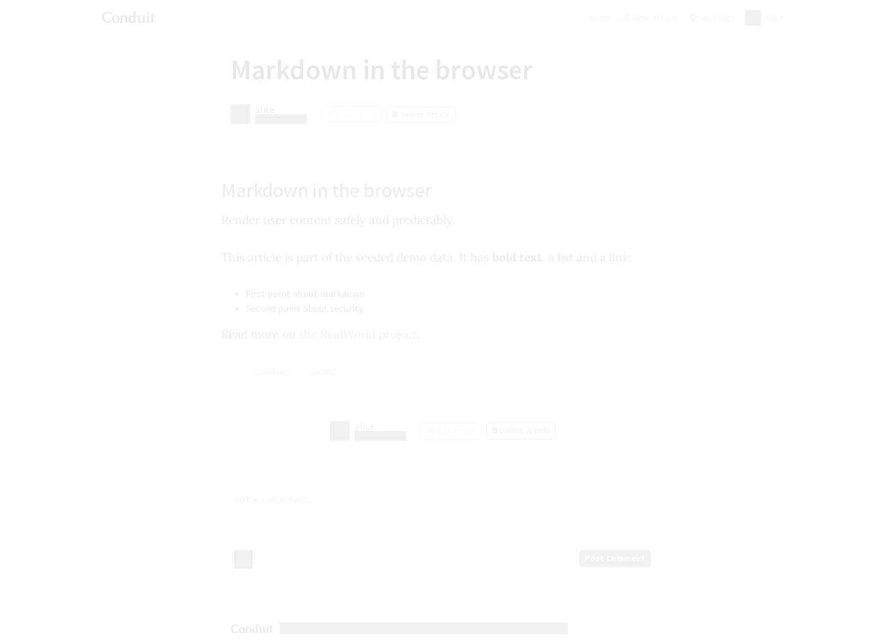     |
| home-after-delete | 0.000% PASS |  | 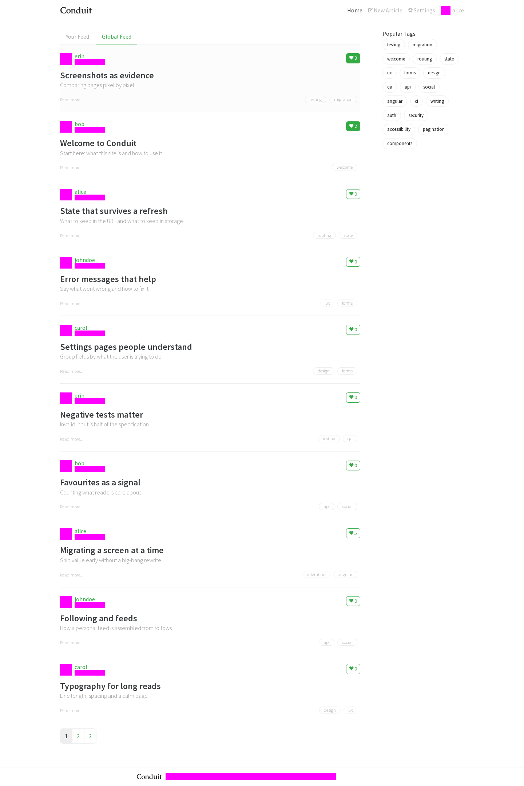 | 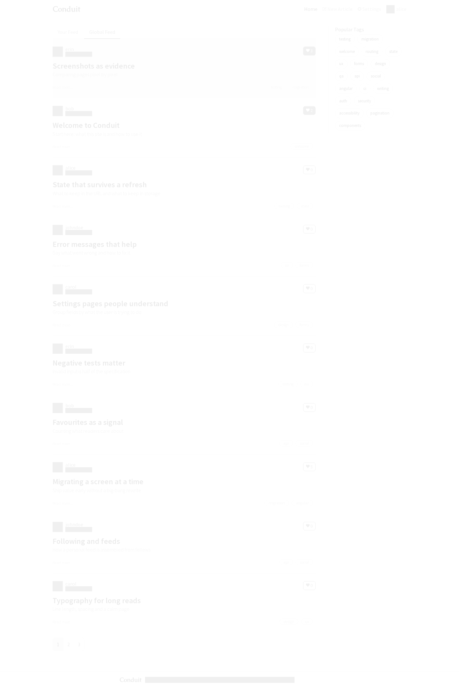 |

API calls (PASS):

| #   | Angular                                                | React                                                  |
| --- | ------------------------------------------------------ | ------------------------------------------------------ |
| 1   | `GET /user → 200`                                      | `GET /user → 200`                                      |
| 2   | `GET /articles/markdown-in-the-browser → 200`          | `GET /articles/markdown-in-the-browser → 200`          |
| 3   | `GET /articles/markdown-in-the-browser/comments → 200` | `GET /articles/markdown-in-the-browser/comments → 200` |
| 4   | `DELETE /articles/markdown-in-the-browser → 204`       | `DELETE /articles/markdown-in-the-browser → 204`       |
| 5   | `GET /articles?limit=10&offset=0 → 200`                | `GET /articles?limit=10&offset=0 → 200`                |
| 6   | `GET /tags → 200`                                      | `GET /tags → 200`                                      |

Functional observations (PASS):

| Key                               | Angular                                                                                                                                   | React                                                                                                                                     |
| --------------------------------- | ----------------------------------------------------------------------------------------------------------------------------------------- | ----------------------------------------------------------------------------------------------------------------------------------------- |
| afterDelete.url                   | `"/"`                                                                                                                                     | `"/"`                                                                                                                                     |
| afterDelete.homeHasDeletedArticle | `false`                                                                                                                                   | `false`                                                                                                                                   |
| backend.articleAfterDelete        | `{"errors":{"article":["not found"]}}`                                                                                                    | `{"errors":{"article":["not found"]}}`                                                                                                    |
| backend.aliceArticles             | `["state-that-survives-a-refresh","migrating-a-screen-at-a-time","component-boundaries-that-last","getting-started-with-reactive-forms"]` | `["state-that-survives-a-refresh","migrating-a-screen-at-a-time","component-boundaries-that-last","getting-started-with-reactive-forms"]` |

## favorite then unfavorite as demo

React journey video: [video/favorite-then-unfavorite-as-demo--react.webm](video/favorite-then-unfavorite-as-demo--react.webm)

| State           | Diff        | Angular                                                                     | React                                                                     | Diff image                                                             |
| --------------- | ----------- | --------------------------------------------------------------------------- | ------------------------------------------------------------------------- | ---------------------------------------------------------------------- |
| before-favorite | 0.000% PASS |  | 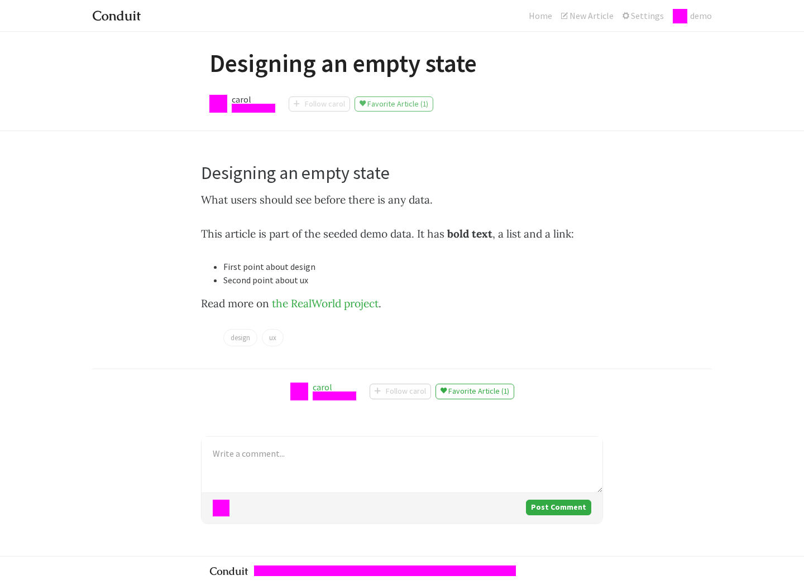 | 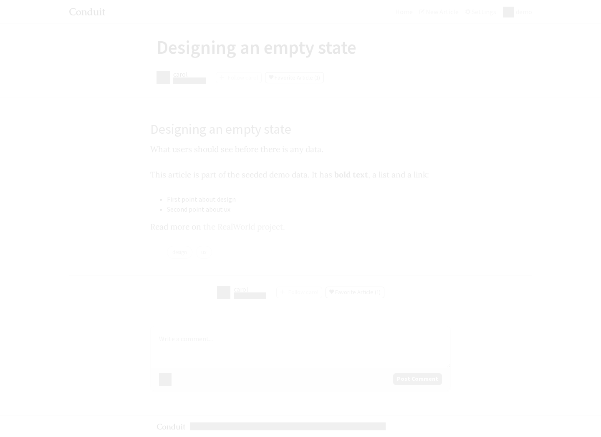 |
| favorited       | 0.000% PASS | 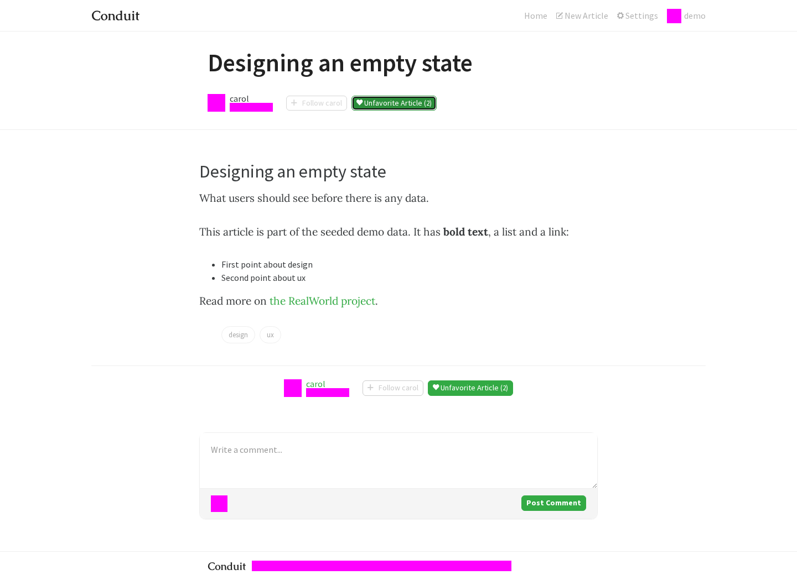       |        | 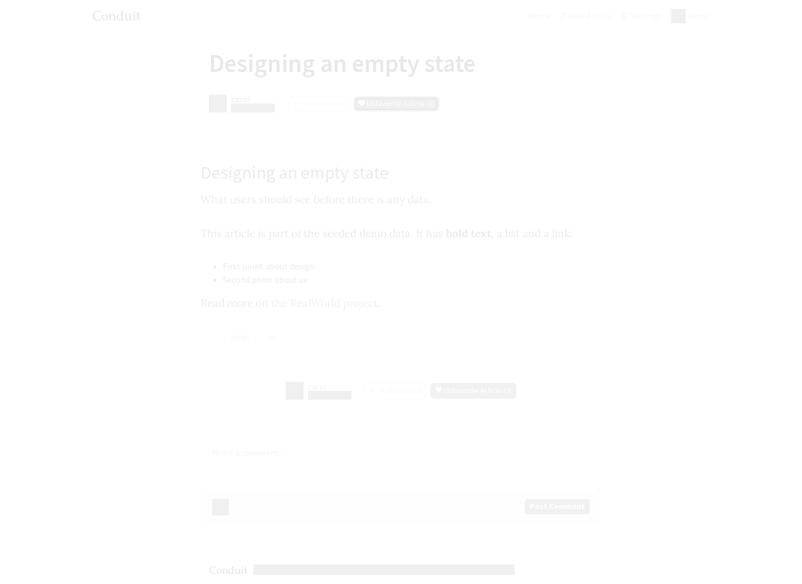       |
| unfavorited     | 0.000% PASS |      | 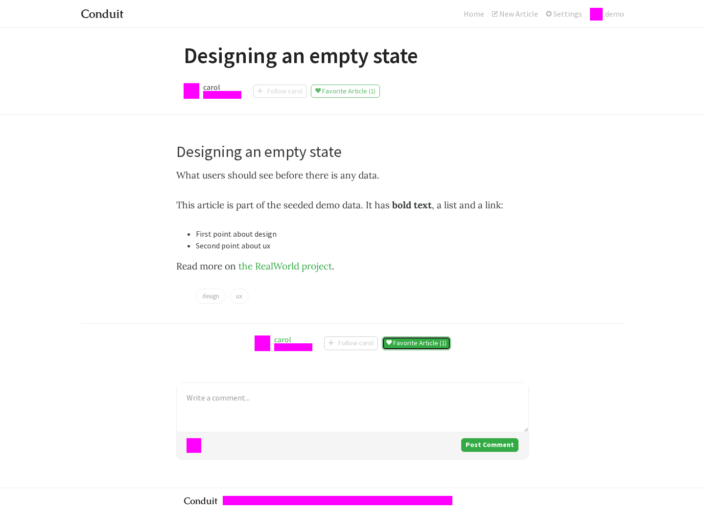     | 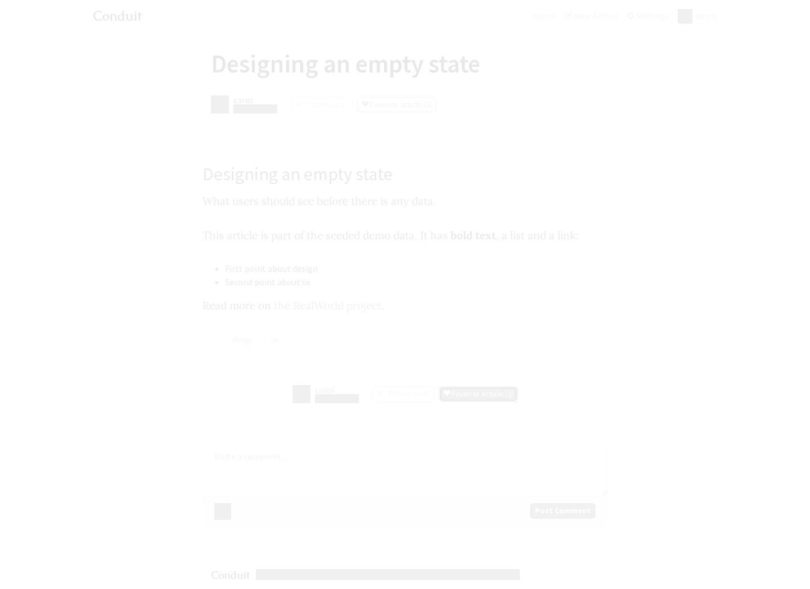     |

API calls (PASS):

| #   | Angular                                                     | React                                                       |
| --- | ----------------------------------------------------------- | ----------------------------------------------------------- |
| 1   | `GET /user → 200`                                           | `GET /user → 200`                                           |
| 2   | `GET /articles/designing-an-empty-state → 200`              | `GET /articles/designing-an-empty-state → 200`              |
| 3   | `GET /articles/designing-an-empty-state/comments → 200`     | `GET /articles/designing-an-empty-state/comments → 200`     |
| 4   | `POST /articles/designing-an-empty-state/favorite {} → 200` | `POST /articles/designing-an-empty-state/favorite {} → 200` |
| 5   | `DELETE /articles/designing-an-empty-state/favorite → 200`  | `DELETE /articles/designing-an-empty-state/favorite → 200`  |

Functional observations (PASS):

| Key                       | Angular                                                                                                                                                           | React                                                                                                                                                             |
| ------------------------- | ----------------------------------------------------------------------------------------------------------------------------------------------------------------- | ----------------------------------------------------------------------------------------------------------------------------------------------------------------- |
| before.url                | `"/article/designing-an-empty-state"`                                                                                                                             | `"/article/designing-an-empty-state"`                                                                                                                             |
| before.title              | `["Designing an empty state"]`                                                                                                                                    | `["Designing an empty state"]`                                                                                                                                    |
| before.bannerMeta         | `["carol October 3, 2026 Follow carol Favorite Article (1)"]`                                                                                                     | `["carol October 3, 2026 Follow carol Favorite Article (1)"]`                                                                                                     |
| before.actionsMeta        | `["carol October 3, 2026 Follow carol Favorite Article (1)"]`                                                                                                     | `["carol October 3, 2026 Follow carol Favorite Article (1)"]`                                                                                                     |
| before.bannerButtons      | `["Follow carol","Favorite Article (1)"]`                                                                                                                         | `["Follow carol","Favorite Article (1)"]`                                                                                                                         |
| before.buttonClasses      | `["btn btn-sm action-btn btn-outline-secondary","btn btn-sm btn-outline-primary","btn btn-sm action-btn btn-outline-secondary","btn btn-sm btn-outline-primary"]` | `["btn btn-sm action-btn btn-outline-secondary","btn btn-sm btn-outline-primary","btn btn-sm action-btn btn-outline-secondary","btn btn-sm btn-outline-primary"]` |
| favorited.url             | `"/article/designing-an-empty-state"`                                                                                                                             | `"/article/designing-an-empty-state"`                                                                                                                             |
| favorited.title           | `["Designing an empty state"]`                                                                                                                                    | `["Designing an empty state"]`                                                                                                                                    |
| favorited.bannerMeta      | `["carol October 3, 2026 Follow carol Unfavorite Article (2)"]`                                                                                                   | `["carol October 3, 2026 Follow carol Unfavorite Article (2)"]`                                                                                                   |
| favorited.actionsMeta     | `["carol October 3, 2026 Follow carol Unfavorite Article (2)"]`                                                                                                   | `["carol October 3, 2026 Follow carol Unfavorite Article (2)"]`                                                                                                   |
| favorited.bannerButtons   | `["Follow carol","Unfavorite Article (2)"]`                                                                                                                       | `["Follow carol","Unfavorite Article (2)"]`                                                                                                                       |
| favorited.buttonClasses   | `["btn btn-sm action-btn btn-outline-secondary","btn btn-sm btn-primary","btn btn-sm action-btn btn-outline-secondary","btn btn-sm btn-primary"]`                 | `["btn btn-sm action-btn btn-outline-secondary","btn btn-sm btn-primary","btn btn-sm action-btn btn-outline-secondary","btn btn-sm btn-primary"]`                 |
| backend.favorited         | `{"favorited":true,"favoritesCount":2}`                                                                                                                           | `{"favorited":true,"favoritesCount":2}`                                                                                                                           |
| unfavorited.url           | `"/article/designing-an-empty-state"`                                                                                                                             | `"/article/designing-an-empty-state"`                                                                                                                             |
| unfavorited.title         | `["Designing an empty state"]`                                                                                                                                    | `["Designing an empty state"]`                                                                                                                                    |
| unfavorited.bannerMeta    | `["carol October 3, 2026 Follow carol Favorite Article (1)"]`                                                                                                     | `["carol October 3, 2026 Follow carol Favorite Article (1)"]`                                                                                                     |
| unfavorited.actionsMeta   | `["carol October 3, 2026 Follow carol Favorite Article (1)"]`                                                                                                     | `["carol October 3, 2026 Follow carol Favorite Article (1)"]`                                                                                                     |
| unfavorited.bannerButtons | `["Follow carol","Favorite Article (1)"]`                                                                                                                         | `["Follow carol","Favorite Article (1)"]`                                                                                                                         |
| unfavorited.buttonClasses | `["btn btn-sm action-btn btn-outline-secondary","btn btn-sm btn-outline-primary","btn btn-sm action-btn btn-outline-secondary","btn btn-sm btn-outline-primary"]` | `["btn btn-sm action-btn btn-outline-secondary","btn btn-sm btn-outline-primary","btn btn-sm action-btn btn-outline-secondary","btn btn-sm btn-outline-primary"]` |
| backend.unfavorited       | `{"favorited":false,"favoritesCount":1}`                                                                                                                          | `{"favorited":false,"favoritesCount":1}`                                                                                                                          |

## follow author as demo

React journey video: [video/follow-author-as-demo--react.webm](video/follow-author-as-demo--react.webm)

| State            | Diff        | Angular                                                           | React                                                           | Diff image                                                   |
| ---------------- | ----------- | ----------------------------------------------------------------- | --------------------------------------------------------------- | ------------------------------------------------------------ |
| following-author | 0.000% PASS |  | 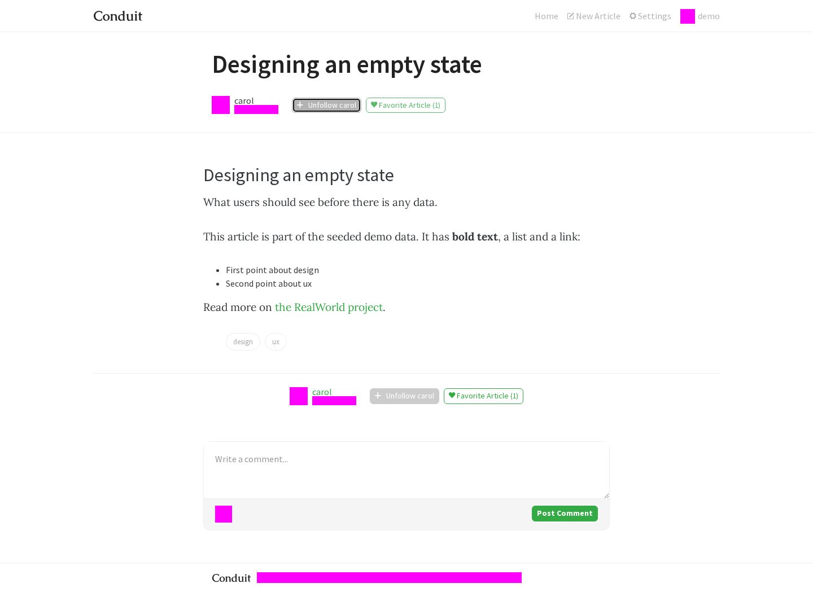 | 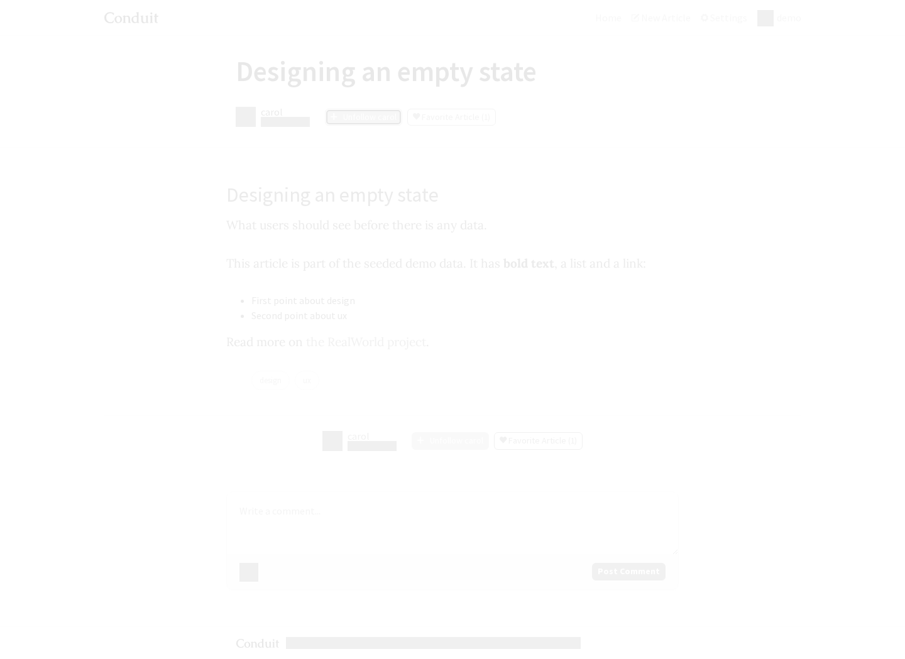 |

API calls (PASS):

| #   | Angular                                                 | React                                                   |
| --- | ------------------------------------------------------- | ------------------------------------------------------- |
| 1   | `GET /user → 200`                                       | `GET /user → 200`                                       |
| 2   | `GET /articles/designing-an-empty-state → 200`          | `GET /articles/designing-an-empty-state → 200`          |
| 3   | `GET /articles/designing-an-empty-state/comments → 200` | `GET /articles/designing-an-empty-state/comments → 200` |
| 4   | `POST /profiles/carol/follow {} → 200`                  | `POST /profiles/carol/follow {} → 200`                  |

Functional observations (PASS):

| Key                     | Angular                                                                                                                                           | React                                                                                                                                             |
| ----------------------- | ------------------------------------------------------------------------------------------------------------------------------------------------- | ------------------------------------------------------------------------------------------------------------------------------------------------- |
| before.followButtons    | `["Follow carol","Follow carol"]`                                                                                                                 | `["Follow carol","Follow carol"]`                                                                                                                 |
| following.url           | `"/article/designing-an-empty-state"`                                                                                                             | `"/article/designing-an-empty-state"`                                                                                                             |
| following.title         | `["Designing an empty state"]`                                                                                                                    | `["Designing an empty state"]`                                                                                                                    |
| following.bannerMeta    | `["carol October 3, 2026 Unfollow carol Favorite Article (1)"]`                                                                                   | `["carol October 3, 2026 Unfollow carol Favorite Article (1)"]`                                                                                   |
| following.actionsMeta   | `["carol October 3, 2026 Unfollow carol Favorite Article (1)"]`                                                                                   | `["carol October 3, 2026 Unfollow carol Favorite Article (1)"]`                                                                                   |
| following.bannerButtons | `["Unfollow carol","Favorite Article (1)"]`                                                                                                       | `["Unfollow carol","Favorite Article (1)"]`                                                                                                       |
| following.buttonClasses | `["btn btn-sm action-btn btn-secondary","btn btn-sm btn-outline-primary","btn btn-sm action-btn btn-secondary","btn btn-sm btn-outline-primary"]` | `["btn btn-sm action-btn btn-secondary","btn btn-sm btn-outline-primary","btn btn-sm action-btn btn-secondary","btn btn-sm btn-outline-primary"]` |
| backend.following       | `true`                                                                                                                                            | `true`                                                                                                                                            |
| backend.feedHasCarol    | `true`                                                                                                                                            | `true`                                                                                                                                            |

## own article shows edit and delete

React journey video: [video/own-article-shows-edit-and-delete--react.webm](video/own-article-shows-edit-and-delete--react.webm)

| State       | Diff        | Angular                                                                  | React                                                                  | Diff image                                                          |
| ----------- | ----------- | ------------------------------------------------------------------------ | ---------------------------------------------------------------------- | ------------------------------------------------------------------- |
| own-article | 0.000% PASS |  | 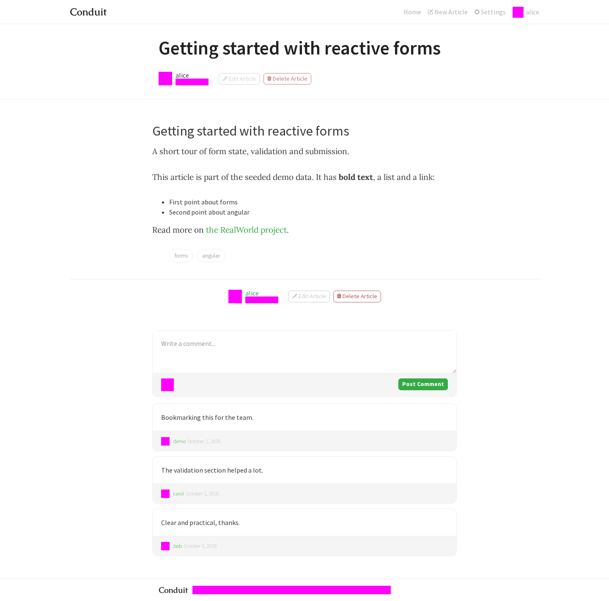 | 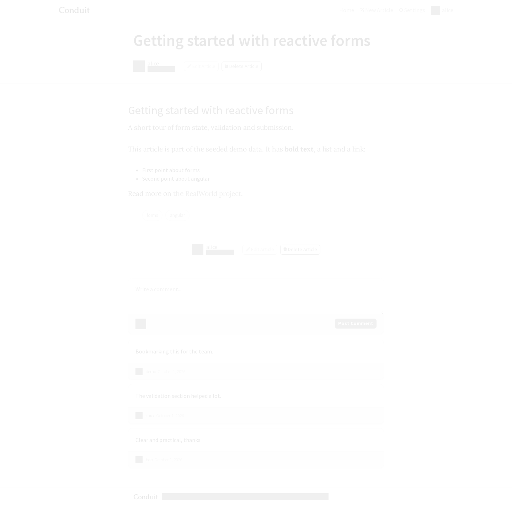 |

API calls (PASS):

| #   | Angular                                                            | React                                                              |
| --- | ------------------------------------------------------------------ | ------------------------------------------------------------------ |
| 1   | `GET /user → 200`                                                  | `GET /user → 200`                                                  |
| 2   | `GET /articles/getting-started-with-reactive-forms → 200`          | `GET /articles/getting-started-with-reactive-forms → 200`          |
| 3   | `GET /articles/getting-started-with-reactive-forms/comments → 200` | `GET /articles/getting-started-with-reactive-forms/comments → 200` |

Functional observations (PASS):

| Key                     | Angular                                                                                                                                   | React                                                                                                                                     |
| ----------------------- | ----------------------------------------------------------------------------------------------------------------------------------------- | ----------------------------------------------------------------------------------------------------------------------------------------- |
| own.url                 | `"/article/getting-started-with-reactive-forms"`                                                                                          | `"/article/getting-started-with-reactive-forms"`                                                                                          |
| own.title               | `["Getting started with reactive forms"]`                                                                                                 | `["Getting started with reactive forms"]`                                                                                                 |
| own.bannerMeta          | `["alice October 1, 2026 Edit Article Delete Article"]`                                                                                   | `["alice October 1, 2026 Edit Article Delete Article"]`                                                                                   |
| own.actionsMeta         | `["alice October 1, 2026 Edit Article Delete Article"]`                                                                                   | `["alice October 1, 2026 Edit Article Delete Article"]`                                                                                   |
| own.bannerButtons       | `["Edit Article","Delete Article"]`                                                                                                       | `["Edit Article","Delete Article"]`                                                                                                       |
| own.buttonClasses       | `["btn btn-sm btn-outline-secondary","btn btn-sm btn-outline-danger","btn btn-sm btn-outline-secondary","btn btn-sm btn-outline-danger"]` | `["btn btn-sm btn-outline-secondary","btn btn-sm btn-outline-danger","btn btn-sm btn-outline-secondary","btn btn-sm btn-outline-danger"]` |
| editLinks               | `["/editor/getting-started-with-reactive-forms","/editor/getting-started-with-reactive-forms"]`                                           | `["/editor/getting-started-with-reactive-forms","/editor/getting-started-with-reactive-forms"]`                                           |
| deleteButtons           | `2`                                                                                                                                       | `2`                                                                                                                                       |
| followOrFavoriteButtons | `0`                                                                                                                                       | `0`                                                                                                                                       |

## view article signed out

React journey video: [video/view-article-signed-out--react.webm](video/view-article-signed-out--react.webm)

| State              | Diff        | Angular                                                               | React                                                               | Diff image                                                       |
| ------------------ | ----------- | --------------------------------------------------------------------- | ------------------------------------------------------------------- | ---------------------------------------------------------------- |
| article-signed-out | 0.000% PASS | 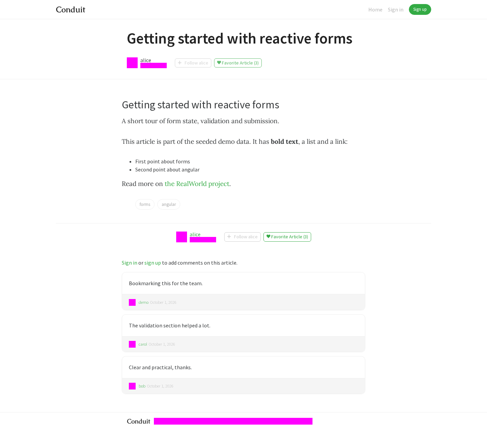 |  | 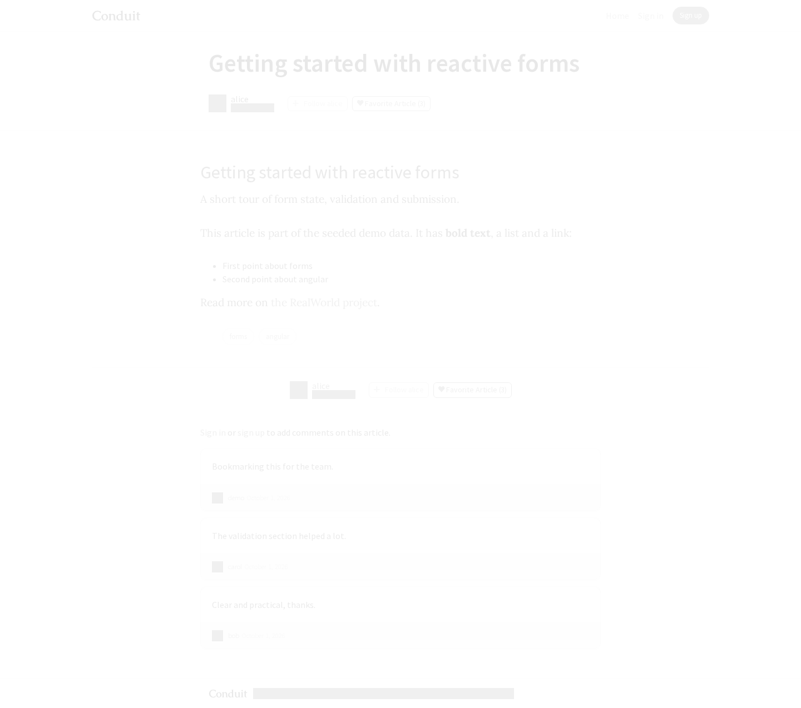 |

API calls (PASS):

| #   | Angular                                                            | React                                                              |
| --- | ------------------------------------------------------------------ | ------------------------------------------------------------------ |
| 1   | `GET /articles/getting-started-with-reactive-forms → 200`          | `GET /articles/getting-started-with-reactive-forms → 200`          |
| 2   | `GET /articles/getting-started-with-reactive-forms/comments → 200` | `GET /articles/getting-started-with-reactive-forms/comments → 200` |

Functional observations (PASS):

| Key                         | Angular                                                                                                                                                                                 | React                                                                                                                                                                                   |
| --------------------------- | --------------------------------------------------------------------------------------------------------------------------------------------------------------------------------------- | --------------------------------------------------------------------------------------------------------------------------------------------------------------------------------------- |
| signedOut.url               | `"/article/getting-started-with-reactive-forms"`                                                                                                                                        | `"/article/getting-started-with-reactive-forms"`                                                                                                                                        |
| signedOut.title             | `["Getting started with reactive forms"]`                                                                                                                                               | `["Getting started with reactive forms"]`                                                                                                                                               |
| signedOut.bannerMeta        | `["alice October 1, 2026 Follow alice Favorite Article (3)"]`                                                                                                                           | `["alice October 1, 2026 Follow alice Favorite Article (3)"]`                                                                                                                           |
| signedOut.actionsMeta       | `["alice October 1, 2026 Follow alice Favorite Article (3)"]`                                                                                                                           | `["alice October 1, 2026 Follow alice Favorite Article (3)"]`                                                                                                                           |
| signedOut.bannerButtons     | `["Follow alice","Favorite Article (3)"]`                                                                                                                                               | `["Follow alice","Favorite Article (3)"]`                                                                                                                                               |
| signedOut.buttonClasses     | `["btn btn-sm action-btn btn-outline-secondary","btn btn-sm btn-outline-primary","btn btn-sm action-btn btn-outline-secondary","btn btn-sm btn-outline-primary"]`                       | `["btn btn-sm action-btn btn-outline-secondary","btn btn-sm btn-outline-primary","btn btn-sm action-btn btn-outline-secondary","btn btn-sm btn-outline-primary"]`                       |
| body.headings               | `["Getting started with reactive forms"]`                                                                                                                                               | `["Getting started with reactive forms"]`                                                                                                                                               |
| body.paragraphs             | `["A short tour of form state, validation and submission.","This article is part of the seeded demo data. It has bold text, a list and a link:","Read more on the RealWorld project."]` | `["A short tour of form state, validation and submission.","This article is part of the seeded demo data. It has bold text, a list and a link:","Read more on the RealWorld project."]` |
| body.listItems              | `["First point about forms","Second point about angular"]`                                                                                                                              | `["First point about forms","Second point about angular"]`                                                                                                                              |
| body.bold                   | `["bold text"]`                                                                                                                                                                         | `["bold text"]`                                                                                                                                                                         |
| body.links                  | `["https://github.com/realworld-apps/realworld"]`                                                                                                                                       | `["https://github.com/realworld-apps/realworld"]`                                                                                                                                       |
| tags                        | `["forms","angular"]`                                                                                                                                                                   | `["forms","angular"]`                                                                                                                                                                   |
| authorLinks                 | `["/profile/alice","/profile/alice"]`                                                                                                                                                   | `["/profile/alice","/profile/alice"]`                                                                                                                                                   |
| backend.article             | `{"title":"Getting started with reactive forms","tagList":["forms","angular"],"favoritesCount":3}`                                                                                      | `{"title":"Getting started with reactive forms","tagList":["forms","angular"],"favoritesCount":3}`                                                                                      |
| signedOut.favoriteClick.url | `"/register"`                                                                                                                                                                           | `"/register"`                                                                                                                                                                           |

## Deviations

## Status after integration (parent session, full suite run 2026-11-12 17:31Z)

Resolved. In the full parity run on the integration branch, with every package merged, all journeys for this screen pass every check (see `evidence/parity-results.md`). The notes below are what the child session recorded on its own branch, before the packages it depended on were merged. They are kept as the audit trail.

---

No check fails: 5/5 journeys pass all checks with 0.000% pixel difference.

**How this was run (read before trusting the numbers).** The page links to two screens owned by other work packages, and both were still stubs on the base branch:

- The comments section (`components/ArticleComments.tsx`, comments package, PR #1, branch `wp/comments` at eb599c4).
- The home page that a delete redirects to (`pages/HomePage.tsx`, home package, branch `wp/home` at e8a7358).

For the runs that produced this evidence, both files were copied from those branches into the working tree. They were **not** committed to `wp/article`. With the stubs instead, every visual check fails: the stub comments row is empty, so the page is 1049 px tall instead of up to 1423 px, a 1.16–1.46% difference. The API check also fails because React skips `GET /articles/:slug/comments`, plus `GET /articles` and `GET /tags` after the delete redirect. The article area itself diffs at 0 pixels in those runs too.

**Known behaviour difference that no journey covers.** When the article does not exist (404), Angular still calls `GET /articles/:slug/comments`, because it loads the article and comments together in `combineLatest`. React only mounts `ArticleComments` once the article has loaded, so it makes no comments call. Both apps show the same thing: an empty `<ul class="error-messages">`. Angular stores `err.errors` and passes it to ListErrors, which reads `.errors` a second time. React reproduces that quirk on purpose.
