# Parity report: auth

Angular (http://localhost:4200) vs React (http://localhost:5173), same seeded mock API reset before each run, viewport 1440×900, dates/avatars masked in magenta. Visual pass threshold: ≤1% differing pixels (pixelmatch, threshold 0.1).

| Journey                                    | No errors | Same states | Visual | API calls + payloads | Functional | Max diff | Result   |
| ------------------------------------------ | --------- | ----------- | ------ | -------------------- | ---------- | -------- | -------- |
| empty fields keep button disabled          | PASS      | PASS        | PASS   | PASS                 | PASS       | 0.000%   | **PASS** |
| invalid credentials error                  | PASS      | PASS        | PASS   | PASS                 | PASS       | 0.000%   | **PASS** |
| login success as demo                      | PASS      | PASS        | PASS   | PASS                 | PASS       | 0.000%   | **PASS** |
| malformed email is rejected in the browser | PASS      | PASS        | PASS   | PASS                 | PASS       | 0.000%   | **PASS** |
| register a new user                        | PASS      | PASS        | PASS   | PASS                 | PASS       | 0.000%   | **PASS** |
| register with taken username               | PASS      | PASS        | PASS   | PASS                 | PASS       | 0.000%   | **PASS** |
| signed-in user visiting login              | PASS      | PASS        | PASS   | PASS                 | PASS       | 0.000%   | **PASS** |

## empty fields keep button disabled

React journey video: [video/empty-fields-keep-button-disabled--react.webm](video/empty-fields-keep-button-disabled--react.webm)

| State                     | Diff        | Angular                                                                                | React                                                                                | Diff image                                                                        |
| ------------------------- | ----------- | -------------------------------------------------------------------------------------- | ------------------------------------------------------------------------------------ | --------------------------------------------------------------------------------- |
| login-email-only          | 0.000% PASS | 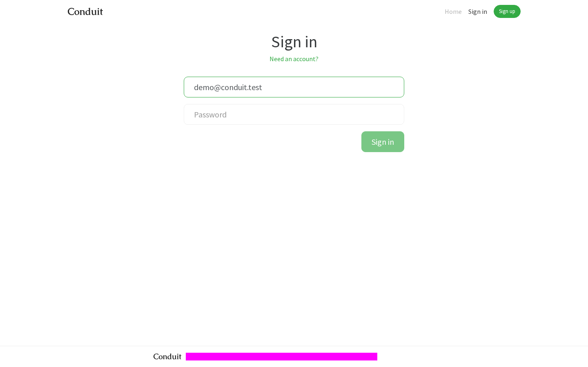          |           | 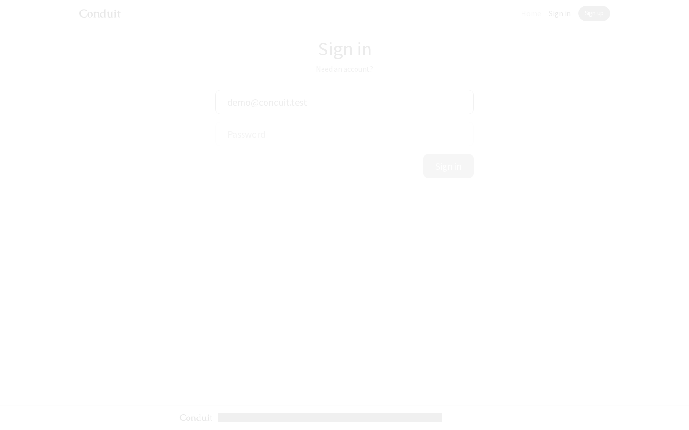          |
| register-without-username | 0.000% PASS |  | 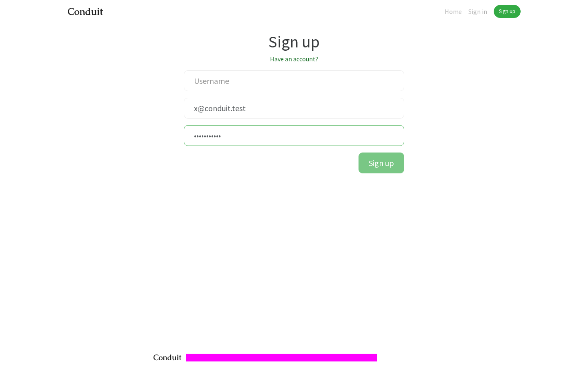 | 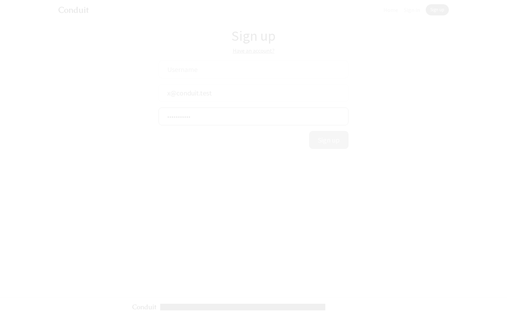 |

API calls (PASS):

| #   | Angular | React |
| --- | ------- | ----- |

Functional observations (PASS):

| Key                           | Angular                                          | React                                            |
| ----------------------------- | ------------------------------------------------ | ------------------------------------------------ |
| login.empty                   | `true`                                           | `true`                                           |
| login.emailOnly               | `true`                                           | `true`                                           |
| login.passwordOnly            | `true`                                           | `true`                                           |
| login.afterClick.url          | `"/login"`                                       | `"/login"`                                       |
| register.empty.url            | `"/register"`                                    | `"/register"`                                    |
| register.empty.title          | `"Sign up"`                                      | `"Sign up"`                                      |
| register.empty.switchLink     | `{"text":"Have an account?","href":"/login"}`    | `{"text":"Have an account?","href":"/login"}`    |
| register.empty.inputs         | `["Username","Email","Password"]`                | `["Username","Email","Password"]`                |
| register.empty.errors         | `[]`                                             | `[]`                                             |
| register.empty.buttonText     | `"Sign up"`                                      | `"Sign up"`                                      |
| register.empty.buttonDisabled | `true`                                           | `true`                                           |
| register.empty.signedIn       | `false`                                          | `false`                                          |
| register.noUsername           | `true`                                           | `true`                                           |
| register.allFilled            | `false`                                          | `false`                                          |
| login.back.url                | `"/login"`                                       | `"/login"`                                       |
| login.back.title              | `"Sign in"`                                      | `"Sign in"`                                      |
| login.back.switchLink         | `{"text":"Need an account?","href":"/register"}` | `{"text":"Need an account?","href":"/register"}` |
| login.back.inputs             | `["Email","Password"]`                           | `["Email","Password"]`                           |
| login.back.errors             | `[]`                                             | `[]`                                             |
| login.back.buttonText         | `"Sign in"`                                      | `"Sign in"`                                      |
| login.back.buttonDisabled     | `true`                                           | `true`                                           |
| login.back.signedIn           | `false`                                          | `false`                                          |

## invalid credentials error

React journey video: [video/invalid-credentials-error--react.webm](video/invalid-credentials-error--react.webm)

| State               | Diff        | Angular                                                                  | React                                                                  | Diff image                                                          |
| ------------------- | ----------- | ------------------------------------------------------------------------ | ---------------------------------------------------------------------- | ------------------------------------------------------------------- |
| credentials-invalid | 0.000% PASS |  | 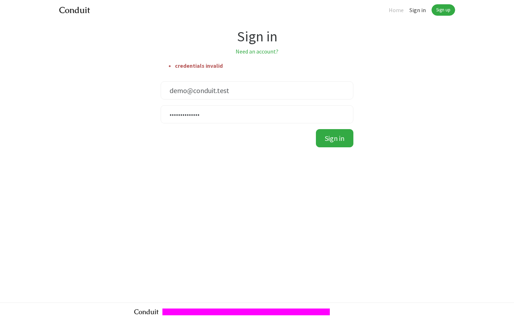 | 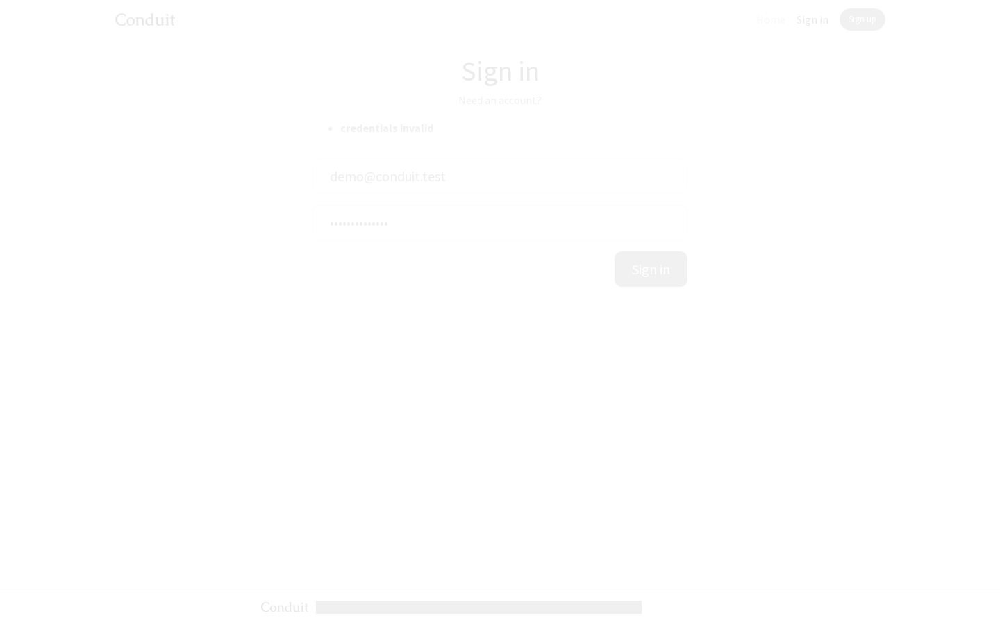 |

API calls (PASS):

| #   | Angular                                                                                      | React                                                                                        |
| --- | -------------------------------------------------------------------------------------------- | -------------------------------------------------------------------------------------------- |
| 1   | `POST /users/login {"user":{"email":"demo@conduit.test","password":"wrong-password"}} → 401` | `POST /users/login {"user":{"email":"demo@conduit.test","password":"wrong-password"}} → 401` |
| 2   | `POST /users/login {"user":{"email":"demo@conduit.test","password":"password123"}} → 200`    | `POST /users/login {"user":{"email":"demo@conduit.test","password":"password123"}} → 200`    |
| 3   | `GET /articles?limit=10&offset=0 → 200`                                                      | `GET /articles?limit=10&offset=0 → 200`                                                      |
| 4   | `GET /tags → 200`                                                                            | `GET /tags → 200`                                                                            |

Functional observations (PASS):

| Key                  | Angular                                                     | React                                                       |
| -------------------- | ----------------------------------------------------------- | ----------------------------------------------------------- |
| error.url            | `"/login"`                                                  | `"/login"`                                                  |
| error.title          | `"Sign in"`                                                 | `"Sign in"`                                                 |
| error.switchLink     | `{"text":"Need an account?","href":"/register"}`            | `{"text":"Need an account?","href":"/register"}`            |
| error.inputs         | `["Email","Password"]`                                      | `["Email","Password"]`                                      |
| error.errors         | `["credentials invalid"]`                                   | `["credentials invalid"]`                                   |
| error.buttonText     | `"Sign in"`                                                 | `"Sign in"`                                                 |
| error.buttonDisabled | `false`                                                     | `false`                                                     |
| error.signedIn       | `false`                                                     | `false`                                                     |
| error.fieldValues    | `{"email":"demo@conduit.test","password":"wrong-password"}` | `{"email":"demo@conduit.test","password":"wrong-password"}` |
| retry.url            | `"/"`                                                       | `"/"`                                                       |
| retry.signedIn       | `true`                                                      | `true`                                                      |

## login success as demo

React journey video: [video/login-success-as-demo--react.webm](video/login-success-as-demo--react.webm)

| State          | Diff        | Angular                                                         | React                                                         | Diff image                                                 |
| -------------- | ----------- | --------------------------------------------------------------- | ------------------------------------------------------------- | ---------------------------------------------------------- |
| login-form     | 0.000% PASS |      | 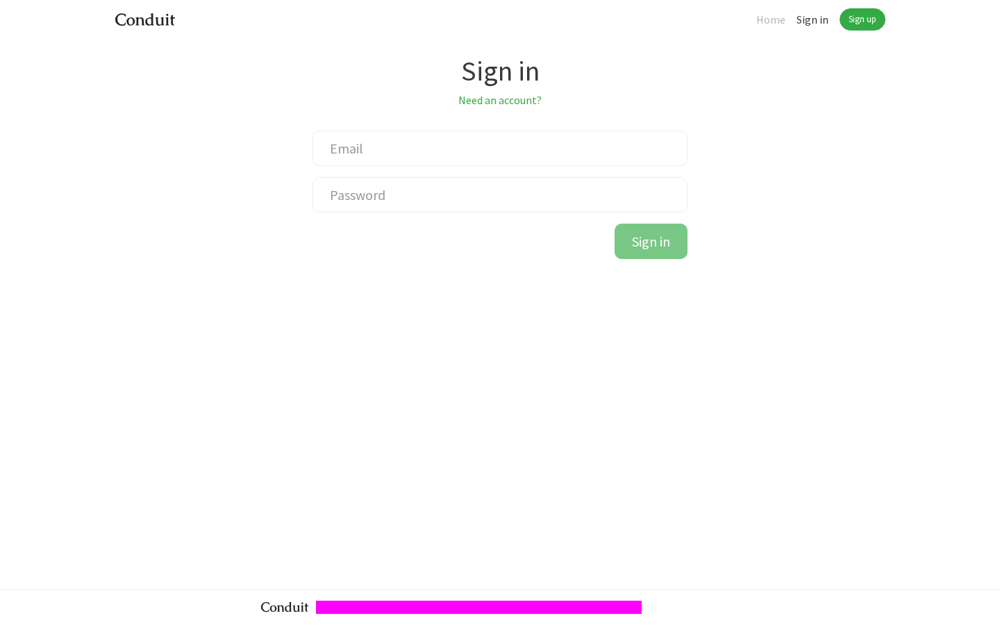     | 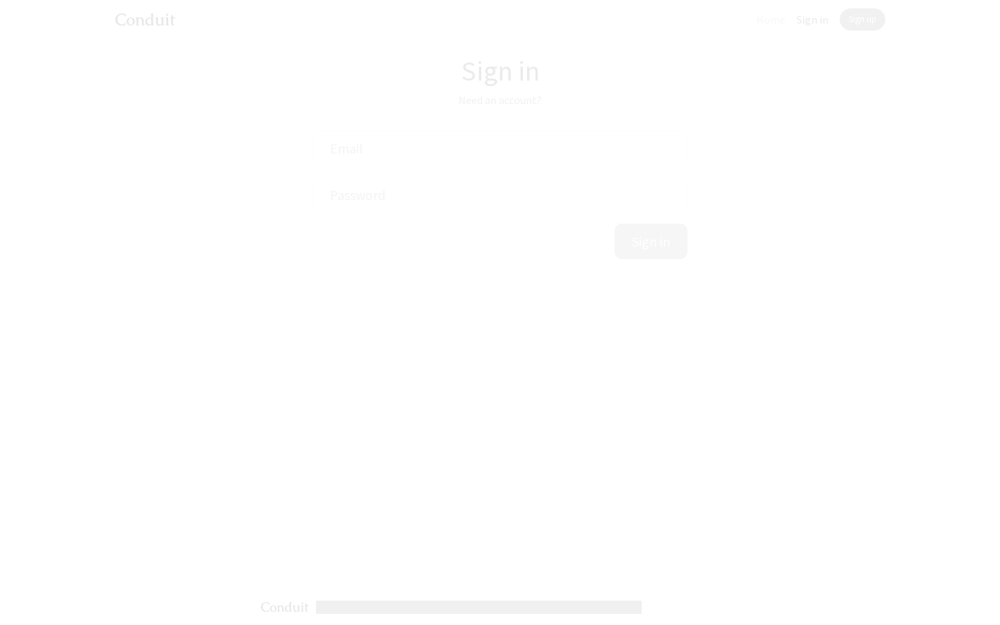     |
| login-filled   | 0.000% PASS |    | 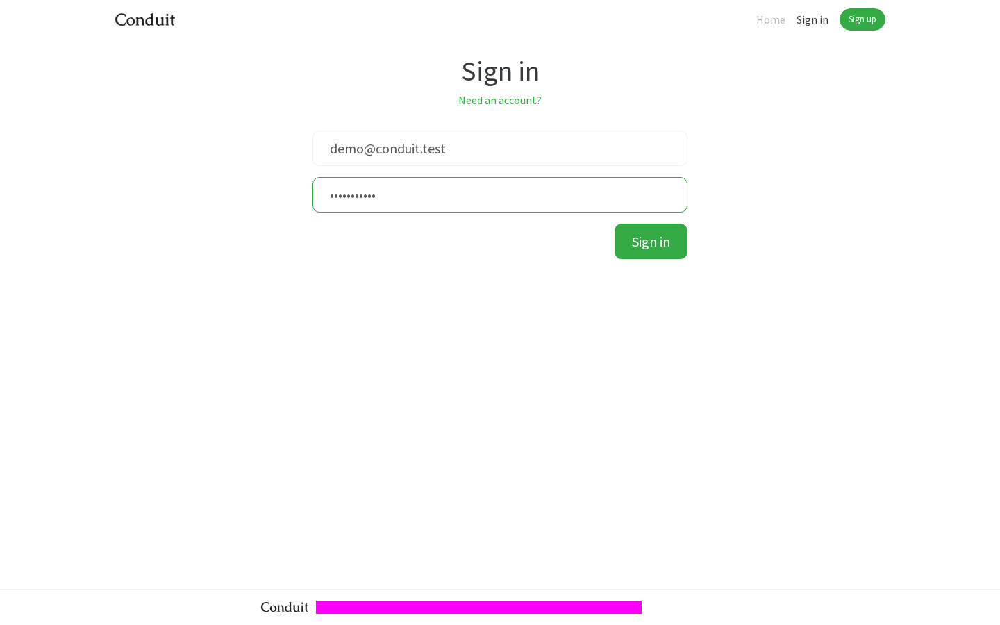   | 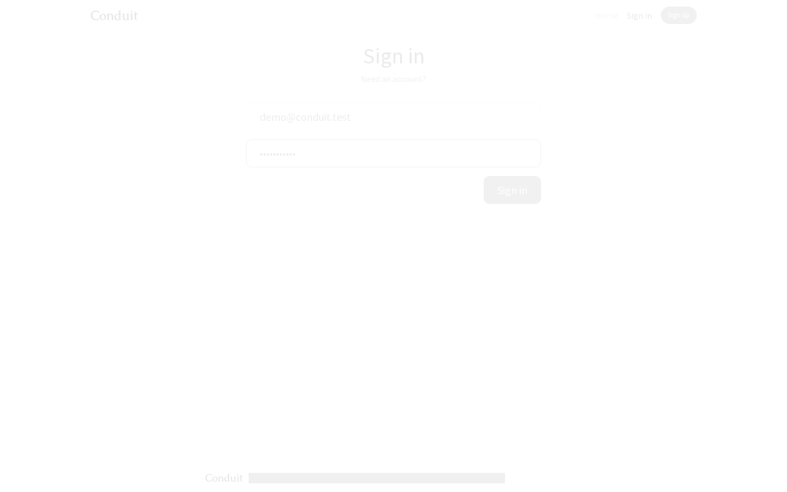   |
| home-signed-in | 0.000% PASS |  | 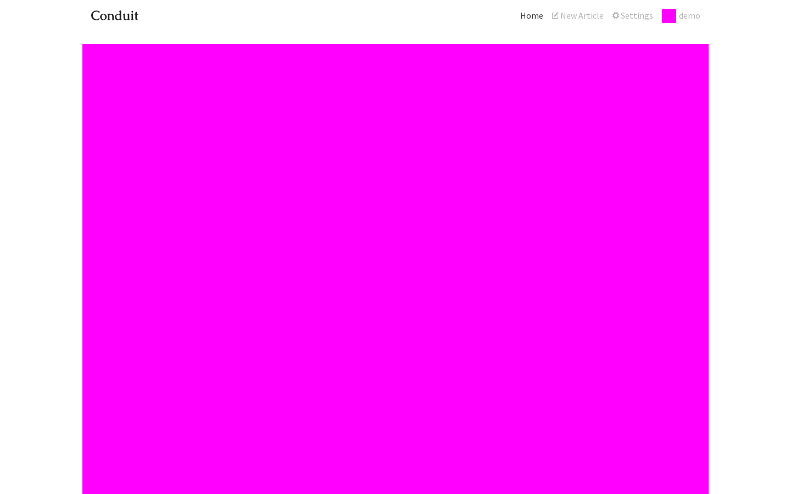 |  |

API calls (PASS):

| #   | Angular                                                                                   | React                                                                                     |
| --- | ----------------------------------------------------------------------------------------- | ----------------------------------------------------------------------------------------- |
| 1   | `POST /users/login {"user":{"email":"demo@conduit.test","password":"password123"}} → 200` | `POST /users/login {"user":{"email":"demo@conduit.test","password":"password123"}} → 200` |
| 2   | `GET /articles?limit=10&offset=0 → 200`                                                   | `GET /articles?limit=10&offset=0 → 200`                                                   |
| 3   | `GET /tags → 200`                                                                         | `GET /tags → 200`                                                                         |

Functional observations (PASS):

| Key                   | Angular                                           | React                                             |
| --------------------- | ------------------------------------------------- | ------------------------------------------------- |
| empty.url             | `"/login"`                                        | `"/login"`                                        |
| empty.title           | `"Sign in"`                                       | `"Sign in"`                                       |
| empty.switchLink      | `{"text":"Need an account?","href":"/register"}`  | `{"text":"Need an account?","href":"/register"}`  |
| empty.inputs          | `["Email","Password"]`                            | `["Email","Password"]`                            |
| empty.errors          | `[]`                                              | `[]`                                              |
| empty.buttonText      | `"Sign in"`                                       | `"Sign in"`                                       |
| empty.buttonDisabled  | `true`                                            | `true`                                            |
| empty.signedIn        | `false`                                           | `false`                                           |
| filled.buttonDisabled | `false`                                           | `false`                                           |
| after.url             | `"/"`                                             | `"/"`                                             |
| after.nav             | `["Home","New Article","Settings","demo"]`        | `["Home","New Article","Settings","demo"]`        |
| after.signedIn        | `true`                                            | `true`                                            |
| after.currentUser     | `{"username":"demo","email":"demo@conduit.test"}` | `{"username":"demo","email":"demo@conduit.test"}` |

## malformed email is rejected in the browser

React journey video: [video/malformed-email-is-rejected-in-the-browser--react.webm](video/malformed-email-is-rejected-in-the-browser--react.webm)

| State            | Diff        | Angular                                                                                | React                                                                                | Diff image                                                                        |
| ---------------- | ----------- | -------------------------------------------------------------------------------------- | ------------------------------------------------------------------------------------ | --------------------------------------------------------------------------------- |
| email-is-invalid | 0.000% PASS | 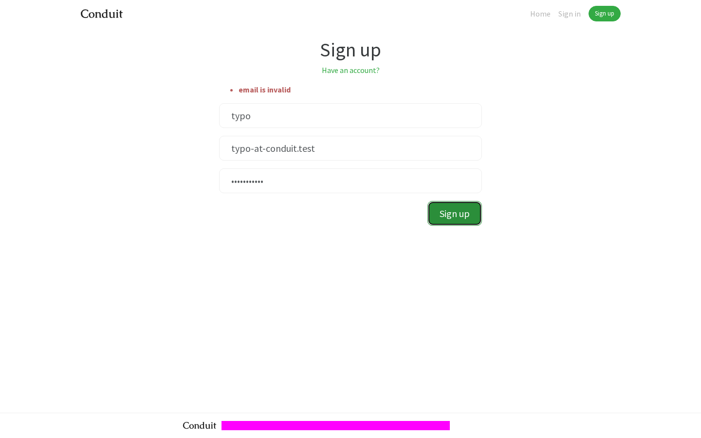 |  |  |

API calls (PASS):

| #   | Angular | React |
| --- | ------- | ----- |

Functional observations (PASS):

| Key                        | Angular                                       | React                                         |
| -------------------------- | --------------------------------------------- | --------------------------------------------- |
| buttonDisabledBeforeSubmit | `false`                                       | `false`                                       |
| invalid.url                | `"/register"`                                 | `"/register"`                                 |
| invalid.title              | `"Sign up"`                                   | `"Sign up"`                                   |
| invalid.switchLink         | `{"text":"Have an account?","href":"/login"}` | `{"text":"Have an account?","href":"/login"}` |
| invalid.inputs             | `["Username","Email","Password"]`             | `["Username","Email","Password"]`             |
| invalid.errors             | `["email is invalid"]`                        | `["email is invalid"]`                        |
| invalid.buttonText         | `"Sign up"`                                   | `"Sign up"`                                   |
| invalid.buttonDisabled     | `false`                                       | `false`                                       |
| invalid.signedIn           | `false`                                       | `false`                                       |

## register a new user

React journey video: [video/register-a-new-user--react.webm](video/register-a-new-user--react.webm)

| State               | Diff        | Angular                                                            | React                                                            | Diff image                                                    |
| ------------------- | ----------- | ------------------------------------------------------------------ | ---------------------------------------------------------------- | ------------------------------------------------------------- |
| register-form       | 0.000% PASS |        | 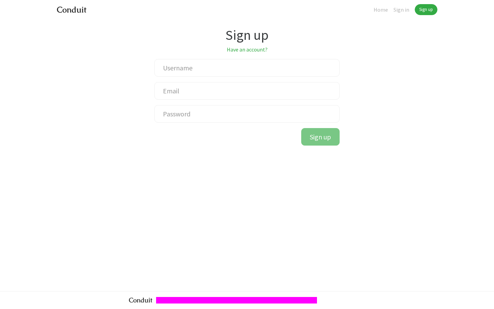       | 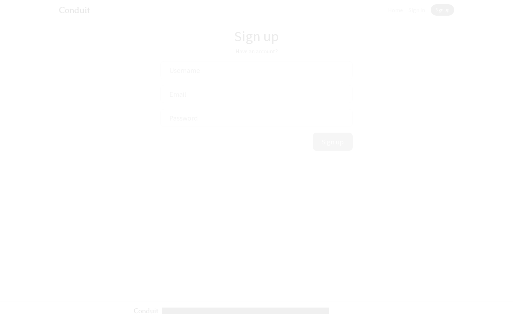       |
| register-filled     | 0.000% PASS |      | 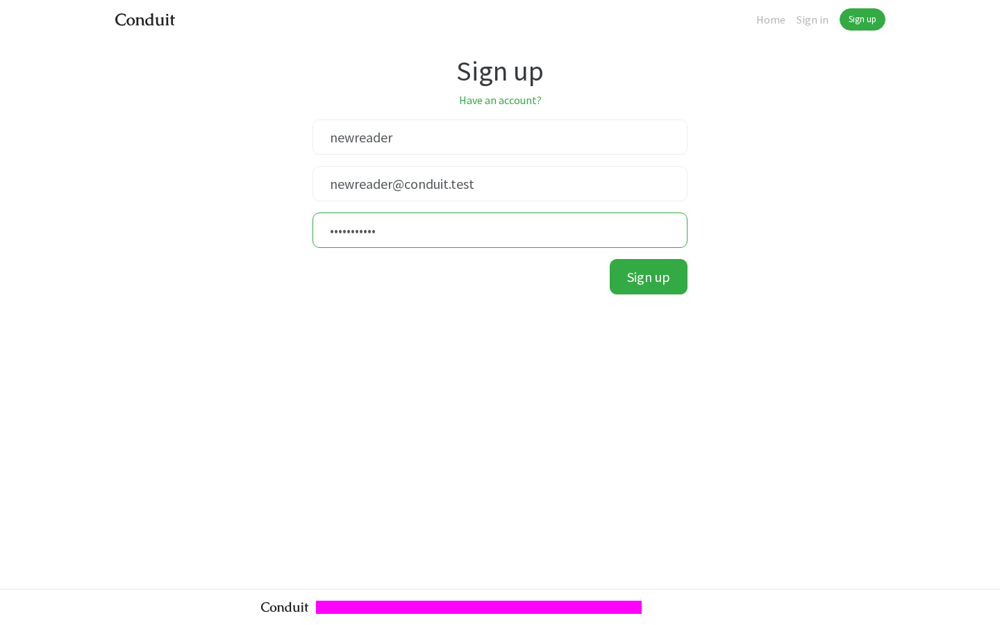     | 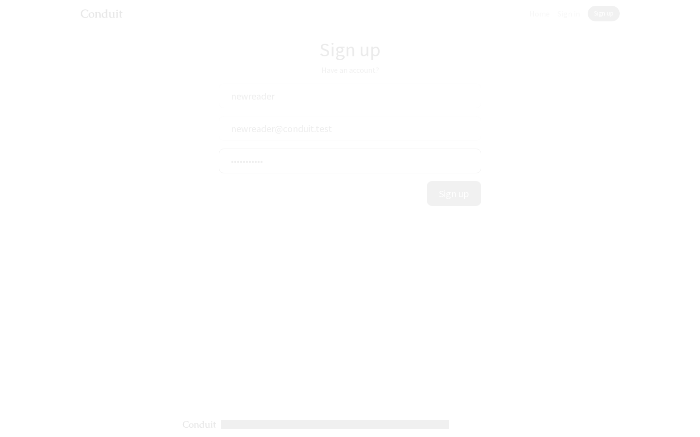     |
| home-after-register | 0.000% PASS |  |  | 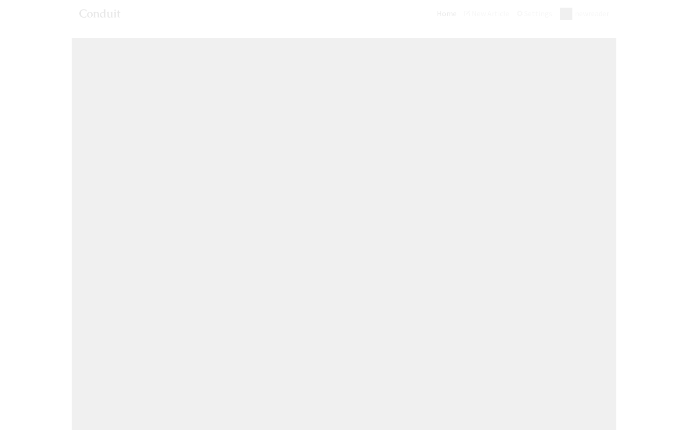 |

API calls (PASS):

| #   | Angular                                                                                                         | React                                                                                                           |
| --- | --------------------------------------------------------------------------------------------------------------- | --------------------------------------------------------------------------------------------------------------- |
| 1   | `POST /users {"user":{"email":"newreader@conduit.test","password":"password123","username":"newreader"}} → 201` | `POST /users {"user":{"email":"newreader@conduit.test","password":"password123","username":"newreader"}} → 201` |
| 2   | `GET /articles?limit=10&offset=0 → 200`                                                                         | `GET /articles?limit=10&offset=0 → 200`                                                                         |
| 3   | `GET /tags → 200`                                                                                               | `GET /tags → 200`                                                                                               |

Functional observations (PASS):

| Key                   | Angular                                                                             | React                                                                               |
| --------------------- | ----------------------------------------------------------------------------------- | ----------------------------------------------------------------------------------- |
| empty.url             | `"/register"`                                                                       | `"/register"`                                                                       |
| empty.title           | `"Sign up"`                                                                         | `"Sign up"`                                                                         |
| empty.switchLink      | `{"text":"Have an account?","href":"/login"}`                                       | `{"text":"Have an account?","href":"/login"}`                                       |
| empty.inputs          | `["Username","Email","Password"]`                                                   | `["Username","Email","Password"]`                                                   |
| empty.errors          | `[]`                                                                                | `[]`                                                                                |
| empty.buttonText      | `"Sign up"`                                                                         | `"Sign up"`                                                                         |
| empty.buttonDisabled  | `true`                                                                              | `true`                                                                              |
| empty.signedIn        | `false`                                                                             | `false`                                                                             |
| filled.buttonDisabled | `false`                                                                             | `false`                                                                             |
| after.url             | `"/"`                                                                               | `"/"`                                                                               |
| after.nav             | `["Home","New Article","Settings","newreader"]`                                     | `["Home","New Article","Settings","newreader"]`                                     |
| after.currentUser     | `{"username":"newreader","email":"newreader@conduit.test","bio":null,"image":null}` | `{"username":"newreader","email":"newreader@conduit.test","bio":null,"image":null}` |
| after.profile         | `{"profile":{"username":"newreader","bio":null,"image":null,"following":false}}`    | `{"profile":{"username":"newreader","bio":null,"image":null,"following":false}}`    |
| after.canLogin        | `200`                                                                               | `200`                                                                               |

## register with taken username

React journey video: [video/register-with-taken-username--react.webm](video/register-with-taken-username--react.webm)

| State          | Diff        | Angular                                                                | React                                                                | Diff image                                                        |
| -------------- | ----------- | ---------------------------------------------------------------------- | -------------------------------------------------------------------- | ----------------------------------------------------------------- |
| username-taken | 0.000% PASS |  | 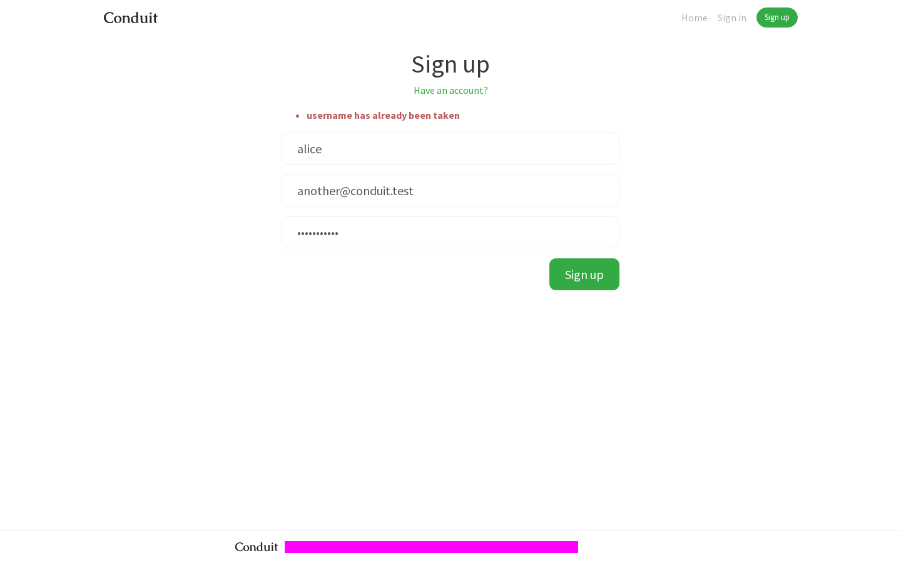 |  |
| email-taken    | 0.000% PASS |     | 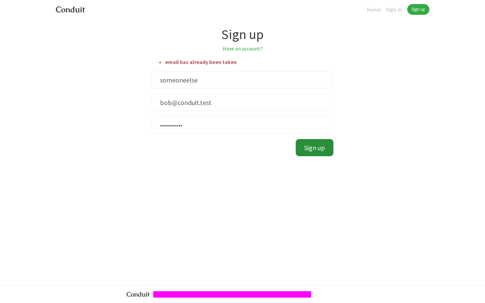    | 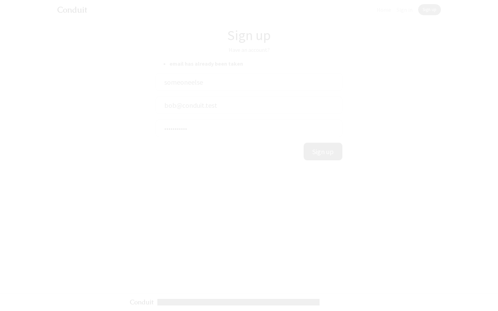    |

API calls (PASS):

| #   | Angular                                                                                                     | React                                                                                                       |
| --- | ----------------------------------------------------------------------------------------------------------- | ----------------------------------------------------------------------------------------------------------- |
| 1   | `POST /users {"user":{"email":"another@conduit.test","password":"password123","username":"alice"}} → 409`   | `POST /users {"user":{"email":"another@conduit.test","password":"password123","username":"alice"}} → 409`   |
| 2   | `POST /users {"user":{"email":"bob@conduit.test","password":"password123","username":"someoneelse"}} → 409` | `POST /users {"user":{"email":"bob@conduit.test","password":"password123","username":"someoneelse"}} → 409` |

Functional observations (PASS):

| Key                  | Angular                                       | React                                         |
| -------------------- | --------------------------------------------- | --------------------------------------------- |
| taken.url            | `"/register"`                                 | `"/register"`                                 |
| taken.title          | `"Sign up"`                                   | `"Sign up"`                                   |
| taken.switchLink     | `{"text":"Have an account?","href":"/login"}` | `{"text":"Have an account?","href":"/login"}` |
| taken.inputs         | `["Username","Email","Password"]`             | `["Username","Email","Password"]`             |
| taken.errors         | `["username has already been taken"]`         | `["username has already been taken"]`         |
| taken.buttonText     | `"Sign up"`                                   | `"Sign up"`                                   |
| taken.buttonDisabled | `false`                                       | `false`                                       |
| taken.signedIn       | `false`                                       | `false`                                       |
| taken.anotherProfile | `{"profile":["not found"]}`                   | `{"profile":["not found"]}`                   |
| emailTaken.errors    | `["email has already been taken"]`            | `["email has already been taken"]`            |

## signed-in user visiting login

React journey video: [video/signed-in-user-visiting-login--react.webm](video/signed-in-user-visiting-login--react.webm)

| State                 | Diff        | Angular                                                                        | React                                                                        | Diff image                                                                |
| --------------------- | ----------- | ------------------------------------------------------------------------------ | ---------------------------------------------------------------------------- | ------------------------------------------------------------------------- |
| login-while-signed-in | 0.000% PASS |  | 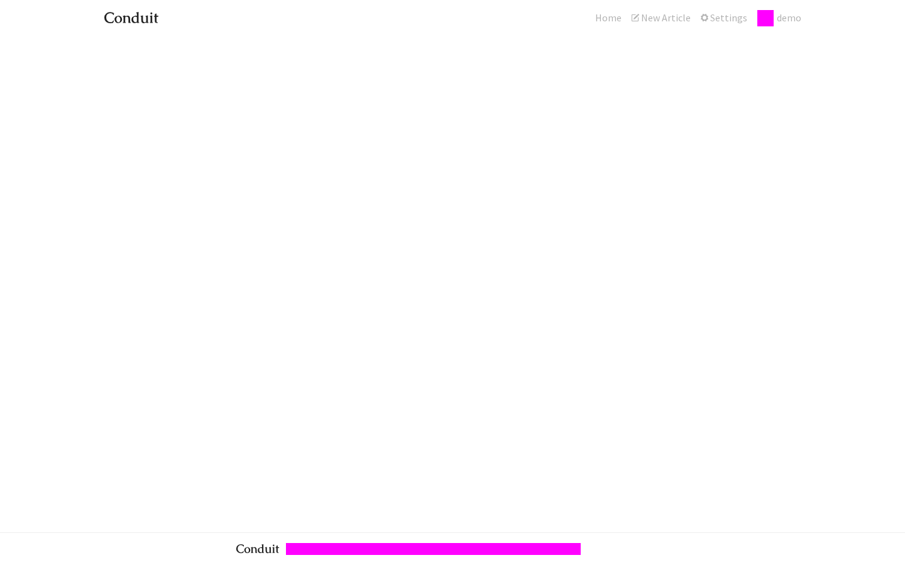 | 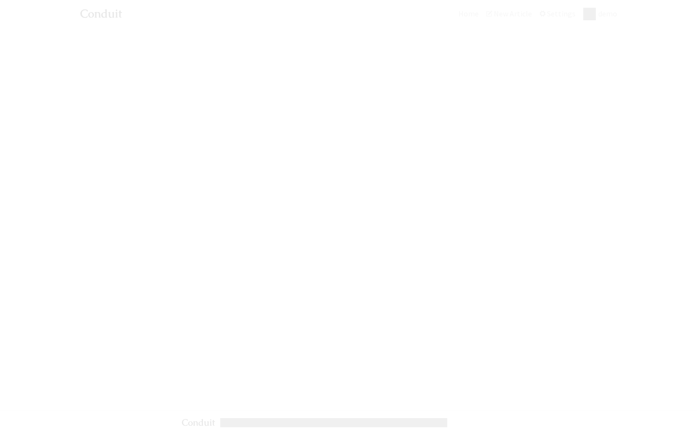 |

API calls (PASS):

| #   | Angular           | React             |
| --- | ----------------- | ----------------- |
| 1   | `GET /user → 200` | `GET /user → 200` |

Functional observations (PASS):

| Key           | Angular                                    | React                                      |
| ------------- | ------------------------------------------ | ------------------------------------------ |
| url           | `"/"`                                      | `"/"`                                      |
| authFormShown | `0`                                        | `0`                                        |
| nav           | `["Home","New Article","Settings","demo"]` | `["Home","New Article","Settings","demo"]` |
| signedIn      | `true`                                     | `true`                                     |

## Deviations

### Results in this report were run together with the home work package's page

Login and register redirect to `/`, so three journeys (login success, invalid credentials then retry, register) end on the home page. The parity check compares the whole journey, including the home page's own API calls (`GET /articles?limit=10&offset=0`, `GET /tags`). On this branch alone `react-app/src/pages/HomePage.tsx` is still the placeholder stub, so those calls are missing on React.

- **Results above (`results/`)**: run with the home package's `HomePage.tsx` from `origin/wp/home` (commit `e8a7358`) copied into the working tree for the run only (not committed here). **7/7 journeys pass all checks, max pixel diff 0.000%.**
- **Run on this branch alone (`standalone-run/results/`)**: 4/7 pass. The 3 failing journeys fail only after the redirect: the API-call check (Angular has the 2 home calls, React has none) and the home snapshot (70.2%, React shows the placeholder). Every auth-screen snapshot is 0.000% and all functional observations (URL, header links, signed-in token, `GET /user`, new user's profile) are equal. These pass once `wp/home` is merged.

### Home content masked in post-redirect snapshots

`home signed in` and `home after register` mask `.home-page .container.page` (feed and tags), because the home screen's visual parity is checked by the home package. The header (signed-in links, user name) and page layout stay compared.

### Foundation changes (outside `pages/AuthPage.tsx`)

1. `react-app/src/app.css`: `#root` gets the same flex rules the theme gives `app-root`. Without them the React footer sat right under the content instead of at the bottom of the window (1.398% diff on every auth snapshot, and on short pages of every screen).
2. `react-app/src/auth/guards.tsx` (`RequireGuest`, used only by `/login` and `/register`): a signed-in user opening `/login` got the home page on React; Angular cancels the navigation, so the URL becomes `/` with an empty page and no home API calls. The guard now checks once on route entry like an Angular guard, and on first load only rewrites the URL to `/`. In-app navigation to `/login` while signed in goes back to the previous page (no UI link leads there, so this path is not covered by a journey).
