# Parity report: comments

Angular (http://localhost:4200) vs React (http://localhost:5173), same seeded mock API reset before each run, viewport 1440×900, dates/avatars masked in magenta. Visual pass threshold: ≤1% differing pixels (pixelmatch, threshold 0.1).

| Journey                                  | No errors | Same states | Visual | API calls + payloads | Functional | Max diff | Result   |
| ---------------------------------------- | --------- | ----------- | ------ | -------------------- | ---------- | -------- | -------- |
| add a comment as demo                    | PASS      | PASS        | PASS   | PASS                 | PASS       | 0.000%   | **PASS** |
| blank comment shows error                | PASS      | PASS        | PASS   | PASS                 | PASS       | 0.000%   | **PASS** |
| delete own comment                       | PASS      | PASS        | PASS   | PASS                 | PASS       | 0.000%   | **PASS** |
| other users comments have no delete icon | PASS      | PASS        | PASS   | PASS                 | PASS       | 0.000%   | **PASS** |
| signed out sees sign-in prompt           | PASS      | PASS        | PASS   | PASS                 | PASS       | 0.000%   | **PASS** |

## add a comment as demo

React journey video: [video/add-a-comment-as-demo--react.webm](video/add-a-comment-as-demo--react.webm)

| State          | Diff        | Angular                                                         | React                                                         | Diff image                                                 |
| -------------- | ----------- | --------------------------------------------------------------- | ------------------------------------------------------------- | ---------------------------------------------------------- |
| comment-form   | 0.000% PASS |    |    |    |
| comment-typed  | 0.000% PASS | 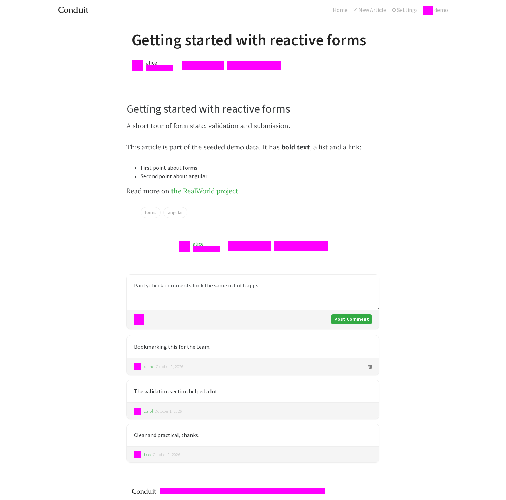  |   | 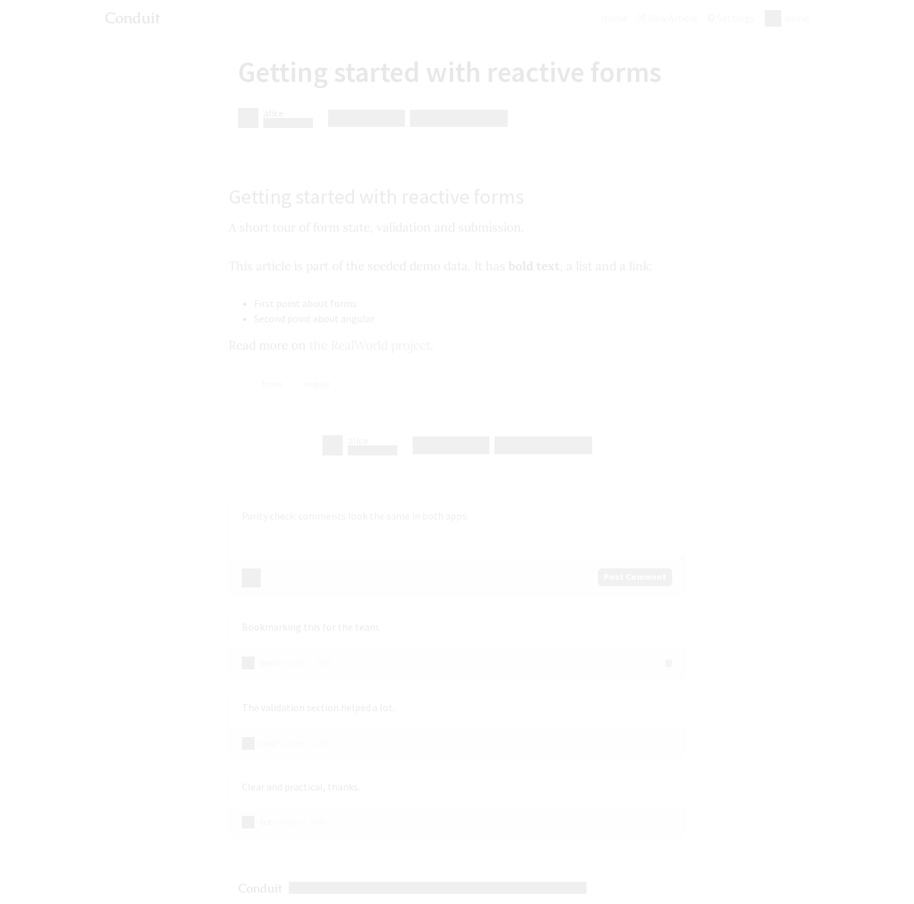  |
| comment-posted | 0.000% PASS | 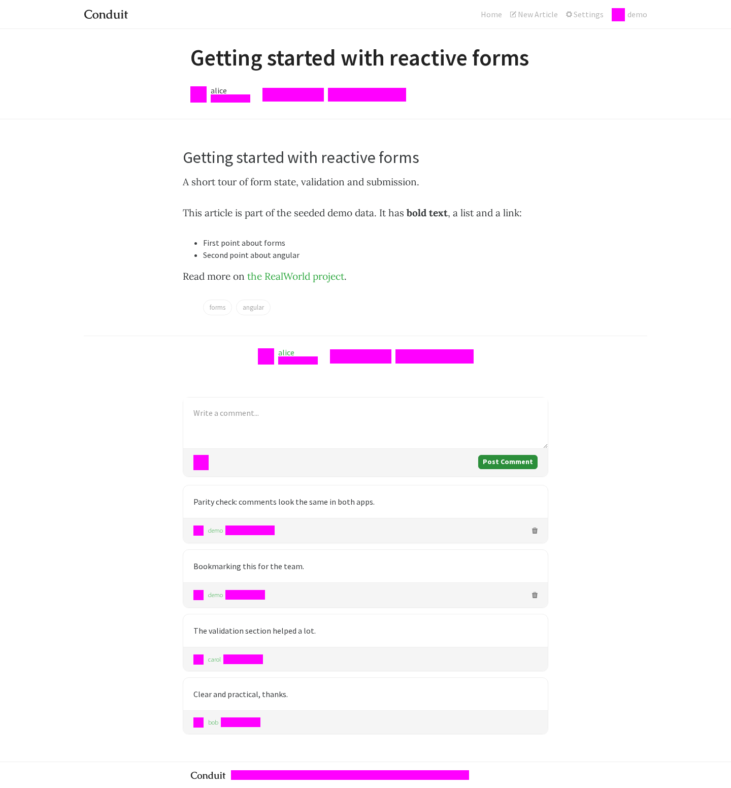 |  | 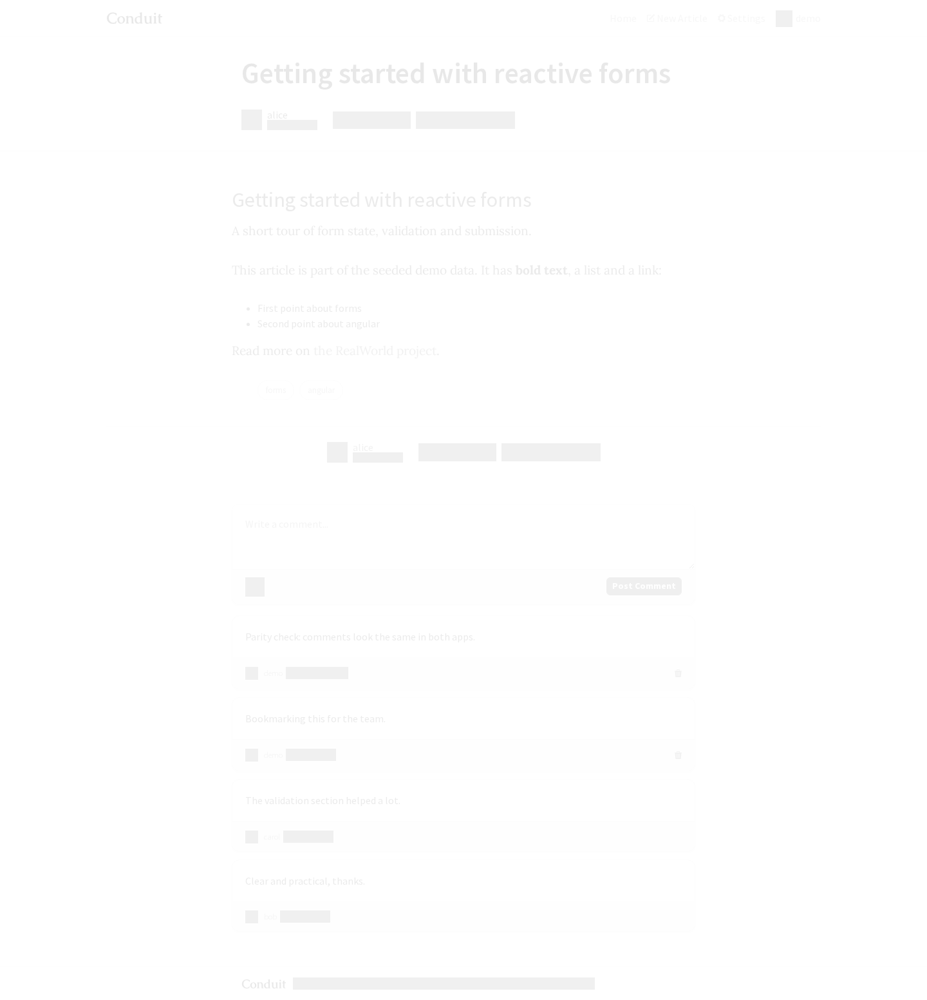 |

API calls (PASS):

| #   | Angular                                                                                                                                       | React                                                                                                                                         |
| --- | --------------------------------------------------------------------------------------------------------------------------------------------- | --------------------------------------------------------------------------------------------------------------------------------------------- |
| 1   | `GET /user → 200`                                                                                                                             | `GET /user → 200`                                                                                                                             |
| 2   | `GET /articles/getting-started-with-reactive-forms → 200`                                                                                     | `GET /articles/getting-started-with-reactive-forms → 200`                                                                                     |
| 3   | `GET /articles/getting-started-with-reactive-forms/comments → 200`                                                                            | `GET /articles/getting-started-with-reactive-forms/comments → 200`                                                                            |
| 4   | `POST /articles/getting-started-with-reactive-forms/comments {"comment":{"body":"Parity check: comments look the same in both apps."}} → 201` | `POST /articles/getting-started-with-reactive-forms/comments {"comment":{"body":"Parity check: comments look the same in both apps."}} → 201` |

Functional observations (PASS):

| Key                 | Angular                                                                                                                                                                                                                                                                                                                                                                                                                                                       | React                                                                                                                                                                                                                                                                                                                                                                                                                                                         |
| ------------------- | ------------------------------------------------------------------------------------------------------------------------------------------------------------------------------------------------------------------------------------------------------------------------------------------------------------------------------------------------------------------------------------------------------------------------------------------------------------- | ------------------------------------------------------------------------------------------------------------------------------------------------------------------------------------------------------------------------------------------------------------------------------------------------------------------------------------------------------------------------------------------------------------------------------------------------------------- |
| prompt count        | `0`                                                                                                                                                                                                                                                                                                                                                                                                                                                           | `0`                                                                                                                                                                                                                                                                                                                                                                                                                                                           |
| form avatar src     | `"/assets/default-avatar.svg"`                                                                                                                                                                                                                                                                                                                                                                                                                                | `"/assets/default-avatar.svg"`                                                                                                                                                                                                                                                                                                                                                                                                                                |
| textarea after post | `""`                                                                                                                                                                                                                                                                                                                                                                                                                                                          | `""`                                                                                                                                                                                                                                                                                                                                                                                                                                                          |
| error items         | `[]`                                                                                                                                                                                                                                                                                                                                                                                                                                                          | `[]`                                                                                                                                                                                                                                                                                                                                                                                                                                                          |
| comments on screen  | `[{"body":"Parity check: comments look the same in both apps.","author":"demo","authorHref":"/profile/demo","hasDelete":true},{"body":"Bookmarking this for the team.","author":"demo","authorHref":"/profile/demo","hasDelete":true},{"body":"The validation section helped a lot.","author":"carol","authorHref":"/profile/carol","hasDelete":false},{"body":"Clear and practical, thanks.","author":"bob","authorHref":"/profile/bob","hasDelete":false}]` | `[{"body":"Parity check: comments look the same in both apps.","author":"demo","authorHref":"/profile/demo","hasDelete":true},{"body":"Bookmarking this for the team.","author":"demo","authorHref":"/profile/demo","hasDelete":true},{"body":"The validation section helped a lot.","author":"carol","authorHref":"/profile/carol","hasDelete":false},{"body":"Clear and practical, thanks.","author":"bob","authorHref":"/profile/bob","hasDelete":false}]` |
| backend comments    | `[{"author":"demo","body":"Parity check: comments look the same in both apps."},{"author":"demo","body":"Bookmarking this for the team."},{"author":"carol","body":"The validation section helped a lot."},{"author":"bob","body":"Clear and practical, thanks."}]`                                                                                                                                                                                           | `[{"author":"demo","body":"Parity check: comments look the same in both apps."},{"author":"demo","body":"Bookmarking this for the team."},{"author":"carol","body":"The validation section helped a lot."},{"author":"bob","body":"Clear and practical, thanks."}]`                                                                                                                                                                                           |

## blank comment shows error

React journey video: [video/blank-comment-shows-error--react.webm](video/blank-comment-shows-error--react.webm)

| State                             | Diff        | Angular                                                                                | React                                                                                | Diff image                                                                        |
| --------------------------------- | ----------- | -------------------------------------------------------------------------------------- | ------------------------------------------------------------------------------------ | --------------------------------------------------------------------------------- |
| blank-comment-error               | 0.000% PASS |                | 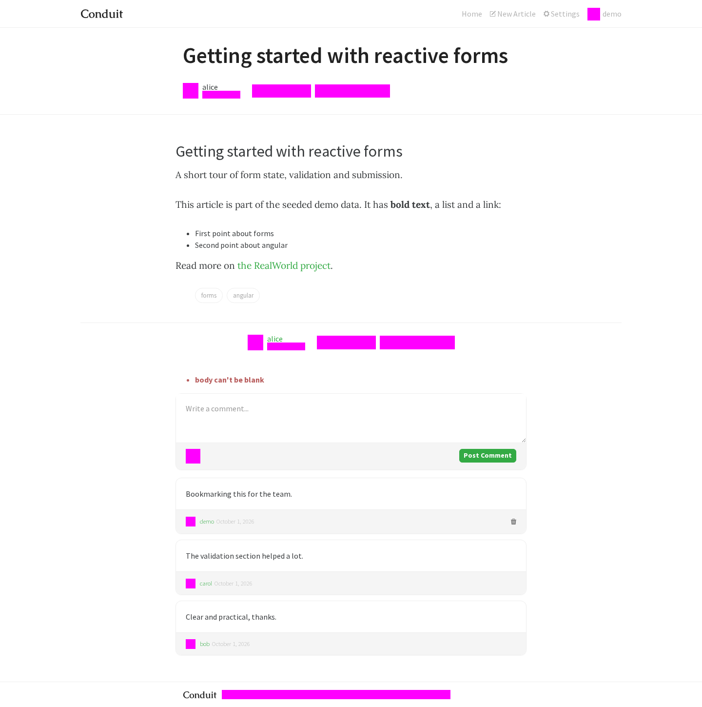               | 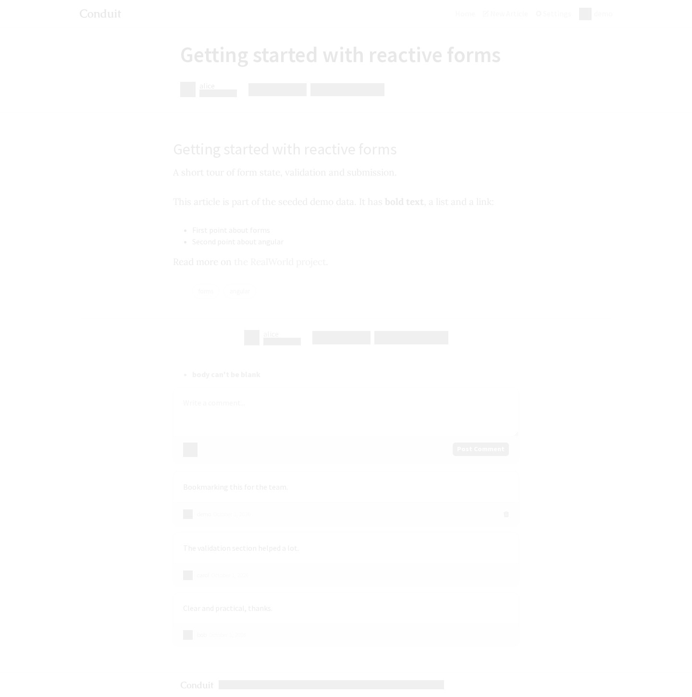               |
| error-cleared-after-valid-comment | 0.000% PASS | 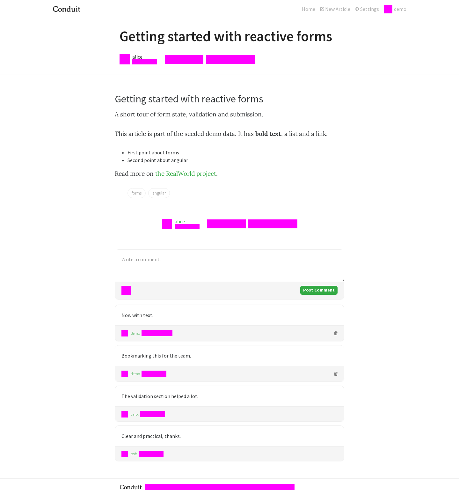 |  | 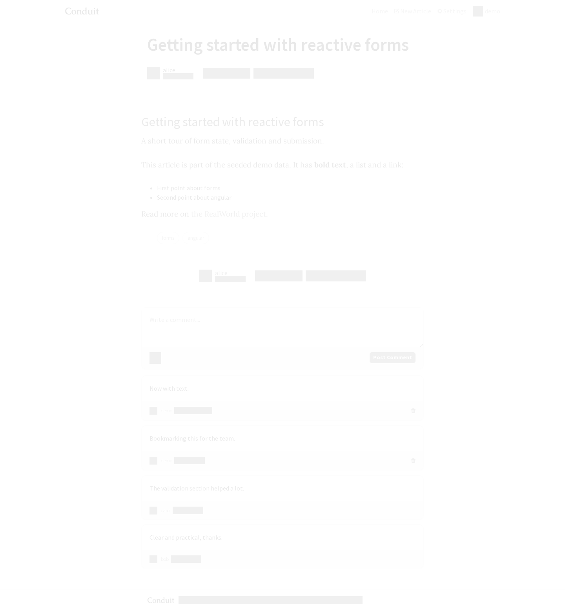 |

API calls (PASS):

| #   | Angular                                                                                                   | React                                                                                                     |
| --- | --------------------------------------------------------------------------------------------------------- | --------------------------------------------------------------------------------------------------------- |
| 1   | `GET /user → 200`                                                                                         | `GET /user → 200`                                                                                         |
| 2   | `GET /articles/getting-started-with-reactive-forms → 200`                                                 | `GET /articles/getting-started-with-reactive-forms → 200`                                                 |
| 3   | `GET /articles/getting-started-with-reactive-forms/comments → 200`                                        | `GET /articles/getting-started-with-reactive-forms/comments → 200`                                        |
| 4   | `POST /articles/getting-started-with-reactive-forms/comments {"comment":{"body":""}} → 422`               | `POST /articles/getting-started-with-reactive-forms/comments {"comment":{"body":""}} → 422`               |
| 5   | `POST /articles/getting-started-with-reactive-forms/comments {"comment":{"body":"Now with text."}} → 201` | `POST /articles/getting-started-with-reactive-forms/comments {"comment":{"body":"Now with text."}} → 201` |

Functional observations (PASS):

| Key                          | Angular                                                                                                                                                                               | React                                                                                                                                                                                 |
| ---------------------------- | ------------------------------------------------------------------------------------------------------------------------------------------------------------------------------------- | ------------------------------------------------------------------------------------------------------------------------------------------------------------------------------------- |
| error items                  | `["body can't be blank"]`                                                                                                                                                             | `["body can't be blank"]`                                                                                                                                                             |
| comment count on screen      | `3`                                                                                                                                                                                   | `3`                                                                                                                                                                                   |
| backend comments             | `[{"author":"demo","body":"Bookmarking this for the team."},{"author":"carol","body":"The validation section helped a lot."},{"author":"bob","body":"Clear and practical, thanks."}]` | `[{"author":"demo","body":"Bookmarking this for the team."},{"author":"carol","body":"The validation section helped a lot."},{"author":"bob","body":"Clear and practical, thanks."}]` |
| error items after valid post | `[]`                                                                                                                                                                                  | `[]`                                                                                                                                                                                  |

## delete own comment

React journey video: [video/delete-own-comment--react.webm](video/delete-own-comment--react.webm)

| State         | Diff        | Angular                                                     | React                                                     | Diff image                                             |
| ------------- | ----------- | ----------------------------------------------------------- | --------------------------------------------------------- | ------------------------------------------------------ |
| before-delete | 0.000% PASS |  |  | 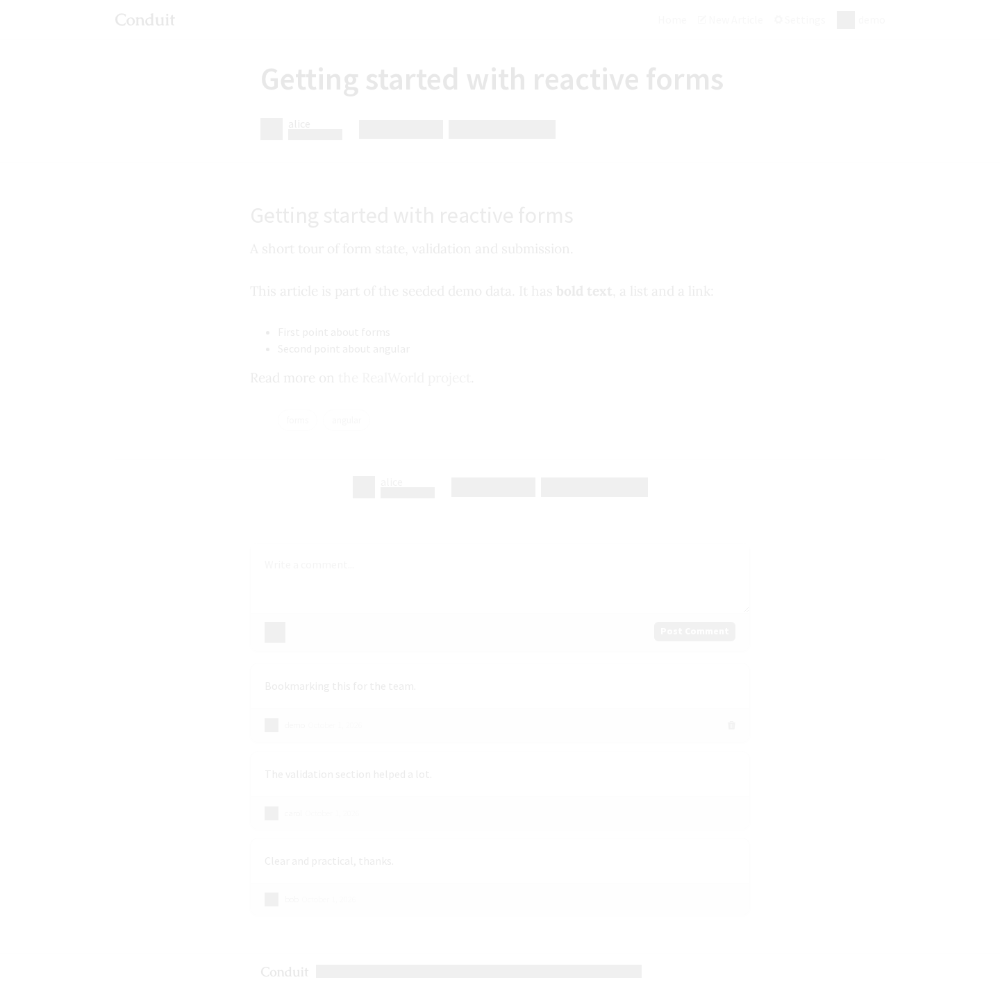 |
| after-delete  | 0.000% PASS | 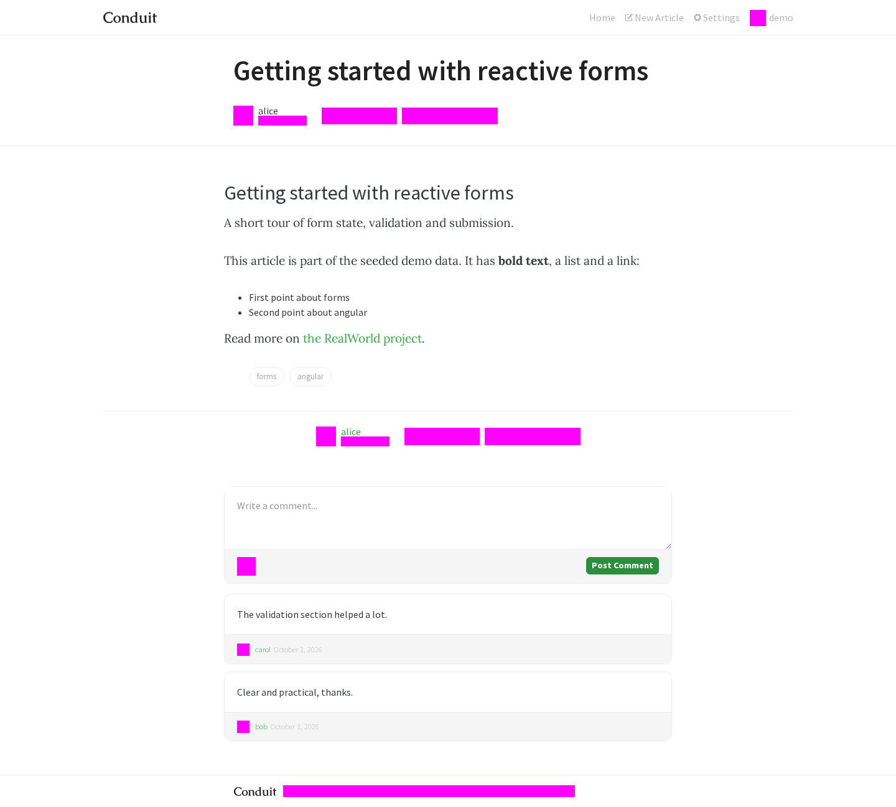  |   | 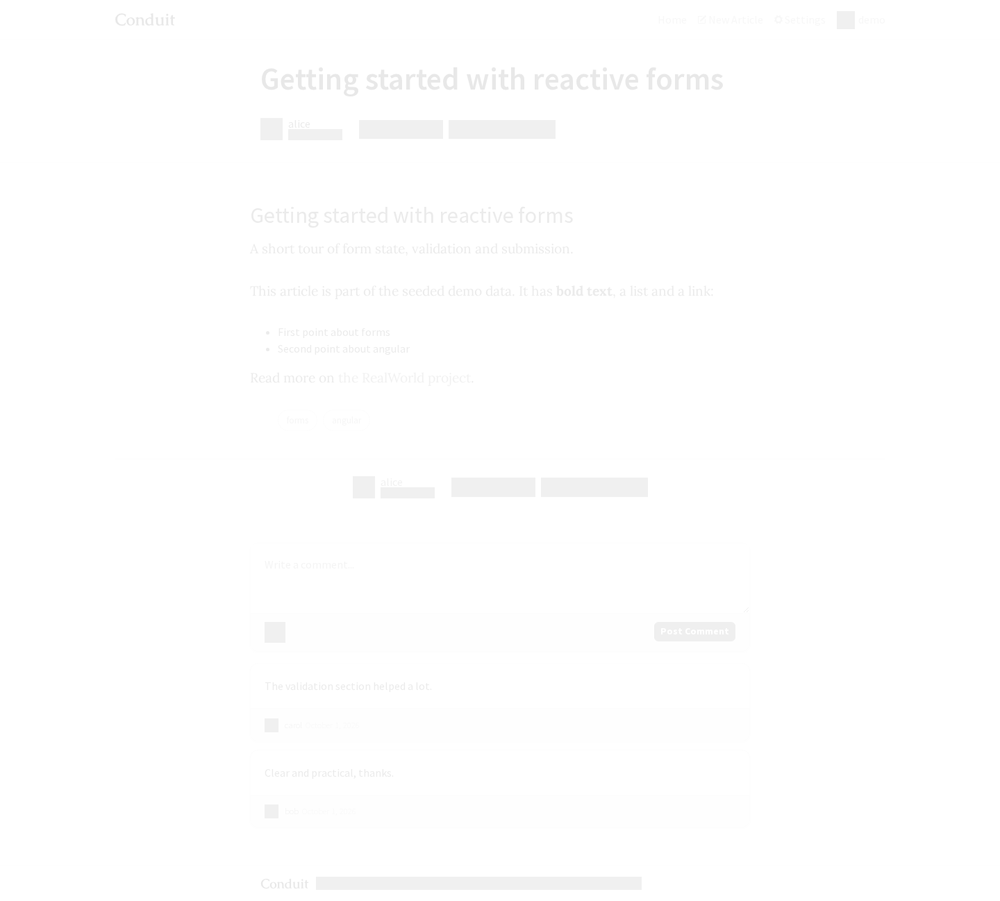  |

API calls (PASS):

| #   | Angular                                                                 | React                                                                   |
| --- | ----------------------------------------------------------------------- | ----------------------------------------------------------------------- |
| 1   | `GET /user → 200`                                                       | `GET /user → 200`                                                       |
| 2   | `GET /articles/getting-started-with-reactive-forms → 200`               | `GET /articles/getting-started-with-reactive-forms → 200`               |
| 3   | `GET /articles/getting-started-with-reactive-forms/comments → 200`      | `GET /articles/getting-started-with-reactive-forms/comments → 200`      |
| 4   | `DELETE /articles/getting-started-with-reactive-forms/comments/3 → 204` | `DELETE /articles/getting-started-with-reactive-forms/comments/3 → 204` |

Functional observations (PASS):

| Key                | Angular                                                                                                                                                                                                                                                                     | React                                                                                                                                                                                                                                                                       |
| ------------------ | --------------------------------------------------------------------------------------------------------------------------------------------------------------------------------------------------------------------------------------------------------------------------- | --------------------------------------------------------------------------------------------------------------------------------------------------------------------------------------------------------------------------------------------------------------------------- |
| comments on screen | `[{"body":"The validation section helped a lot.","author":"carol","authorHref":"/profile/carol","date":"October 1, 2026","hasDelete":false},{"body":"Clear and practical, thanks.","author":"bob","authorHref":"/profile/bob","date":"October 1, 2026","hasDelete":false}]` | `[{"body":"The validation section helped a lot.","author":"carol","authorHref":"/profile/carol","date":"October 1, 2026","hasDelete":false},{"body":"Clear and practical, thanks.","author":"bob","authorHref":"/profile/bob","date":"October 1, 2026","hasDelete":false}]` |
| error items        | `[]`                                                                                                                                                                                                                                                                        | `[]`                                                                                                                                                                                                                                                                        |
| backend comments   | `[{"author":"carol","body":"The validation section helped a lot."},{"author":"bob","body":"Clear and practical, thanks."}]`                                                                                                                                                 | `[{"author":"carol","body":"The validation section helped a lot."},{"author":"bob","body":"Clear and practical, thanks."}]`                                                                                                                                                 |
| url                | `"/article/getting-started-with-reactive-forms"`                                                                                                                                                                                                                            | `"/article/getting-started-with-reactive-forms"`                                                                                                                                                                                                                            |

## other users comments have no delete icon

React journey video: [video/other-users-comments-have-no-delete-icon--react.webm](video/other-users-comments-have-no-delete-icon--react.webm)

| State            | Diff        | Angular                                                                              | React                                                                              | Diff image                                                                      |
| ---------------- | ----------- | ------------------------------------------------------------------------------------ | ---------------------------------------------------------------------------------- | ------------------------------------------------------------------------------- |
| signed-in-as-bob | 0.000% PASS | 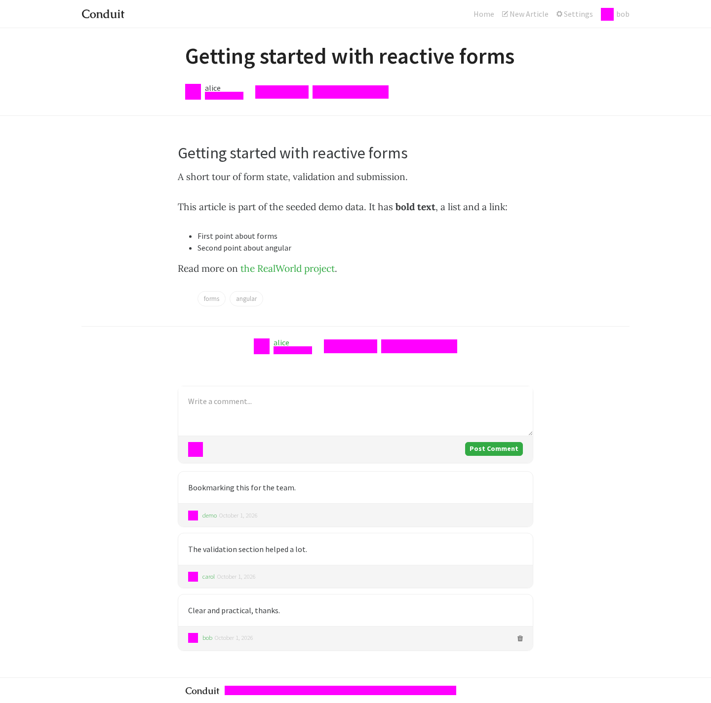 |  | 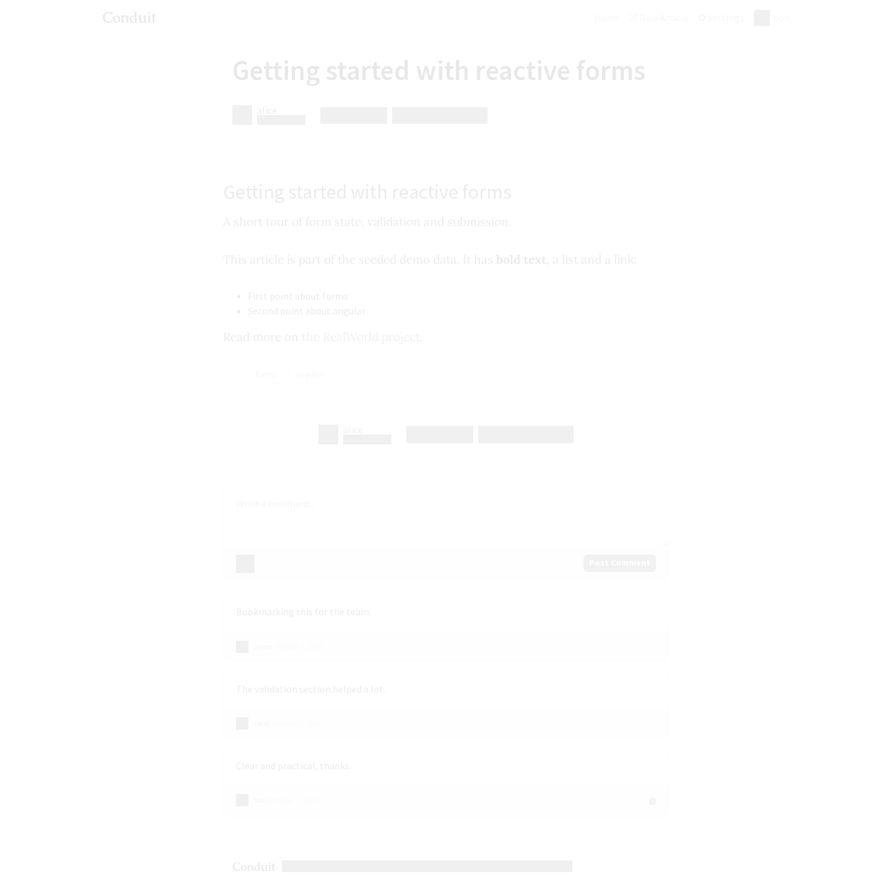 |

API calls (PASS):

| #   | Angular                                                            | React                                                              |
| --- | ------------------------------------------------------------------ | ------------------------------------------------------------------ |
| 1   | `GET /user → 200`                                                  | `GET /user → 200`                                                  |
| 2   | `GET /articles/getting-started-with-reactive-forms → 200`          | `GET /articles/getting-started-with-reactive-forms → 200`          |
| 3   | `GET /articles/getting-started-with-reactive-forms/comments → 200` | `GET /articles/getting-started-with-reactive-forms/comments → 200` |

Functional observations (PASS):

| Key                | Angular                                                                                                                                                                                                                                                                                                                                                                                                      | React                                                                                                                                                                                                                                                                                                                                                                                                        |
| ------------------ | ------------------------------------------------------------------------------------------------------------------------------------------------------------------------------------------------------------------------------------------------------------------------------------------------------------------------------------------------------------------------------------------------------------ | ------------------------------------------------------------------------------------------------------------------------------------------------------------------------------------------------------------------------------------------------------------------------------------------------------------------------------------------------------------------------------------------------------------ |
| comments on screen | `[{"body":"Bookmarking this for the team.","author":"demo","authorHref":"/profile/demo","date":"October 1, 2026","hasDelete":false},{"body":"The validation section helped a lot.","author":"carol","authorHref":"/profile/carol","date":"October 1, 2026","hasDelete":false},{"body":"Clear and practical, thanks.","author":"bob","authorHref":"/profile/bob","date":"October 1, 2026","hasDelete":true}]` | `[{"body":"Bookmarking this for the team.","author":"demo","authorHref":"/profile/demo","date":"October 1, 2026","hasDelete":false},{"body":"The validation section helped a lot.","author":"carol","authorHref":"/profile/carol","date":"October 1, 2026","hasDelete":false},{"body":"Clear and practical, thanks.","author":"bob","authorHref":"/profile/bob","date":"October 1, 2026","hasDelete":true}]` |
| delete icon count  | `1`                                                                                                                                                                                                                                                                                                                                                                                                          | `1`                                                                                                                                                                                                                                                                                                                                                                                                          |
| author link hrefs  | `["/profile/demo","/profile/demo","/profile/carol","/profile/carol","/profile/bob","/profile/bob"]`                                                                                                                                                                                                                                                                                                          | `["/profile/demo","/profile/demo","/profile/carol","/profile/carol","/profile/bob","/profile/bob"]`                                                                                                                                                                                                                                                                                                          |

## signed out sees sign-in prompt

React journey video: [video/signed-out-sees-sign-in-prompt--react.webm](video/signed-out-sees-sign-in-prompt--react.webm)

| State               | Diff        | Angular                                                                       | React                                                                       | Diff image                                                               |
| ------------------- | ----------- | ----------------------------------------------------------------------------- | --------------------------------------------------------------------------- | ------------------------------------------------------------------------ |
| signed-out-comments | 0.000% PASS | 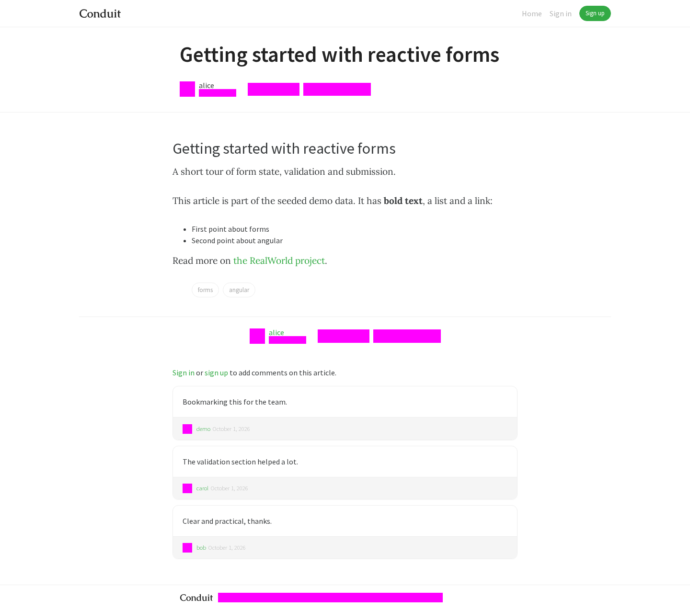 |  | 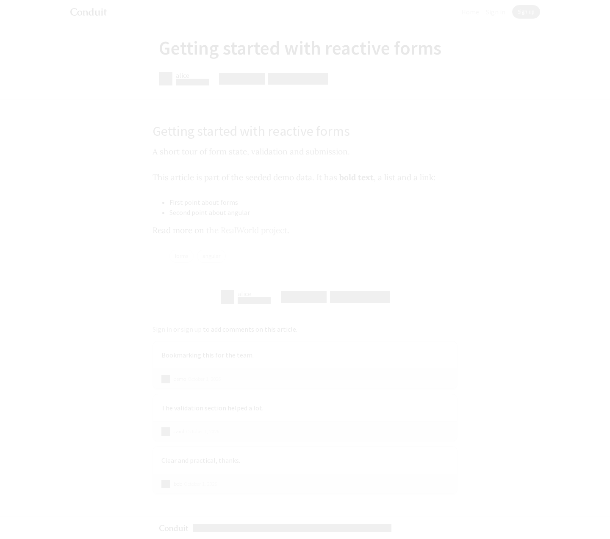 |

API calls (PASS):

| #   | Angular                                                            | React                                                              |
| --- | ------------------------------------------------------------------ | ------------------------------------------------------------------ |
| 1   | `GET /articles/getting-started-with-reactive-forms → 200`          | `GET /articles/getting-started-with-reactive-forms → 200`          |
| 2   | `GET /articles/getting-started-with-reactive-forms/comments → 200` | `GET /articles/getting-started-with-reactive-forms/comments → 200` |
| 3   | `GET /articles/getting-started-with-reactive-forms → 200`          | `GET /articles/getting-started-with-reactive-forms → 200`          |
| 4   | `GET /articles/getting-started-with-reactive-forms/comments → 200` | `GET /articles/getting-started-with-reactive-forms/comments → 200` |

Functional observations (PASS):

| Key                | Angular                                                                                                                                                                                                                                                                                                                                                                                                       | React                                                                                                                                                                                                                                                                                                                                                                                                         |
| ------------------ | ------------------------------------------------------------------------------------------------------------------------------------------------------------------------------------------------------------------------------------------------------------------------------------------------------------------------------------------------------------------------------------------------------------- | ------------------------------------------------------------------------------------------------------------------------------------------------------------------------------------------------------------------------------------------------------------------------------------------------------------------------------------------------------------------------------------------------------------- |
| comment form count | `0`                                                                                                                                                                                                                                                                                                                                                                                                           | `0`                                                                                                                                                                                                                                                                                                                                                                                                           |
| prompt text        | `"Sign in or sign up to add comments on this article."`                                                                                                                                                                                                                                                                                                                                                       | `"Sign in or sign up to add comments on this article."`                                                                                                                                                                                                                                                                                                                                                       |
| prompt links       | `[["Sign in","/login"],["sign up","/register"]]`                                                                                                                                                                                                                                                                                                                                                              | `[["Sign in","/login"],["sign up","/register"]]`                                                                                                                                                                                                                                                                                                                                                              |
| comments on screen | `[{"body":"Bookmarking this for the team.","author":"demo","authorHref":"/profile/demo","date":"October 1, 2026","hasDelete":false},{"body":"The validation section helped a lot.","author":"carol","authorHref":"/profile/carol","date":"October 1, 2026","hasDelete":false},{"body":"Clear and practical, thanks.","author":"bob","authorHref":"/profile/bob","date":"October 1, 2026","hasDelete":false}]` | `[{"body":"Bookmarking this for the team.","author":"demo","authorHref":"/profile/demo","date":"October 1, 2026","hasDelete":false},{"body":"The validation section helped a lot.","author":"carol","authorHref":"/profile/carol","date":"October 1, 2026","hasDelete":false},{"body":"Clear and practical, thanks.","author":"bob","authorHref":"/profile/bob","date":"October 1, 2026","hasDelete":false}]` |
| url after Sign in  | `"/login"`                                                                                                                                                                                                                                                                                                                                                                                                    | `"/login"`                                                                                                                                                                                                                                                                                                                                                                                                    |
| url after sign up  | `"/register"`                                                                                                                                                                                                                                                                                                                                                                                                 | `"/register"`                                                                                                                                                                                                                                                                                                                                                                                                 |

## Deviations

_None recorded._
