# Parity report: editor

Angular (http://localhost:4200) vs React (http://localhost:5173), same seeded mock API reset before each run, viewport 1440×900, dates/avatars masked in magenta. Visual pass threshold: ≤1% differing pixels (pixelmatch, threshold 0.1).

| Journey                              | No errors | Same states | Visual | API calls + payloads | Functional | Max diff | Result   |
| ------------------------------------ | --------- | ----------- | ------ | -------------------- | ---------- | -------- | -------- |
| blank title shows error              | PASS      | PASS        | PASS   | PASS                 | PASS       | 0.000%   | **PASS** |
| create article with two tags as demo | PASS      | PASS        | PASS   | PASS                 | PASS       | 0.000%   | **PASS** |
| edit own article as alice            | PASS      | PASS        | PASS   | PASS                 | PASS       | 0.000%   | **PASS** |
| non-author is redirected from edit   | PASS      | PASS        | PASS   | PASS                 | PASS       | 0.000%   | **PASS** |
| signed out editor redirects to login | PASS      | PASS        | PASS   | PASS                 | PASS       | 0.000%   | **PASS** |

## blank title shows error

React journey video: [video/blank-title-shows-error--react.webm](video/blank-title-shows-error--react.webm)

| State             | Diff        | Angular                                                              | React                                                              | Diff image                                                      |
| ----------------- | ----------- | -------------------------------------------------------------------- | ------------------------------------------------------------------ | --------------------------------------------------------------- |
| blank-title-error | 0.000% PASS |  | 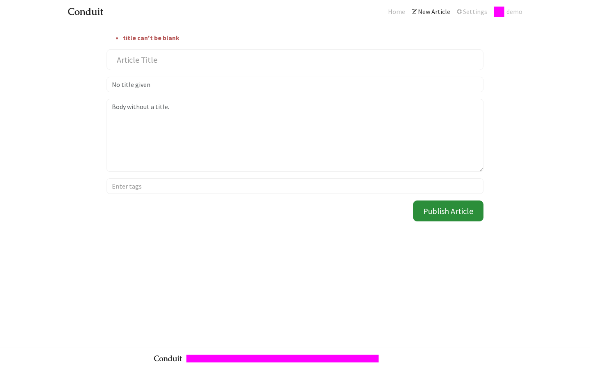 | 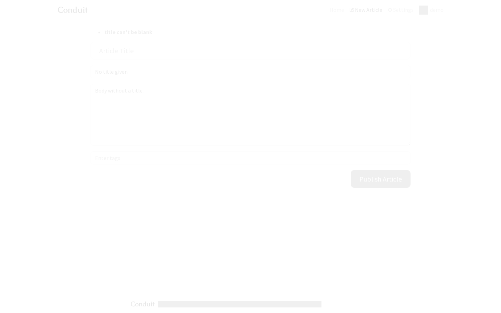 |

API calls (PASS):

| #   | Angular                                                                                                                    | React                                                                                                                      |
| --- | -------------------------------------------------------------------------------------------------------------------------- | -------------------------------------------------------------------------------------------------------------------------- |
| 1   | `GET /user → 200`                                                                                                          | `GET /user → 200`                                                                                                          |
| 2   | `POST /articles {"article":{"title":"","description":"No title given","body":"Body without a title.","tagList":[]}} → 422` | `POST /articles {"article":{"title":"","description":"No title given","body":"Body without a title.","tagList":[]}} → 422` |

Functional observations (PASS):

| Key                 | Angular                                                                                                                                | React                                                                                                                                  |
| ------------------- | -------------------------------------------------------------------------------------------------------------------------------------- | -------------------------------------------------------------------------------------------------------------------------------------- |
| form after error    | `{"title":"","description":"No title given","body":"Body without a title.","tagInput":"","tags":[],"errors":["title can't be blank"]}` | `{"title":"","description":"No title given","body":"Body without a title.","tagInput":"","tags":[],"errors":["title can't be blank"]}` |
| url after error     | `"/editor"`                                                                                                                            | `"/editor"`                                                                                                                            |
| demo articles count | `0`                                                                                                                                    | `0`                                                                                                                                    |

## create article with two tags as demo

React journey video: [video/create-article-with-two-tags-as-demo--react.webm](video/create-article-with-two-tags-as-demo--react.webm)

| State                | Diff        | Angular                                                                              | React                                                                              | Diff image                                                                      |
| -------------------- | ----------- | ------------------------------------------------------------------------------------ | ---------------------------------------------------------------------------------- | ------------------------------------------------------------------------------- |
| empty-editor         | 0.000% PASS |          | 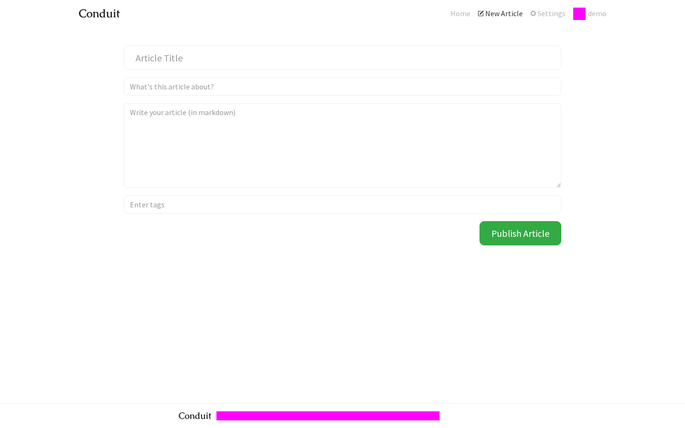         | 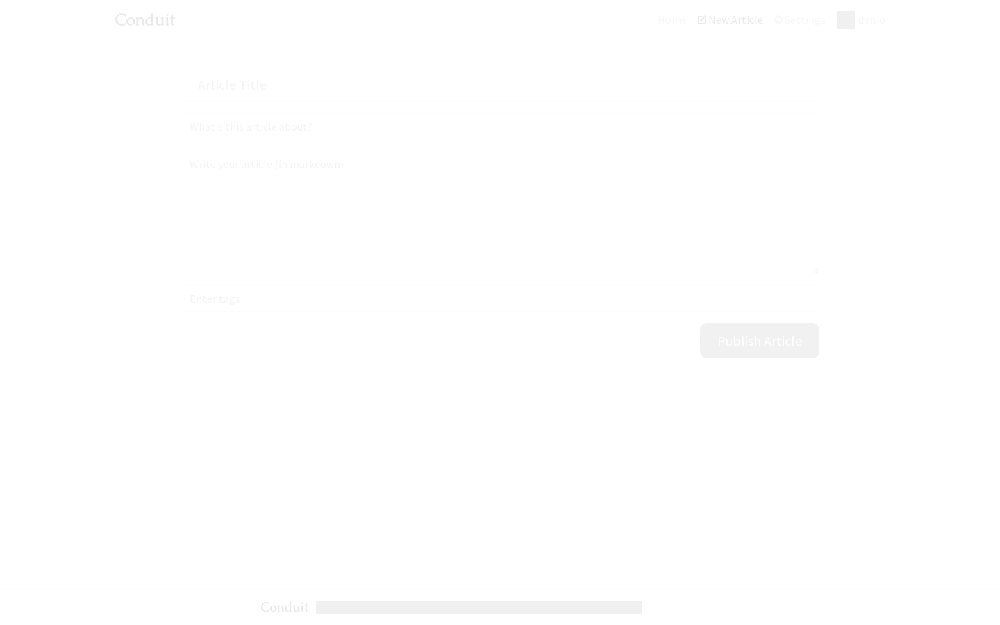         |
| three-tag-pills      | 0.000% PASS |       |       | 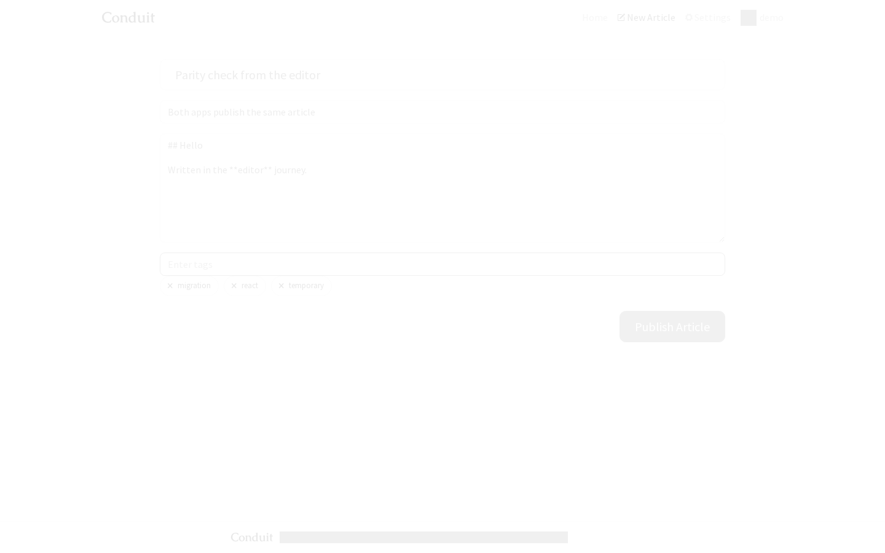      |
| filled-with-two-tags | 0.000% PASS |  | 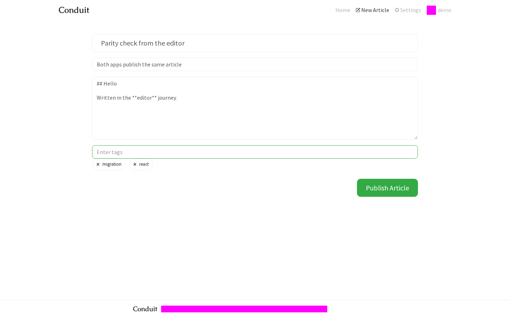 |  |

API calls (PASS):

| #   | Angular                                                                                                                                                                                                                | React                                                                                                                                                                                                                  |
| --- | ---------------------------------------------------------------------------------------------------------------------------------------------------------------------------------------------------------------------- | ---------------------------------------------------------------------------------------------------------------------------------------------------------------------------------------------------------------------- |
| 1   | `GET /user → 200`                                                                                                                                                                                                      | `GET /user → 200`                                                                                                                                                                                                      |
| 2   | `POST /articles {"article":{"title":"Parity check from the editor","description":"Both apps publish the same article","body":"## Hello\n\nWritten in the **editor** journey.","tagList":["migration","react"]}} → 201` | `POST /articles {"article":{"title":"Parity check from the editor","description":"Both apps publish the same article","body":"## Hello\n\nWritten in the **editor** journey.","tagList":["migration","react"]}} → 201` |
| 3   | `GET /articles/parity-check-from-the-editor → 200`                                                                                                                                                                     | `GET /articles/parity-check-from-the-editor → 200`                                                                                                                                                                     |
| 4   | `GET /articles/parity-check-from-the-editor/comments → 200`                                                                                                                                                            | `GET /articles/parity-check-from-the-editor/comments → 200`                                                                                                                                                            |

Functional observations (PASS):

| Key                     | Angular                                                                                                                                                                                                                                     | React                                                                                                                                                                                                                                       |
| ----------------------- | ------------------------------------------------------------------------------------------------------------------------------------------------------------------------------------------------------------------------------------------- | ------------------------------------------------------------------------------------------------------------------------------------------------------------------------------------------------------------------------------------------- |
| empty form              | `{"title":"","description":"","body":"","tagInput":"","tags":[],"errors":[]}`                                                                                                                                                               | `{"title":"","description":"","body":"","tagInput":"","tags":[],"errors":[]}`                                                                                                                                                               |
| after adding three tags | `{"title":"Parity check from the editor","description":"Both apps publish the same article","body":"## Hello\n\nWritten in the **editor** journey.","tagInput":"","tags":["migration","react","temporary"],"errors":[]}`                    | `{"title":"Parity check from the editor","description":"Both apps publish the same article","body":"## Hello\n\nWritten in the **editor** journey.","tagInput":"","tags":["migration","react","temporary"],"errors":[]}`                    |
| before publish          | `{"title":"Parity check from the editor","description":"Both apps publish the same article","body":"## Hello\n\nWritten in the **editor** journey.","tagInput":"","tags":["migration","react"],"errors":[]}`                                | `{"title":"Parity check from the editor","description":"Both apps publish the same article","body":"## Hello\n\nWritten in the **editor** journey.","tagInput":"","tags":["migration","react"],"errors":[]}`                                |
| url after publish       | `"/article/parity-check-from-the-editor"`                                                                                                                                                                                                   | `"/article/parity-check-from-the-editor"`                                                                                                                                                                                                   |
| backend article         | `{"slug":"parity-check-from-the-editor","title":"Parity check from the editor","description":"Both apps publish the same article","body":"## Hello\n\nWritten in the **editor** journey.","tagList":["migration","react"],"author":"demo"}` | `{"slug":"parity-check-from-the-editor","title":"Parity check from the editor","description":"Both apps publish the same article","body":"## Hello\n\nWritten in the **editor** journey.","tagList":["migration","react"],"author":"demo"}` |
| demo article slugs      | `["parity-check-from-the-editor"]`                                                                                                                                                                                                          | `["parity-check-from-the-editor"]`                                                                                                                                                                                                          |

## edit own article as alice

React journey video: [video/edit-own-article-as-alice--react.webm](video/edit-own-article-as-alice--react.webm)

| State                 | Diff        | Angular                                                                    | React                                                                    | Diff image                                                            |
| --------------------- | ----------- | -------------------------------------------------------------------------- | ------------------------------------------------------------------------ | --------------------------------------------------------------------- |
| prefilled-editor      | 0.000% PASS |       | 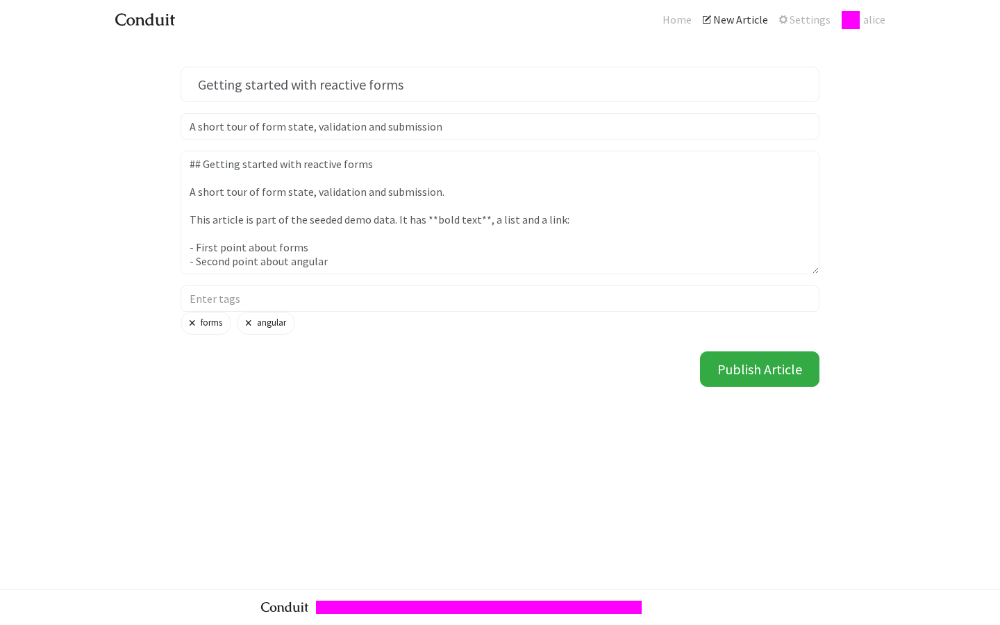      |       |
| edited-before-publish | 0.000% PASS | 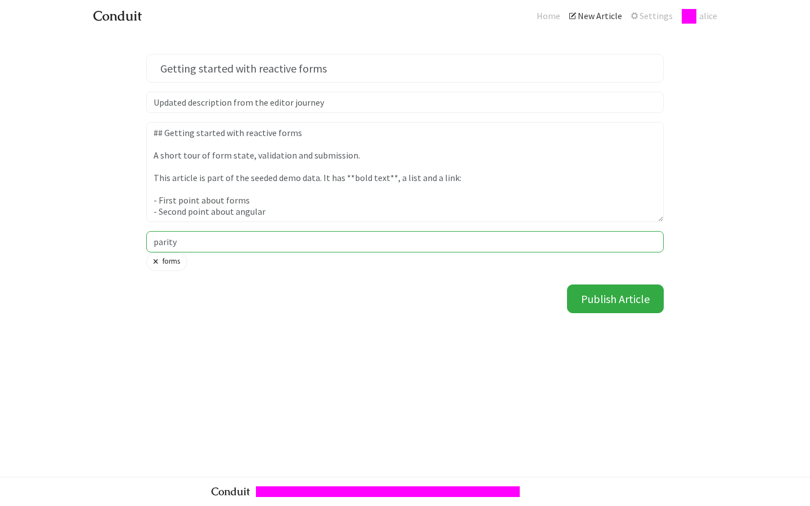 |  | 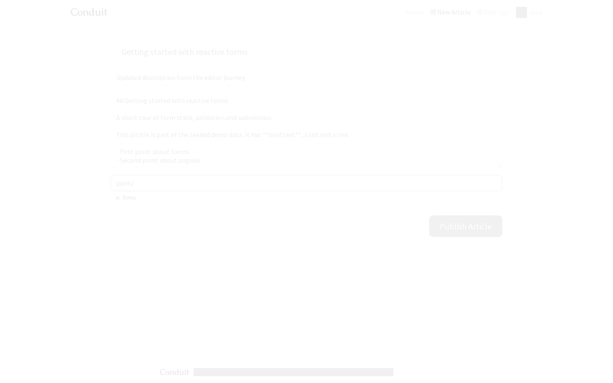 |

API calls (PASS):

| #   | Angular                                                                                                                                                                                                                                                                                                                                                                                                                                                                                                                                                                                                          | React                                                                                                                                                                                                                                                                                                                                                                                                                                                                                                                                                                                                            |
| --- | ---------------------------------------------------------------------------------------------------------------------------------------------------------------------------------------------------------------------------------------------------------------------------------------------------------------------------------------------------------------------------------------------------------------------------------------------------------------------------------------------------------------------------------------------------------------------------------------------------------------- | ---------------------------------------------------------------------------------------------------------------------------------------------------------------------------------------------------------------------------------------------------------------------------------------------------------------------------------------------------------------------------------------------------------------------------------------------------------------------------------------------------------------------------------------------------------------------------------------------------------------- |
| 1   | `GET /user → 200`                                                                                                                                                                                                                                                                                                                                                                                                                                                                                                                                                                                                | `GET /user → 200`                                                                                                                                                                                                                                                                                                                                                                                                                                                                                                                                                                                                |
| 2   | `GET /articles/getting-started-with-reactive-forms → 200`                                                                                                                                                                                                                                                                                                                                                                                                                                                                                                                                                        | `GET /articles/getting-started-with-reactive-forms → 200`                                                                                                                                                                                                                                                                                                                                                                                                                                                                                                                                                        |
| 3   | `GET /user → 200`                                                                                                                                                                                                                                                                                                                                                                                                                                                                                                                                                                                                | `GET /user → 200`                                                                                                                                                                                                                                                                                                                                                                                                                                                                                                                                                                                                |
| 4   | `PUT /articles/getting-started-with-reactive-forms {"article":{"title":"Getting started with reactive forms","description":"Updated description from the editor journey","body":"## Getting started with reactive forms\n\nA short tour of form state, validation and submission.\n\nThis article is part of the seeded demo data. It has **bold text**, a list and a link:\n\n- First point about forms\n- Second point about angular\n\nRead more on [the RealWorld project](https://github.com/realworld-apps/realworld).","tagList":["forms","parity"],"slug":"getting-started-with-reactive-forms"}} → 200` | `PUT /articles/getting-started-with-reactive-forms {"article":{"title":"Getting started with reactive forms","description":"Updated description from the editor journey","body":"## Getting started with reactive forms\n\nA short tour of form state, validation and submission.\n\nThis article is part of the seeded demo data. It has **bold text**, a list and a link:\n\n- First point about forms\n- Second point about angular\n\nRead more on [the RealWorld project](https://github.com/realworld-apps/realworld).","tagList":["forms","parity"],"slug":"getting-started-with-reactive-forms"}} → 200` |
| 5   | `GET /articles/getting-started-with-reactive-forms → 200`                                                                                                                                                                                                                                                                                                                                                                                                                                                                                                                                                        | `GET /articles/getting-started-with-reactive-forms → 200`                                                                                                                                                                                                                                                                                                                                                                                                                                                                                                                                                        |
| 6   | `GET /articles/getting-started-with-reactive-forms/comments → 200`                                                                                                                                                                                                                                                                                                                                                                                                                                                                                                                                               | `GET /articles/getting-started-with-reactive-forms/comments → 200`                                                                                                                                                                                                                                                                                                                                                                                                                                                                                                                                               |

Functional observations (PASS):

| Key               | Angular                                                                                                                                                                                                                                                                                                                                                                                                                                                                                                                                                       | React                                                                                                                                                                                                                                                                                                                                                                                                                                                                                                                                                         |
| ----------------- | ------------------------------------------------------------------------------------------------------------------------------------------------------------------------------------------------------------------------------------------------------------------------------------------------------------------------------------------------------------------------------------------------------------------------------------------------------------------------------------------------------------------------------------------------------------- | ------------------------------------------------------------------------------------------------------------------------------------------------------------------------------------------------------------------------------------------------------------------------------------------------------------------------------------------------------------------------------------------------------------------------------------------------------------------------------------------------------------------------------------------------------------- |
| prefilled form    | `{"title":"Getting started with reactive forms","description":"A short tour of form state, validation and submission","body":"## Getting started with reactive forms\n\nA short tour of form state, validation and submission.\n\nThis article is part of the seeded demo data. It has **bold text**, a list and a link:\n\n- First point about forms\n- Second point about angular\n\nRead more on [the RealWorld project](https://github.com/realworld-apps/realworld).","tagInput":"","tags":["forms","angular"],"errors":[]}`                             | `{"title":"Getting started with reactive forms","description":"A short tour of form state, validation and submission","body":"## Getting started with reactive forms\n\nA short tour of form state, validation and submission.\n\nThis article is part of the seeded demo data. It has **bold text**, a list and a link:\n\n- First point about forms\n- Second point about angular\n\nRead more on [the RealWorld project](https://github.com/realworld-apps/realworld).","tagInput":"","tags":["forms","angular"],"errors":[]}`                             |
| edited form       | `{"title":"Getting started with reactive forms","description":"Updated description from the editor journey","body":"## Getting started with reactive forms\n\nA short tour of form state, validation and submission.\n\nThis article is part of the seeded demo data. It has **bold text**, a list and a link:\n\n- First point about forms\n- Second point about angular\n\nRead more on [the RealWorld project](https://github.com/realworld-apps/realworld).","tagInput":"parity","tags":["forms"],"errors":[]}`                                           | `{"title":"Getting started with reactive forms","description":"Updated description from the editor journey","body":"## Getting started with reactive forms\n\nA short tour of form state, validation and submission.\n\nThis article is part of the seeded demo data. It has **bold text**, a list and a link:\n\n- First point about forms\n- Second point about angular\n\nRead more on [the RealWorld project](https://github.com/realworld-apps/realworld).","tagInput":"parity","tags":["forms"],"errors":[]}`                                           |
| url after publish | `"/article/getting-started-with-reactive-forms"`                                                                                                                                                                                                                                                                                                                                                                                                                                                                                                              | `"/article/getting-started-with-reactive-forms"`                                                                                                                                                                                                                                                                                                                                                                                                                                                                                                              |
| backend article   | `{"slug":"getting-started-with-reactive-forms","title":"Getting started with reactive forms","description":"Updated description from the editor journey","body":"## Getting started with reactive forms\n\nA short tour of form state, validation and submission.\n\nThis article is part of the seeded demo data. It has **bold text**, a list and a link:\n\n- First point about forms\n- Second point about angular\n\nRead more on [the RealWorld project](https://github.com/realworld-apps/realworld).","tagList":["forms","parity"],"author":"alice"}` | `{"slug":"getting-started-with-reactive-forms","title":"Getting started with reactive forms","description":"Updated description from the editor journey","body":"## Getting started with reactive forms\n\nA short tour of form state, validation and submission.\n\nThis article is part of the seeded demo data. It has **bold text**, a list and a link:\n\n- First point about forms\n- Second point about angular\n\nRead more on [the RealWorld project](https://github.com/realworld-apps/realworld).","tagList":["forms","parity"],"author":"alice"}` |

## non-author is redirected from edit

React journey video: [video/non-author-is-redirected-from-edit--react.webm](video/non-author-is-redirected-from-edit--react.webm)

| State              | Diff        | Angular                                                                          | React                                                                          | Diff image                                                                  |
| ------------------ | ----------- | -------------------------------------------------------------------------------- | ------------------------------------------------------------------------------ | --------------------------------------------------------------------------- |
| redirected-to-home | 0.000% PASS | 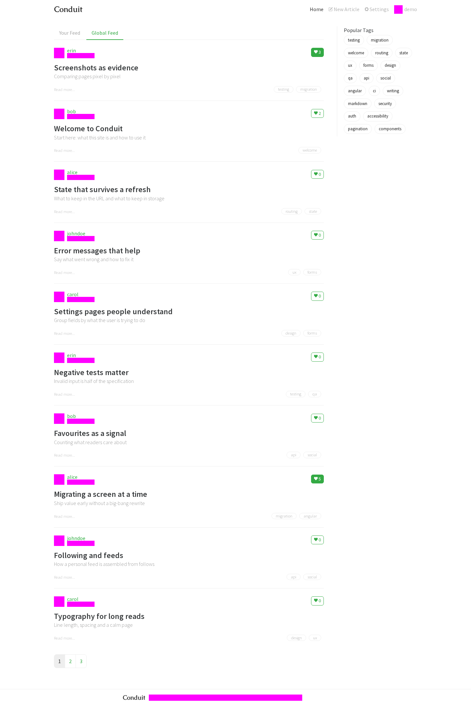 | 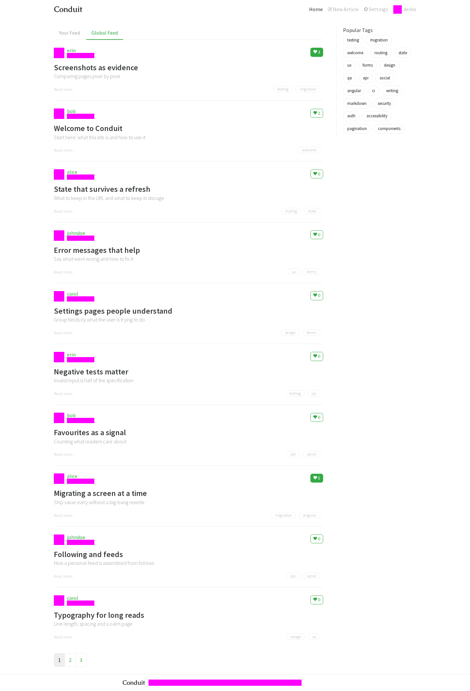 | 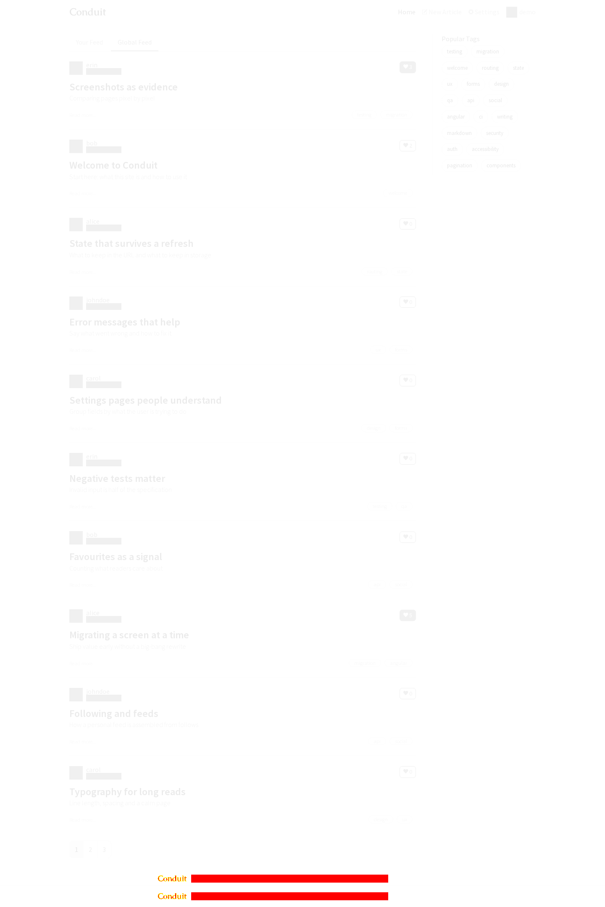 |

API calls (PASS):

| #   | Angular                                                   | React                                                     |
| --- | --------------------------------------------------------- | --------------------------------------------------------- |
| 1   | `GET /user → 200`                                         | `GET /user → 200`                                         |
| 2   | `GET /articles/getting-started-with-reactive-forms → 200` | `GET /articles/getting-started-with-reactive-forms → 200` |
| 3   | `GET /user → 200`                                         | `GET /user → 200`                                         |
| 4   | `GET /articles?limit=10&offset=0 → 200`                   | `GET /articles?limit=10&offset=0 → 200`                   |
| 5   | `GET /tags → 200`                                         | `GET /tags → 200`                                         |

Functional observations (PASS):

| Key                | Angular                                                                                                                                                                                                                                                                                                                                                                                                                                                                                                                                                                  | React                                                                                                                                                                                                                                                                                                                                                                                                                                                                                                                                                                    |
| ------------------ | ------------------------------------------------------------------------------------------------------------------------------------------------------------------------------------------------------------------------------------------------------------------------------------------------------------------------------------------------------------------------------------------------------------------------------------------------------------------------------------------------------------------------------------------------------------------------ | ------------------------------------------------------------------------------------------------------------------------------------------------------------------------------------------------------------------------------------------------------------------------------------------------------------------------------------------------------------------------------------------------------------------------------------------------------------------------------------------------------------------------------------------------------------------------ |
| url after redirect | `"/"`                                                                                                                                                                                                                                                                                                                                                                                                                                                                                                                                                                    | `"/"`                                                                                                                                                                                                                                                                                                                                                                                                                                                                                                                                                                    |
| editor present     | `0`                                                                                                                                                                                                                                                                                                                                                                                                                                                                                                                                                                      | `0`                                                                                                                                                                                                                                                                                                                                                                                                                                                                                                                                                                      |
| backend article    | `{"slug":"getting-started-with-reactive-forms","title":"Getting started with reactive forms","description":"A short tour of form state, validation and submission","body":"## Getting started with reactive forms\n\nA short tour of form state, validation and submission.\n\nThis article is part of the seeded demo data. It has **bold text**, a list and a link:\n\n- First point about forms\n- Second point about angular\n\nRead more on [the RealWorld project](https://github.com/realworld-apps/realworld).","tagList":["forms","angular"],"author":"alice"}` | `{"slug":"getting-started-with-reactive-forms","title":"Getting started with reactive forms","description":"A short tour of form state, validation and submission","body":"## Getting started with reactive forms\n\nA short tour of form state, validation and submission.\n\nThis article is part of the seeded demo data. It has **bold text**, a list and a link:\n\n- First point about forms\n- Second point about angular\n\nRead more on [the RealWorld project](https://github.com/realworld-apps/realworld).","tagList":["forms","angular"],"author":"alice"}` |

## signed out editor redirects to login

React journey video: [video/signed-out-editor-redirects-to-login--react.webm](video/signed-out-editor-redirects-to-login--react.webm)

| State | Diff | Angular | React | Diff image |
| ----- | ---- | ------- | ----- | ---------- |

API calls (PASS):

| #   | Angular | React |
| --- | ------- | ----- |

Functional observations (PASS):

| Key                | Angular    | React      |
| ------------------ | ---------- | ---------- |
| url after redirect | `"/login"` | `"/login"` |
| editor present     | `0`        | `0`        |

## Deviations

## Status after integration (parent session, full suite run 2026-11-12 17:31Z)

Resolved. In the full parity run on the integration branch, with every package merged, all journeys for this screen pass every check (see `evidence/parity-results.md`). The notes below are what the child session recorded on its own branch, before the packages it depended on were merged. They are kept as the audit trail.

---

No failing checks. Notes:

- **Signed-out journey has no screenshot.** It ends on `/login`, which is still a stub in React (work package `auth`), so it observes the URL and the absence of the editor only.
- **Fixed during the run, not by this package:** on the first runs every editor screen differed by 1.40% because the theme's sticky-footer rules target Angular's `<app-root>`, not React's `#root`. The integration branch now carries the fix in `react-app/src/app.css` (merged from another package); this branch takes that version unchanged.
- **Fixed by merging the integration branch:** before `wp/article` was merged, the create and edit journeys differed only in the two calls Angular's Article page makes after Publish (`GET /articles/<slug>`, `GET /articles/<slug>/comments`). With the Article page merged they match.
