# Parity report: home

Angular (http://localhost:4200) vs React (http://localhost:5173), same seeded mock API reset before each run, viewport 1440×900, dates/avatars masked in magenta. Visual pass threshold: ≤1% differing pixels (pixelmatch, threshold 0.1).

| Journey                                     | No errors | Same states | Visual | API calls + payloads | Functional | Max diff | Result   |
| ------------------------------------------- | --------- | ----------- | ------ | -------------------- | ---------- | -------- | -------- |
| click a sidebar tag                         | PASS      | PASS        | PASS   | PASS                 | PASS       | 0.020%   | **PASS** |
| global feed signed out                      | PASS      | PASS        | PASS   | PASS                 | PASS       | 0.000%   | **PASS** |
| go to page 2                                | PASS      | PASS        | PASS   | PASS                 | PASS       | 0.000%   | **PASS** |
| signed-in your feed (demo)                  | PASS      | PASS        | PASS   | PASS                 | PASS       | 0.003%   | **PASS** |
| signed-out your feed url redirects to login | PASS      | PASS        | PASS   | PASS                 | PASS       | 0.000%   | **PASS** |
| tag url loaded directly                     | PASS      | PASS        | PASS   | PASS                 | PASS       | 0.000%   | **PASS** |

## click a sidebar tag

React journey video: [video/click-a-sidebar-tag--react.webm](video/click-a-sidebar-tag--react.webm)

| State               | Diff        | Angular                                                            | React                                                            | Diff image                                                    |
| ------------------- | ----------- | ------------------------------------------------------------------ | ---------------------------------------------------------------- | ------------------------------------------------------------- |
| tag-testing         | 0.000% PASS |          | 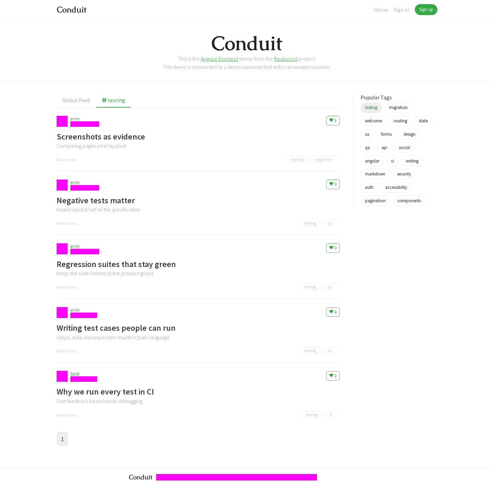         | 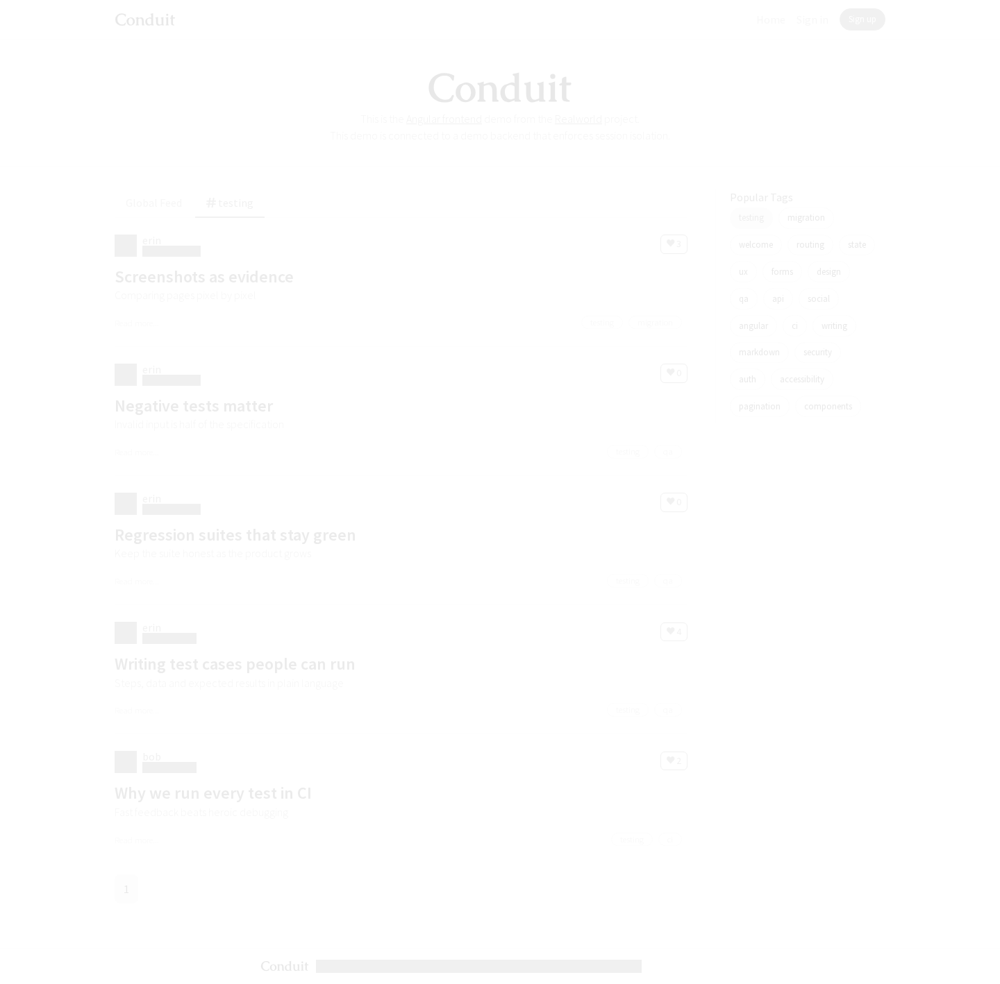         |
| back-to-global-feed | 0.020% PASS | 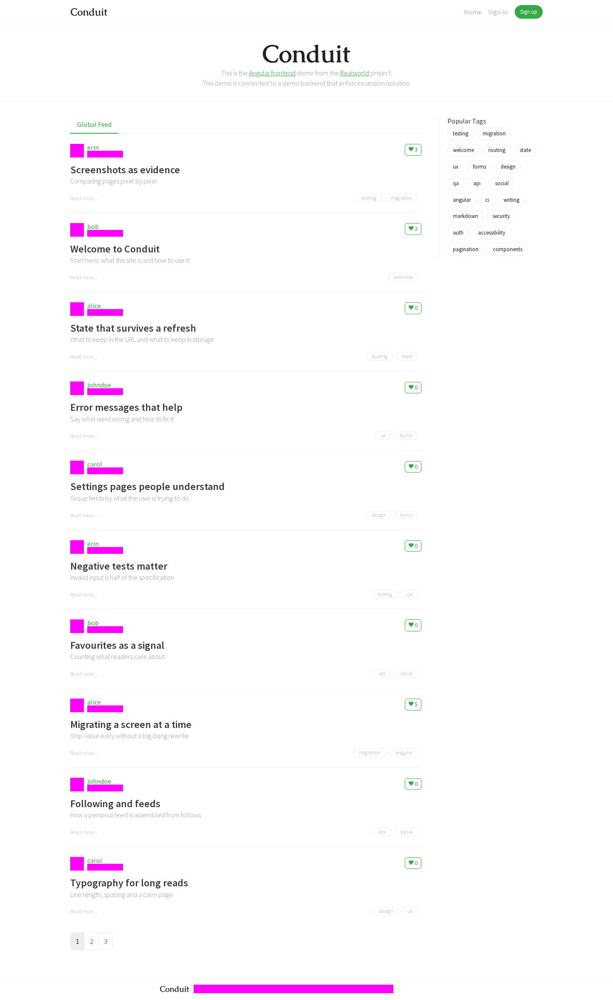 | 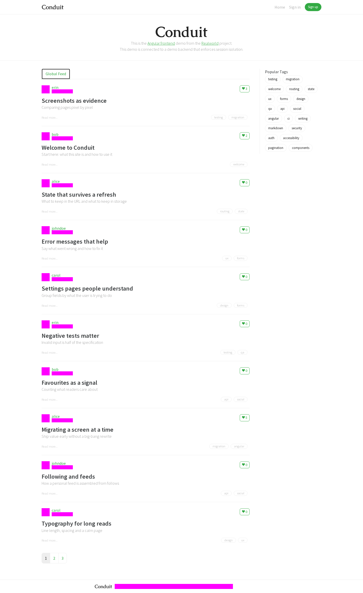 | 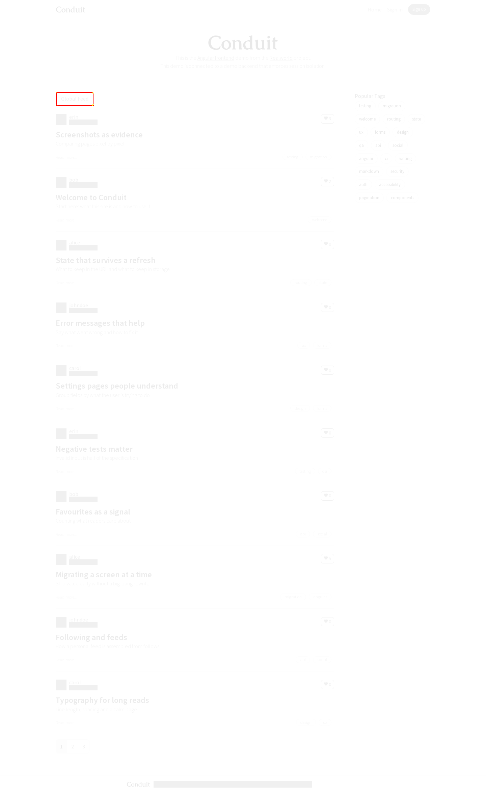 |

API calls (PASS):

| #   | Angular                                             | React                                               |
| --- | --------------------------------------------------- | --------------------------------------------------- |
| 1   | `GET /articles?limit=10&offset=0 → 200`             | `GET /articles?limit=10&offset=0 → 200`             |
| 2   | `GET /tags → 200`                                   | `GET /tags → 200`                                   |
| 3   | `GET /articles?limit=10&offset=0&tag=testing → 200` | `GET /articles?limit=10&offset=0&tag=testing → 200` |
| 4   | `GET /tags → 200`                                   | `GET /tags → 200`                                   |
| 5   | `GET /articles?limit=10&offset=0 → 200`             | `GET /articles?limit=10&offset=0 → 200`             |
| 6   | `GET /tags → 200`                                   | `GET /tags → 200`                                   |

Functional observations (PASS):

| Key                    | Angular                                                                                                                                                                                                                                                                            | React                                                                                                                                                                                                                                                                              |
| ---------------------- | ---------------------------------------------------------------------------------------------------------------------------------------------------------------------------------------------------------------------------------------------------------------------------------- | ---------------------------------------------------------------------------------------------------------------------------------------------------------------------------------------------------------------------------------------------------------------------------------- |
| tag.url                | `"/tag/testing"`                                                                                                                                                                                                                                                                   | `"/tag/testing"`                                                                                                                                                                                                                                                                   |
| tag.bannerVisible      | `true`                                                                                                                                                                                                                                                                             | `true`                                                                                                                                                                                                                                                                             |
| tag.tabs               | `[{"text":"Global Feed","active":false},{"text":"testing","active":true}]`                                                                                                                                                                                                         | `[{"text":"Global Feed","active":false},{"text":"testing","active":true}]`                                                                                                                                                                                                         |
| tag.titles             | `["Screenshots as evidence","Negative tests matter","Regression suites that stay green","Writing test cases people can run","Why we run every test in CI"]`                                                                                                                        | `["Screenshots as evidence","Negative tests matter","Regression suites that stay green","Writing test cases people can run","Why we run every test in CI"]`                                                                                                                        |
| tag.emptyMessage       | `[]`                                                                                                                                                                                                                                                                               | `[]`                                                                                                                                                                                                                                                                               |
| tag.pages              | `["1"]`                                                                                                                                                                                                                                                                            | `["1"]`                                                                                                                                                                                                                                                                            |
| tag.activePage         | `["1"]`                                                                                                                                                                                                                                                                            | `["1"]`                                                                                                                                                                                                                                                                            |
| tag.tags               | `["testing","migration","welcome","routing","state","ux","forms","design","qa","api","social","angular","ci","writing","markdown","security","auth","accessibility","pagination","components"]`                                                                                    | `["testing","migration","welcome","routing","state","ux","forms","design","qa","api","social","angular","ci","writing","markdown","security","auth","accessibility","pagination","components"]`                                                                                    |
| tag.sidebarMessages    | `[]`                                                                                                                                                                                                                                                                               | `[]`                                                                                                                                                                                                                                                                               |
| backend.tagTitles      | `["Screenshots as evidence","Negative tests matter","Regression suites that stay green","Writing test cases people can run","Why we run every test in CI"]`                                                                                                                        | `["Screenshots as evidence","Negative tests matter","Regression suites that stay green","Writing test cases people can run","Why we run every test in CI"]`                                                                                                                        |
| global.url             | `"/"`                                                                                                                                                                                                                                                                              | `"/"`                                                                                                                                                                                                                                                                              |
| global.bannerVisible   | `true`                                                                                                                                                                                                                                                                             | `true`                                                                                                                                                                                                                                                                             |
| global.tabs            | `[{"text":"Global Feed","active":true}]`                                                                                                                                                                                                                                           | `[{"text":"Global Feed","active":true}]`                                                                                                                                                                                                                                           |
| global.titles          | `["Screenshots as evidence","Welcome to Conduit","State that survives a refresh","Error messages that help","Settings pages people understand","Negative tests matter","Favourites as a signal","Migrating a screen at a time","Following and feeds","Typography for long reads"]` | `["Screenshots as evidence","Welcome to Conduit","State that survives a refresh","Error messages that help","Settings pages people understand","Negative tests matter","Favourites as a signal","Migrating a screen at a time","Following and feeds","Typography for long reads"]` |
| global.emptyMessage    | `[]`                                                                                                                                                                                                                                                                               | `[]`                                                                                                                                                                                                                                                                               |
| global.pages           | `["1","2","3"]`                                                                                                                                                                                                                                                                    | `["1","2","3"]`                                                                                                                                                                                                                                                                    |
| global.activePage      | `["1"]`                                                                                                                                                                                                                                                                            | `["1"]`                                                                                                                                                                                                                                                                            |
| global.tags            | `["testing","migration","welcome","routing","state","ux","forms","design","qa","api","social","angular","ci","writing","markdown","security","auth","accessibility","pagination","components"]`                                                                                    | `["testing","migration","welcome","routing","state","ux","forms","design","qa","api","social","angular","ci","writing","markdown","security","auth","accessibility","pagination","components"]`                                                                                    |
| global.sidebarMessages | `[]`                                                                                                                                                                                                                                                                               | `[]`                                                                                                                                                                                                                                                                               |

## global feed signed out

React journey video: [video/global-feed-signed-out--react.webm](video/global-feed-signed-out--react.webm)

| State       | Diff        | Angular                                                       | React                                                       | Diff image                                               |
| ----------- | ----------- | ------------------------------------------------------------- | ----------------------------------------------------------- | -------------------------------------------------------- |
| global-feed | 0.000% PASS |  |  | 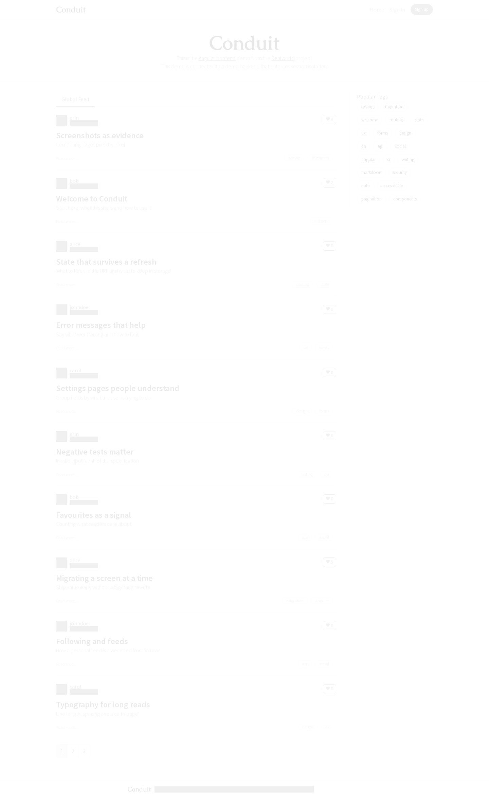 |

API calls (PASS):

| #   | Angular                                 | React                                   |
| --- | --------------------------------------- | --------------------------------------- |
| 1   | `GET /articles?limit=10&offset=0 → 200` | `GET /articles?limit=10&offset=0 → 200` |
| 2   | `GET /tags → 200`                       | `GET /tags → 200`                       |

Functional observations (PASS):

| Key                     | Angular                                                                                                                                                                                                                                                                            | React                                                                                                                                                                                                                                                                              |
| ----------------------- | ---------------------------------------------------------------------------------------------------------------------------------------------------------------------------------------------------------------------------------------------------------------------------------- | ---------------------------------------------------------------------------------------------------------------------------------------------------------------------------------------------------------------------------------------------------------------------------------- |
| global.url              | `"/"`                                                                                                                                                                                                                                                                              | `"/"`                                                                                                                                                                                                                                                                              |
| global.bannerVisible    | `true`                                                                                                                                                                                                                                                                             | `true`                                                                                                                                                                                                                                                                             |
| global.tabs             | `[{"text":"Global Feed","active":true}]`                                                                                                                                                                                                                                           | `[{"text":"Global Feed","active":true}]`                                                                                                                                                                                                                                           |
| global.titles           | `["Screenshots as evidence","Welcome to Conduit","State that survives a refresh","Error messages that help","Settings pages people understand","Negative tests matter","Favourites as a signal","Migrating a screen at a time","Following and feeds","Typography for long reads"]` | `["Screenshots as evidence","Welcome to Conduit","State that survives a refresh","Error messages that help","Settings pages people understand","Negative tests matter","Favourites as a signal","Migrating a screen at a time","Following and feeds","Typography for long reads"]` |
| global.emptyMessage     | `[]`                                                                                                                                                                                                                                                                               | `[]`                                                                                                                                                                                                                                                                               |
| global.pages            | `["1","2","3"]`                                                                                                                                                                                                                                                                    | `["1","2","3"]`                                                                                                                                                                                                                                                                    |
| global.activePage       | `["1"]`                                                                                                                                                                                                                                                                            | `["1"]`                                                                                                                                                                                                                                                                            |
| global.tags             | `["testing","migration","welcome","routing","state","ux","forms","design","qa","api","social","angular","ci","writing","markdown","security","auth","accessibility","pagination","components"]`                                                                                    | `["testing","migration","welcome","routing","state","ux","forms","design","qa","api","social","angular","ci","writing","markdown","security","auth","accessibility","pagination","components"]`                                                                                    |
| global.sidebarMessages  | `[]`                                                                                                                                                                                                                                                                               | `[]`                                                                                                                                                                                                                                                                               |
| global.yourFeedTabCount | `0`                                                                                                                                                                                                                                                                                | `0`                                                                                                                                                                                                                                                                                |
| backend.titles          | `["Screenshots as evidence","Welcome to Conduit","State that survives a refresh","Error messages that help","Settings pages people understand","Negative tests matter","Favourites as a signal","Migrating a screen at a time","Following and feeds","Typography for long reads"]` | `["Screenshots as evidence","Welcome to Conduit","State that survives a refresh","Error messages that help","Settings pages people understand","Negative tests matter","Favourites as a signal","Migrating a screen at a time","Following and feeds","Typography for long reads"]` |
| backend.articlesCount   | `22`                                                                                                                                                                                                                                                                               | `22`                                                                                                                                                                                                                                                                               |

## go to page 2

React journey video: [video/go-to-page-2--react.webm](video/go-to-page-2--react.webm)

| State          | Diff        | Angular                                                | React                                                | Diff image                                        |
| -------------- | ----------- | ------------------------------------------------------ | ---------------------------------------------------- | ------------------------------------------------- |
| page-2         | 0.000% PASS |          | 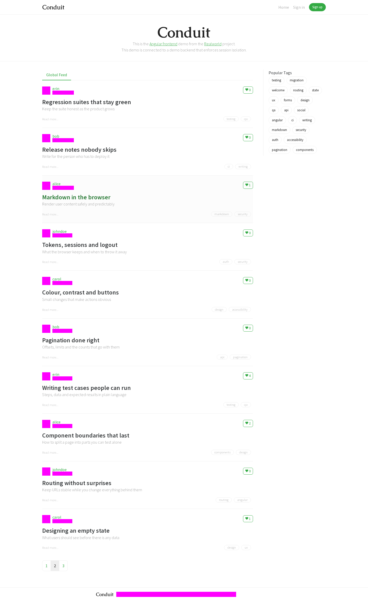         | 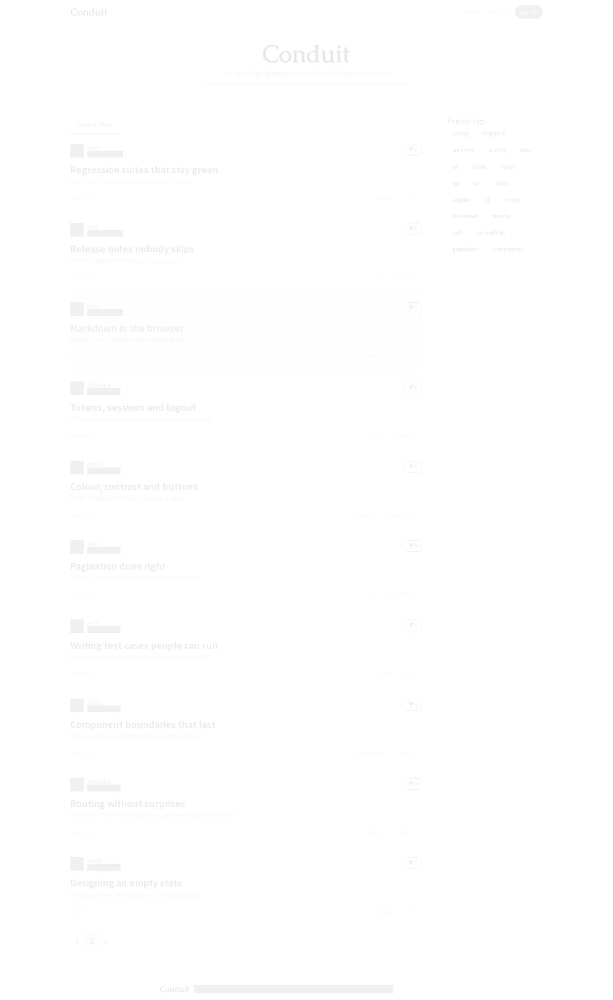         |
| back-to-page-1 | 0.000% PASS | 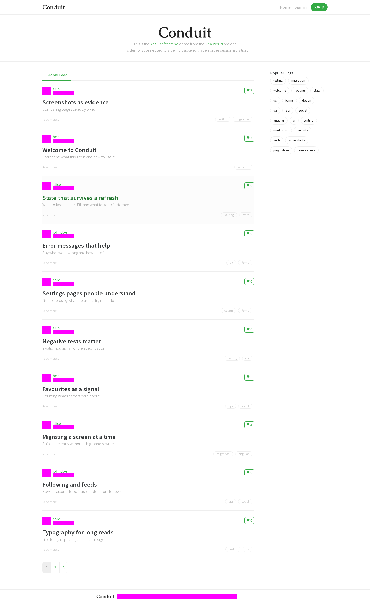 |  | 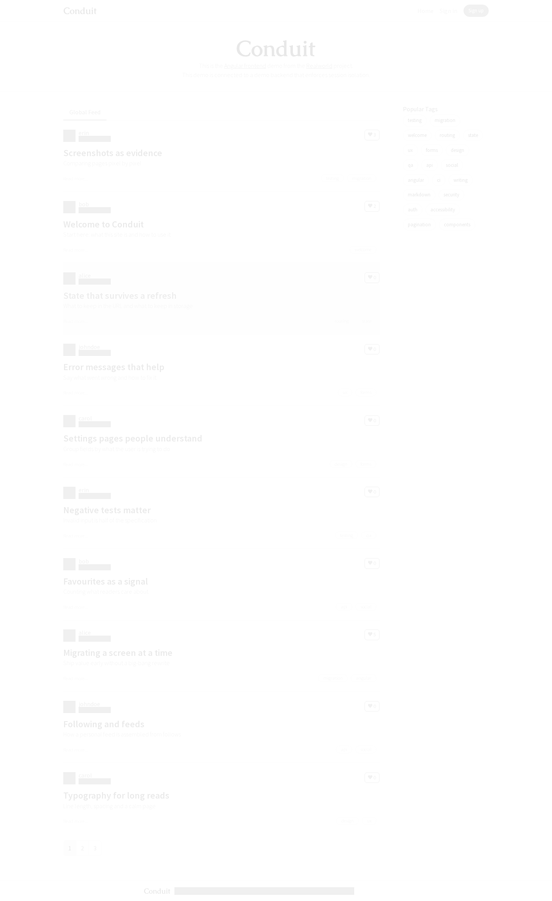 |

API calls (PASS):

| #   | Angular                                  | React                                    |
| --- | ---------------------------------------- | ---------------------------------------- |
| 1   | `GET /articles?limit=10&offset=0 → 200`  | `GET /articles?limit=10&offset=0 → 200`  |
| 2   | `GET /tags → 200`                        | `GET /tags → 200`                        |
| 3   | `GET /articles?limit=10&offset=10 → 200` | `GET /articles?limit=10&offset=10 → 200` |
| 4   | `GET /articles?limit=10&offset=10 → 200` | `GET /articles?limit=10&offset=10 → 200` |
| 5   | `GET /articles?limit=10&offset=0 → 200`  | `GET /articles?limit=10&offset=0 → 200`  |
| 6   | `GET /articles?limit=10&offset=0 → 200`  | `GET /articles?limit=10&offset=0 → 200`  |

Functional observations (PASS):

| Key                   | Angular                                                                                                                                                                                                                                                                                                         | React                                                                                                                                                                                                                                                                                                           |
| --------------------- | --------------------------------------------------------------------------------------------------------------------------------------------------------------------------------------------------------------------------------------------------------------------------------------------------------------- | --------------------------------------------------------------------------------------------------------------------------------------------------------------------------------------------------------------------------------------------------------------------------------------------------------------- |
| page2.url             | `"/?page=2"`                                                                                                                                                                                                                                                                                                    | `"/?page=2"`                                                                                                                                                                                                                                                                                                    |
| page2.bannerVisible   | `true`                                                                                                                                                                                                                                                                                                          | `true`                                                                                                                                                                                                                                                                                                          |
| page2.tabs            | `[{"text":"Global Feed","active":true}]`                                                                                                                                                                                                                                                                        | `[{"text":"Global Feed","active":true}]`                                                                                                                                                                                                                                                                        |
| page2.titles          | `["Regression suites that stay green","Release notes nobody skips","Markdown in the browser","Tokens, sessions and logout","Colour, contrast and buttons","Pagination done right","Writing test cases people can run","Component boundaries that last","Routing without surprises","Designing an empty state"]` | `["Regression suites that stay green","Release notes nobody skips","Markdown in the browser","Tokens, sessions and logout","Colour, contrast and buttons","Pagination done right","Writing test cases people can run","Component boundaries that last","Routing without surprises","Designing an empty state"]` |
| page2.emptyMessage    | `[]`                                                                                                                                                                                                                                                                                                            | `[]`                                                                                                                                                                                                                                                                                                            |
| page2.pages           | `["1","2","3"]`                                                                                                                                                                                                                                                                                                 | `["1","2","3"]`                                                                                                                                                                                                                                                                                                 |
| page2.activePage      | `["2"]`                                                                                                                                                                                                                                                                                                         | `["2"]`                                                                                                                                                                                                                                                                                                         |
| page2.tags            | `["testing","migration","welcome","routing","state","ux","forms","design","qa","api","social","angular","ci","writing","markdown","security","auth","accessibility","pagination","components"]`                                                                                                                 | `["testing","migration","welcome","routing","state","ux","forms","design","qa","api","social","angular","ci","writing","markdown","security","auth","accessibility","pagination","components"]`                                                                                                                 |
| page2.sidebarMessages | `[]`                                                                                                                                                                                                                                                                                                            | `[]`                                                                                                                                                                                                                                                                                                            |
| backend.page2Titles   | `["Regression suites that stay green","Release notes nobody skips","Markdown in the browser","Tokens, sessions and logout","Colour, contrast and buttons","Pagination done right","Writing test cases people can run","Component boundaries that last","Routing without surprises","Designing an empty state"]` | `["Regression suites that stay green","Release notes nobody skips","Markdown in the browser","Tokens, sessions and logout","Colour, contrast and buttons","Pagination done right","Writing test cases people can run","Component boundaries that last","Routing without surprises","Designing an empty state"]` |
| page1.url             | `"/"`                                                                                                                                                                                                                                                                                                           | `"/"`                                                                                                                                                                                                                                                                                                           |
| page1.bannerVisible   | `true`                                                                                                                                                                                                                                                                                                          | `true`                                                                                                                                                                                                                                                                                                          |
| page1.tabs            | `[{"text":"Global Feed","active":true}]`                                                                                                                                                                                                                                                                        | `[{"text":"Global Feed","active":true}]`                                                                                                                                                                                                                                                                        |
| page1.titles          | `["Screenshots as evidence","Welcome to Conduit","State that survives a refresh","Error messages that help","Settings pages people understand","Negative tests matter","Favourites as a signal","Migrating a screen at a time","Following and feeds","Typography for long reads"]`                              | `["Screenshots as evidence","Welcome to Conduit","State that survives a refresh","Error messages that help","Settings pages people understand","Negative tests matter","Favourites as a signal","Migrating a screen at a time","Following and feeds","Typography for long reads"]`                              |
| page1.emptyMessage    | `[]`                                                                                                                                                                                                                                                                                                            | `[]`                                                                                                                                                                                                                                                                                                            |
| page1.pages           | `["1","2","3"]`                                                                                                                                                                                                                                                                                                 | `["1","2","3"]`                                                                                                                                                                                                                                                                                                 |
| page1.activePage      | `["1"]`                                                                                                                                                                                                                                                                                                         | `["1"]`                                                                                                                                                                                                                                                                                                         |
| page1.tags            | `["testing","migration","welcome","routing","state","ux","forms","design","qa","api","social","angular","ci","writing","markdown","security","auth","accessibility","pagination","components"]`                                                                                                                 | `["testing","migration","welcome","routing","state","ux","forms","design","qa","api","social","angular","ci","writing","markdown","security","auth","accessibility","pagination","components"]`                                                                                                                 |
| page1.sidebarMessages | `[]`                                                                                                                                                                                                                                                                                                            | `[]`                                                                                                                                                                                                                                                                                                            |

## signed-in your feed (demo)

React journey video: [video/signed-in-your-feed-demo--react.webm](video/signed-in-your-feed-demo--react.webm)

| State                 | Diff        | Angular                                                                   | React                                                                   | Diff image                                                           |
| --------------------- | ----------- | ------------------------------------------------------------------------- | ----------------------------------------------------------------------- | -------------------------------------------------------------------- |
| signed-in-global-feed | 0.000% PASS |  | 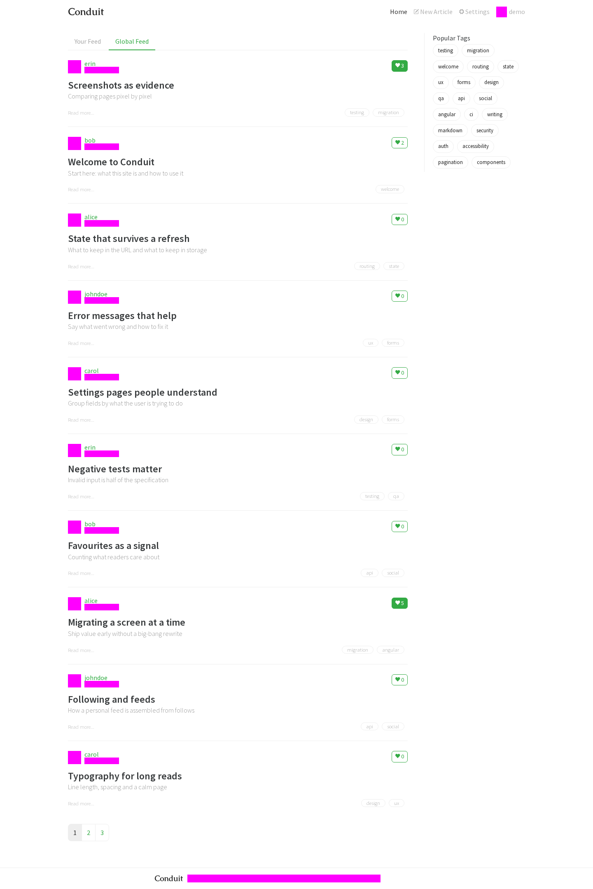 | 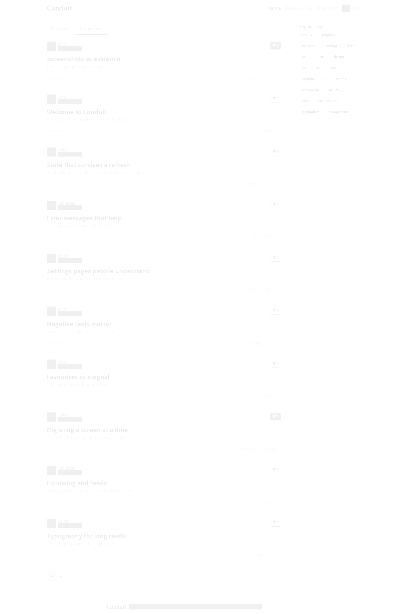 |
| your-feed             | 0.003% PASS | 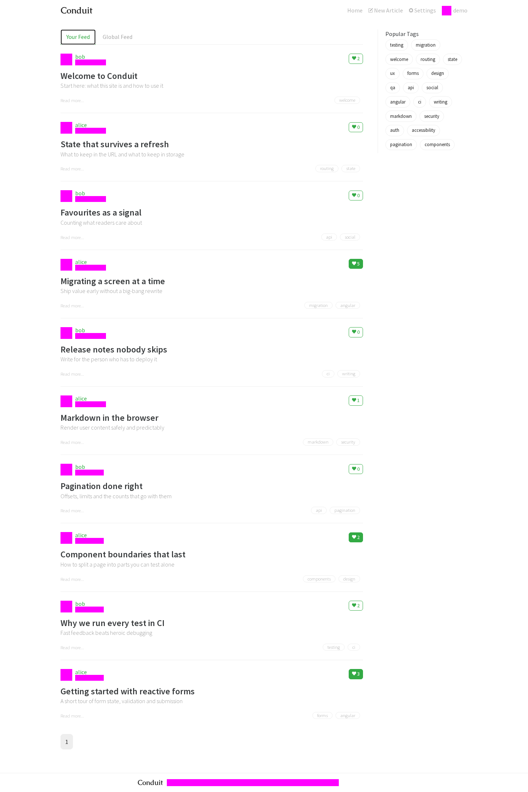             |              | 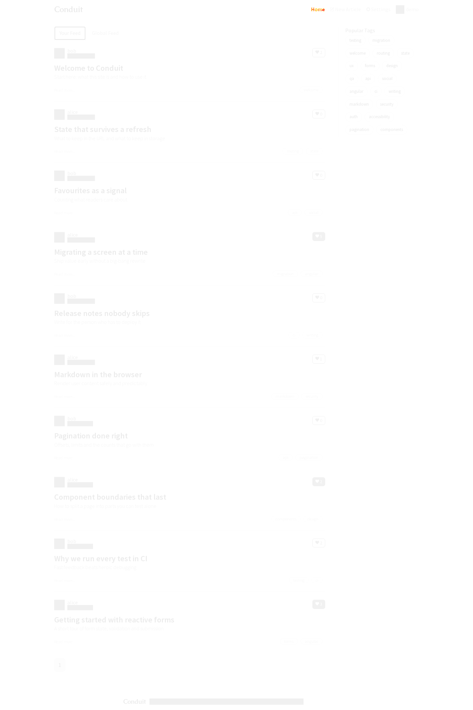             |

API calls (PASS):

| #   | Angular                                      | React                                        |
| --- | -------------------------------------------- | -------------------------------------------- |
| 1   | `GET /user → 200`                            | `GET /user → 200`                            |
| 2   | `GET /articles?limit=10&offset=0 → 200`      | `GET /articles?limit=10&offset=0 → 200`      |
| 3   | `GET /tags → 200`                            | `GET /tags → 200`                            |
| 4   | `GET /articles/feed?limit=10&offset=0 → 200` | `GET /articles/feed?limit=10&offset=0 → 200` |

Functional observations (PASS):

| Key                    | Angular                                                                                                                                                                                                                                                                                              | React                                                                                                                                                                                                                                                                                                |
| ---------------------- | ---------------------------------------------------------------------------------------------------------------------------------------------------------------------------------------------------------------------------------------------------------------------------------------------------- | ---------------------------------------------------------------------------------------------------------------------------------------------------------------------------------------------------------------------------------------------------------------------------------------------------- |
| global.url             | `"/"`                                                                                                                                                                                                                                                                                                | `"/"`                                                                                                                                                                                                                                                                                                |
| global.bannerVisible   | `false`                                                                                                                                                                                                                                                                                              | `false`                                                                                                                                                                                                                                                                                              |
| global.tabs            | `[{"text":"Your Feed","active":false},{"text":"Global Feed","active":true}]`                                                                                                                                                                                                                         | `[{"text":"Your Feed","active":false},{"text":"Global Feed","active":true}]`                                                                                                                                                                                                                         |
| global.titles          | `["Screenshots as evidence","Welcome to Conduit","State that survives a refresh","Error messages that help","Settings pages people understand","Negative tests matter","Favourites as a signal","Migrating a screen at a time","Following and feeds","Typography for long reads"]`                   | `["Screenshots as evidence","Welcome to Conduit","State that survives a refresh","Error messages that help","Settings pages people understand","Negative tests matter","Favourites as a signal","Migrating a screen at a time","Following and feeds","Typography for long reads"]`                   |
| global.emptyMessage    | `[]`                                                                                                                                                                                                                                                                                                 | `[]`                                                                                                                                                                                                                                                                                                 |
| global.pages           | `["1","2","3"]`                                                                                                                                                                                                                                                                                      | `["1","2","3"]`                                                                                                                                                                                                                                                                                      |
| global.activePage      | `["1"]`                                                                                                                                                                                                                                                                                              | `["1"]`                                                                                                                                                                                                                                                                                              |
| global.tags            | `["testing","migration","welcome","routing","state","ux","forms","design","qa","api","social","angular","ci","writing","markdown","security","auth","accessibility","pagination","components"]`                                                                                                      | `["testing","migration","welcome","routing","state","ux","forms","design","qa","api","social","angular","ci","writing","markdown","security","auth","accessibility","pagination","components"]`                                                                                                      |
| global.sidebarMessages | `[]`                                                                                                                                                                                                                                                                                                 | `[]`                                                                                                                                                                                                                                                                                                 |
| feed.url               | `"/?feed=following"`                                                                                                                                                                                                                                                                                 | `"/?feed=following"`                                                                                                                                                                                                                                                                                 |
| feed.bannerVisible     | `false`                                                                                                                                                                                                                                                                                              | `false`                                                                                                                                                                                                                                                                                              |
| feed.tabs              | `[{"text":"Your Feed","active":true},{"text":"Global Feed","active":false}]`                                                                                                                                                                                                                         | `[{"text":"Your Feed","active":true},{"text":"Global Feed","active":false}]`                                                                                                                                                                                                                         |
| feed.titles            | `["Welcome to Conduit","State that survives a refresh","Favourites as a signal","Migrating a screen at a time","Release notes nobody skips","Markdown in the browser","Pagination done right","Component boundaries that last","Why we run every test in CI","Getting started with reactive forms"]` | `["Welcome to Conduit","State that survives a refresh","Favourites as a signal","Migrating a screen at a time","Release notes nobody skips","Markdown in the browser","Pagination done right","Component boundaries that last","Why we run every test in CI","Getting started with reactive forms"]` |
| feed.emptyMessage      | `[]`                                                                                                                                                                                                                                                                                                 | `[]`                                                                                                                                                                                                                                                                                                 |
| feed.pages             | `["1"]`                                                                                                                                                                                                                                                                                              | `["1"]`                                                                                                                                                                                                                                                                                              |
| feed.activePage        | `["1"]`                                                                                                                                                                                                                                                                                              | `["1"]`                                                                                                                                                                                                                                                                                              |
| feed.tags              | `["testing","migration","welcome","routing","state","ux","forms","design","qa","api","social","angular","ci","writing","markdown","security","auth","accessibility","pagination","components"]`                                                                                                      | `["testing","migration","welcome","routing","state","ux","forms","design","qa","api","social","angular","ci","writing","markdown","security","auth","accessibility","pagination","components"]`                                                                                                      |
| feed.sidebarMessages   | `[]`                                                                                                                                                                                                                                                                                                 | `[]`                                                                                                                                                                                                                                                                                                 |
| backend.feedTitles     | `["Welcome to Conduit","State that survives a refresh","Favourites as a signal","Migrating a screen at a time","Release notes nobody skips","Markdown in the browser","Pagination done right","Component boundaries that last","Why we run every test in CI","Getting started with reactive forms"]` | `["Welcome to Conduit","State that survives a refresh","Favourites as a signal","Migrating a screen at a time","Release notes nobody skips","Markdown in the browser","Pagination done right","Component boundaries that last","Why we run every test in CI","Getting started with reactive forms"]` |
| backend.feedCount      | `10`                                                                                                                                                                                                                                                                                                 | `10`                                                                                                                                                                                                                                                                                                 |

## signed-out your feed url redirects to login

React journey video: [video/signed-out-your-feed-url-redirects-to-login--react.webm](video/signed-out-your-feed-url-redirects-to-login--react.webm)

| State | Diff | Angular | React | Diff image |
| ----- | ---- | ------- | ----- | ---------- |

API calls (PASS):

| #   | Angular                                 | React                                   |
| --- | --------------------------------------- | --------------------------------------- |
| 1   | `GET /articles?limit=10&offset=0 → 200` | `GET /articles?limit=10&offset=0 → 200` |
| 2   | `GET /tags → 200`                       | `GET /tags → 200`                       |

Functional observations (PASS):

| Key              | Angular    | React      |
| ---------------- | ---------- | ---------- |
| url              | `"/login"` | `"/login"` |
| yourFeedTabCount | `0`        | `0`        |

## tag url loaded directly

React journey video: [video/tag-url-loaded-directly--react.webm](video/tag-url-loaded-directly--react.webm)

| State      | Diff        | Angular                                                       | React                                                       | Diff image                                               |
| ---------- | ----------- | ------------------------------------------------------------- | ----------------------------------------------------------- | -------------------------------------------------------- |
| tag-design | 0.000% PASS |  | 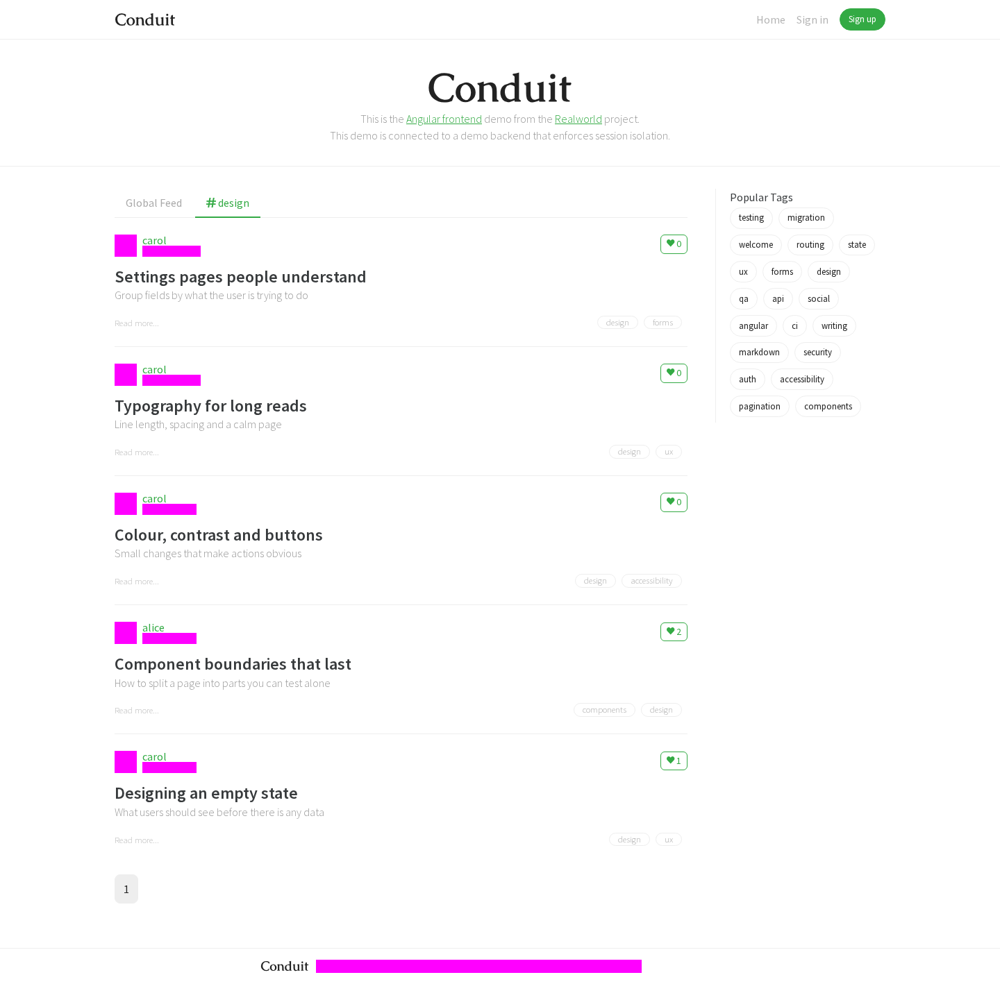 | 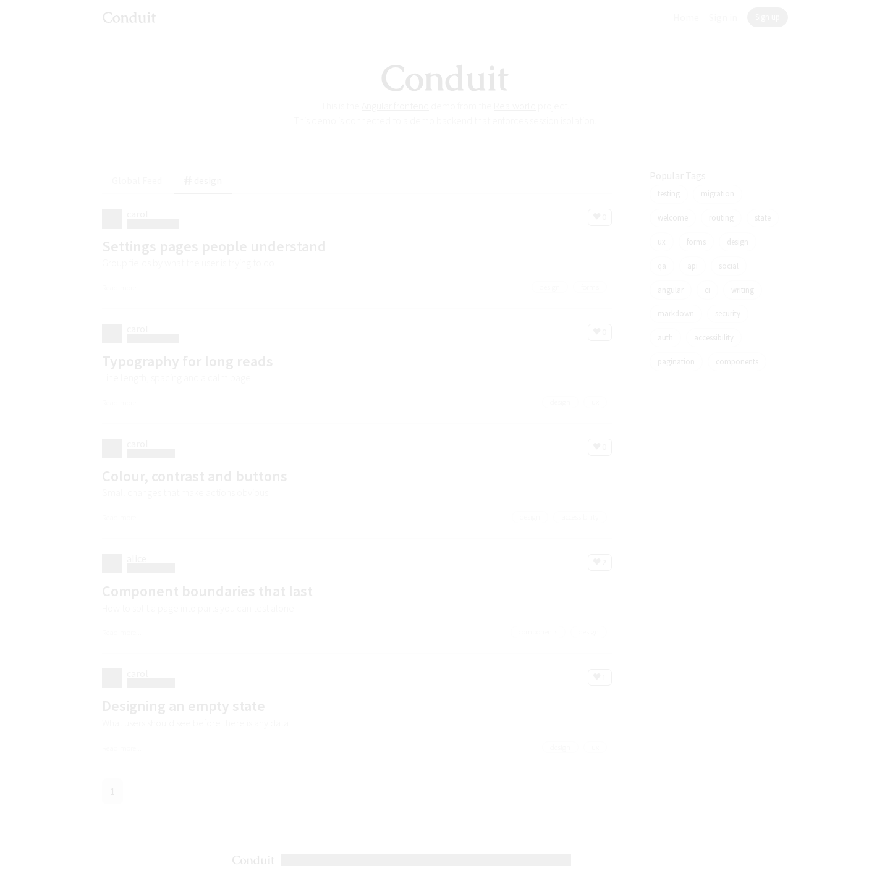 |
| tag-ux     | 0.000% PASS |      | 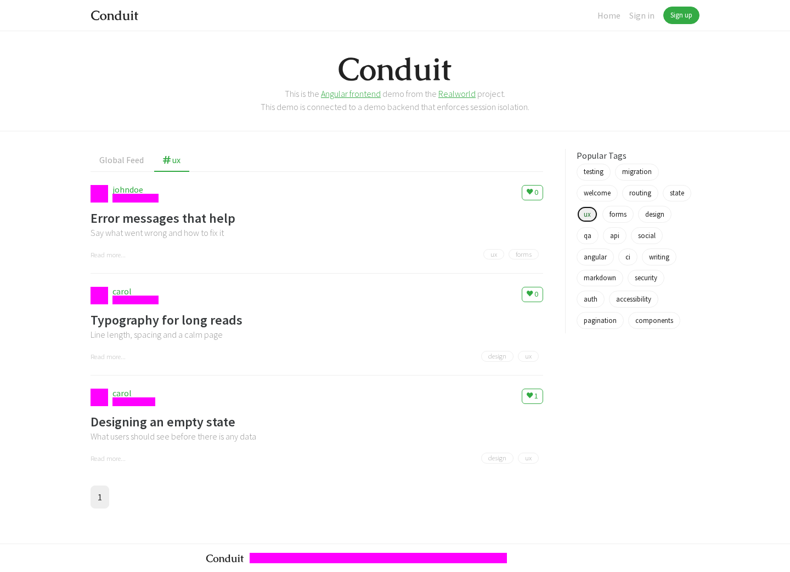     | 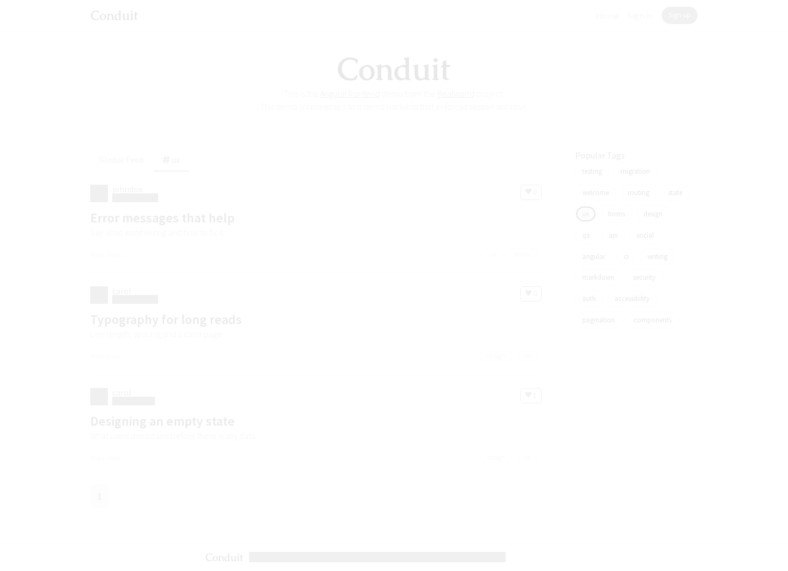     |

API calls (PASS):

| #   | Angular                                            | React                                              |
| --- | -------------------------------------------------- | -------------------------------------------------- |
| 1   | `GET /articles?limit=10&offset=0&tag=design → 200` | `GET /articles?limit=10&offset=0&tag=design → 200` |
| 2   | `GET /tags → 200`                                  | `GET /tags → 200`                                  |
| 3   | `GET /articles?limit=10&offset=0&tag=ux → 200`     | `GET /articles?limit=10&offset=0&tag=ux → 200`     |

Functional observations (PASS):

| Key                  | Angular                                                                                                                                                                                         | React                                                                                                                                                                                           |
| -------------------- | ----------------------------------------------------------------------------------------------------------------------------------------------------------------------------------------------- | ----------------------------------------------------------------------------------------------------------------------------------------------------------------------------------------------- |
| tag.url              | `"/tag/design"`                                                                                                                                                                                 | `"/tag/design"`                                                                                                                                                                                 |
| tag.bannerVisible    | `true`                                                                                                                                                                                          | `true`                                                                                                                                                                                          |
| tag.tabs             | `[{"text":"Global Feed","active":false},{"text":"design","active":true}]`                                                                                                                       | `[{"text":"Global Feed","active":false},{"text":"design","active":true}]`                                                                                                                       |
| tag.titles           | `["Settings pages people understand","Typography for long reads","Colour, contrast and buttons","Component boundaries that last","Designing an empty state"]`                                   | `["Settings pages people understand","Typography for long reads","Colour, contrast and buttons","Component boundaries that last","Designing an empty state"]`                                   |
| tag.emptyMessage     | `[]`                                                                                                                                                                                            | `[]`                                                                                                                                                                                            |
| tag.pages            | `["1"]`                                                                                                                                                                                         | `["1"]`                                                                                                                                                                                         |
| tag.activePage       | `["1"]`                                                                                                                                                                                         | `["1"]`                                                                                                                                                                                         |
| tag.tags             | `["testing","migration","welcome","routing","state","ux","forms","design","qa","api","social","angular","ci","writing","markdown","security","auth","accessibility","pagination","components"]` | `["testing","migration","welcome","routing","state","ux","forms","design","qa","api","social","angular","ci","writing","markdown","security","auth","accessibility","pagination","components"]` |
| tag.sidebarMessages  | `[]`                                                                                                                                                                                            | `[]`                                                                                                                                                                                            |
| backend.tagTitles    | `["Settings pages people understand","Typography for long reads","Colour, contrast and buttons","Component boundaries that last","Designing an empty state"]`                                   | `["Settings pages people understand","Typography for long reads","Colour, contrast and buttons","Component boundaries that last","Designing an empty state"]`                                   |
| tag2.url             | `"/tag/ux"`                                                                                                                                                                                     | `"/tag/ux"`                                                                                                                                                                                     |
| tag2.bannerVisible   | `true`                                                                                                                                                                                          | `true`                                                                                                                                                                                          |
| tag2.tabs            | `[{"text":"Global Feed","active":false},{"text":"ux","active":true}]`                                                                                                                           | `[{"text":"Global Feed","active":false},{"text":"ux","active":true}]`                                                                                                                           |
| tag2.titles          | `["Error messages that help","Typography for long reads","Designing an empty state"]`                                                                                                           | `["Error messages that help","Typography for long reads","Designing an empty state"]`                                                                                                           |
| tag2.emptyMessage    | `[]`                                                                                                                                                                                            | `[]`                                                                                                                                                                                            |
| tag2.pages           | `["1"]`                                                                                                                                                                                         | `["1"]`                                                                                                                                                                                         |
| tag2.activePage      | `["1"]`                                                                                                                                                                                         | `["1"]`                                                                                                                                                                                         |
| tag2.tags            | `["testing","migration","welcome","routing","state","ux","forms","design","qa","api","social","angular","ci","writing","markdown","security","auth","accessibility","pagination","components"]` | `["testing","migration","welcome","routing","state","ux","forms","design","qa","api","social","angular","ci","writing","markdown","security","auth","accessibility","pagination","components"]` |
| tag2.sidebarMessages | `[]`                                                                                                                                                                                            | `[]`                                                                                                                                                                                            |

## Deviations

_None recorded._
