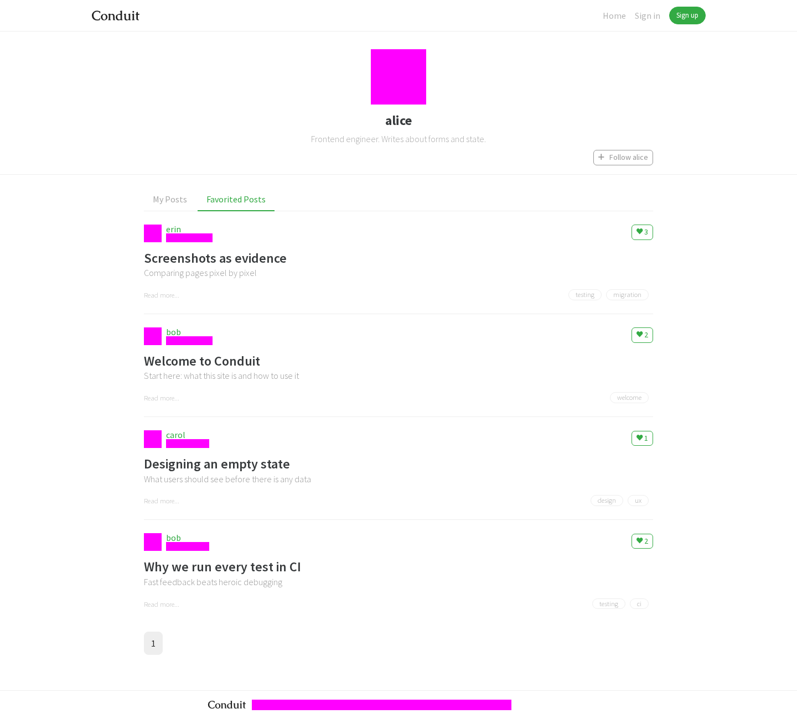
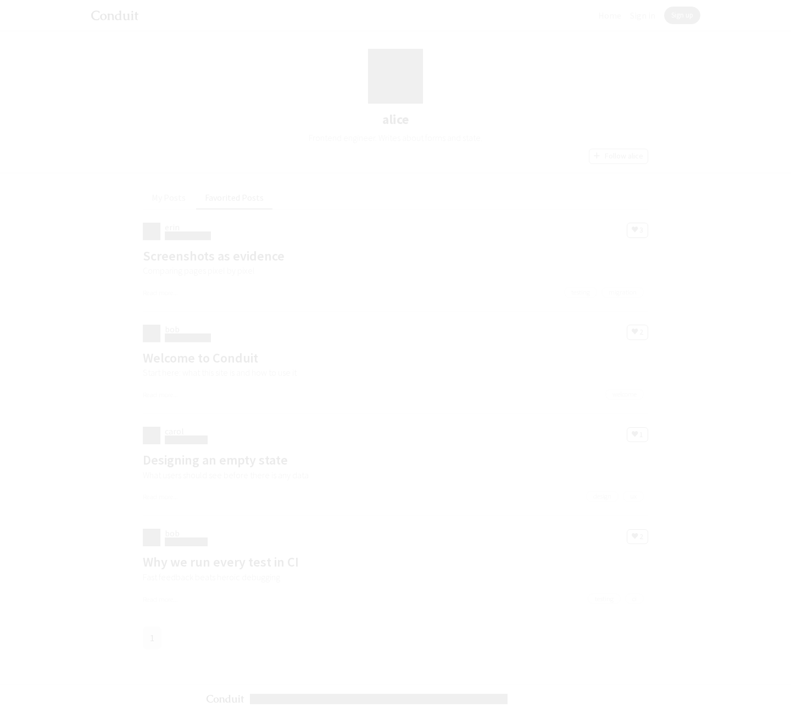
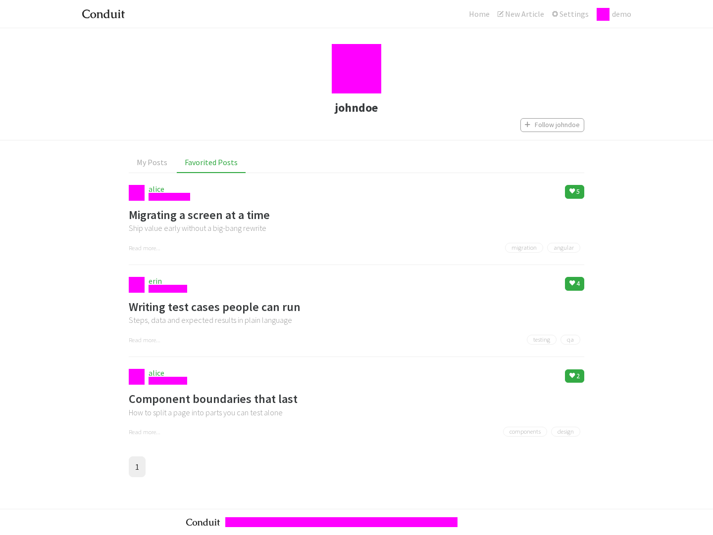
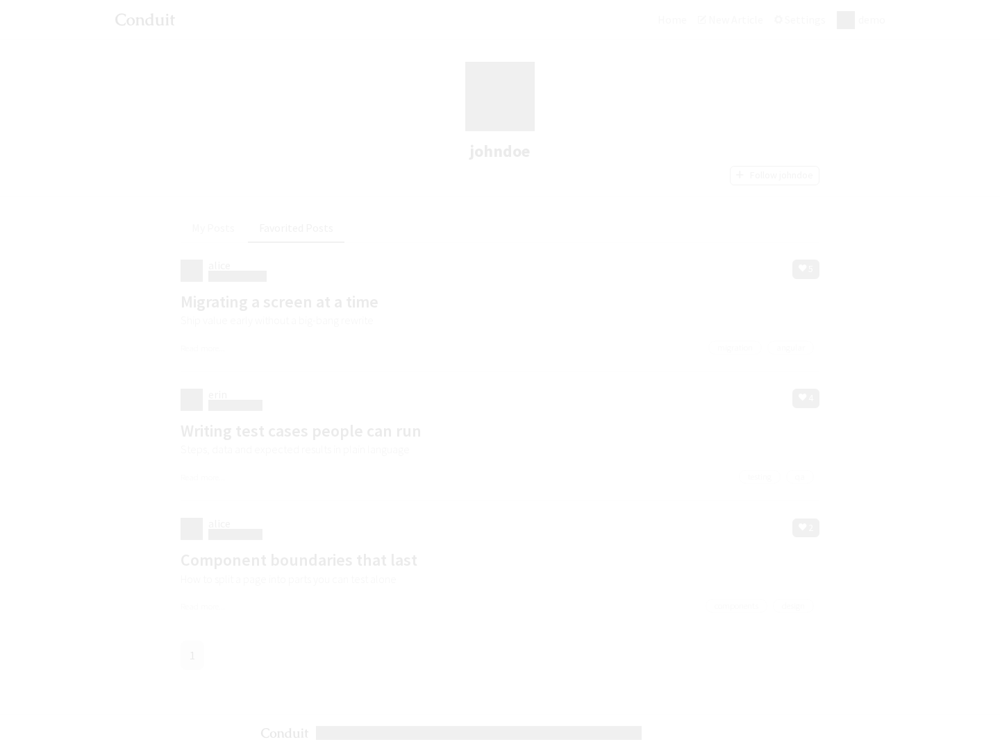
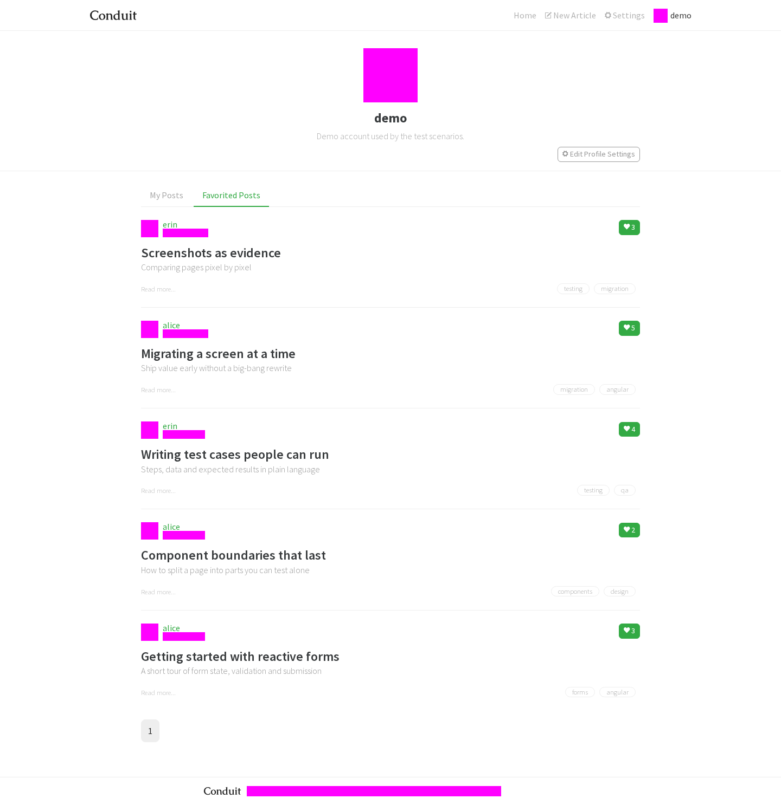
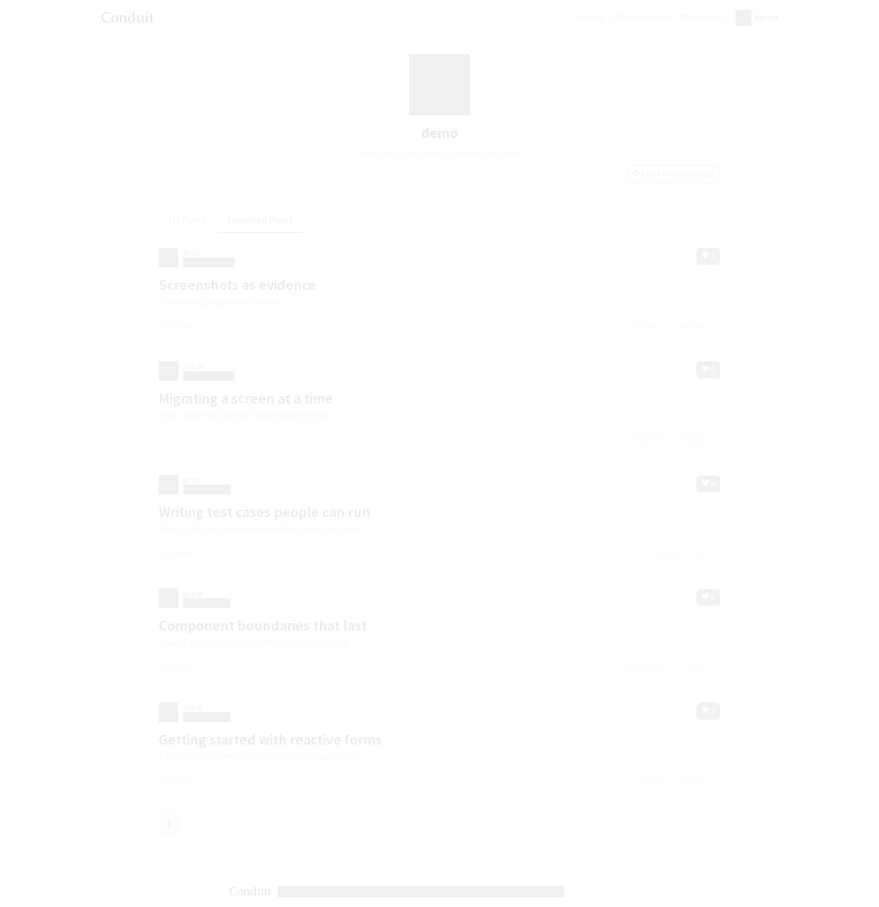

# Parity report: profile-favorites

Angular (http://localhost:4200) vs React (http://localhost:5173), same seeded mock API reset before each run, viewport 1440×900, dates/avatars masked in magenta. Visual pass threshold: ≤1% differing pixels (pixelmatch, threshold 0.1).

| Journey                      | No errors | Same states | Visual | API calls + payloads | Functional | Max diff | Result   |
| ---------------------------- | --------- | ----------- | ------ | -------------------- | ---------- | -------- | -------- |
| alice's favorites signed out | PASS      | PASS        | PASS   | PASS                 | PASS       | 0.000%   | **PASS** |
| johndoe favorites as demo    | PASS      | PASS        | PASS   | PASS                 | PASS       | 0.000%   | **PASS** |
| own favorites as demo        | PASS      | PASS        | PASS   | PASS                 | PASS       | 0.000%   | **PASS** |

## alice's favorites signed out

React journey video: [video/alice-s-favorites-signed-out--react.webm](video/alice-s-favorites-signed-out--react.webm)

| State                      | Diff        | Angular                                                                            | React                                                                            | Diff image                                                                    |
| -------------------------- | ----------- | ---------------------------------------------------------------------------------- | -------------------------------------------------------------------------------- | ----------------------------------------------------------------------------- |
| alice-favorites-signed-out | 0.000% PASS |  |  |  |

API calls (PASS):

| #   | Angular                                                 | React                                                   |
| --- | ------------------------------------------------------- | ------------------------------------------------------- |
| 1   | `GET /profiles/alice → 200`                             | `GET /profiles/alice → 200`                             |
| 2   | `GET /profiles/alice → 200`                             | `GET /profiles/alice → 200`                             |
| 3   | `GET /articles?favorited=alice&limit=10&offset=0 → 200` | `GET /articles?favorited=alice&limit=10&offset=0 → 200` |

Functional observations (PASS):

| Key                    | Angular                                                                                                                                   | React                                                                                                                                     |
| ---------------------- | ----------------------------------------------------------------------------------------------------------------------------------------- | ----------------------------------------------------------------------------------------------------------------------------------------- |
| alice.url              | `"/profile/alice/favorites"`                                                                                                              | `"/profile/alice/favorites"`                                                                                                              |
| alice.tabs             | `[{"text":"My Posts","href":"/profile/alice","active":false},{"text":"Favorited Posts","href":"/profile/alice/favorites","active":true}]` | `[{"text":"My Posts","href":"/profile/alice","active":false},{"text":"Favorited Posts","href":"/profile/alice/favorites","active":true}]` |
| alice.articleTitles    | `["Screenshots as evidence","Welcome to Conduit","Designing an empty state","Why we run every test in CI"]`                               | `["Screenshots as evidence","Welcome to Conduit","Designing an empty state","Why we run every test in CI"]`                               |
| alice.emptyMessage     | `[]`                                                                                                                                      | `[]`                                                                                                                                      |
| alice.pages            | `["1"]`                                                                                                                                   | `["1"]`                                                                                                                                   |
| backend.favoritedCount | `4`                                                                                                                                       | `4`                                                                                                                                       |

## johndoe favorites as demo

React journey video: [video/johndoe-favorites-as-demo--react.webm](video/johndoe-favorites-as-demo--react.webm)

| State             | Diff        | Angular                                                                | React                                                                | Diff image                                                        |
| ----------------- | ----------- | ---------------------------------------------------------------------- | -------------------------------------------------------------------- | ----------------------------------------------------------------- |
| johndoe-favorites | 0.000% PASS |  |  |  |

API calls (PASS):

| #   | Angular                                                   | React                                                     |
| --- | --------------------------------------------------------- | --------------------------------------------------------- |
| 1   | `GET /user → 200`                                         | `GET /user → 200`                                         |
| 2   | `GET /profiles/johndoe → 200`                             | `GET /profiles/johndoe → 200`                             |
| 3   | `GET /profiles/johndoe → 200`                             | `GET /profiles/johndoe → 200`                             |
| 4   | `GET /articles?favorited=johndoe&limit=10&offset=0 → 200` | `GET /articles?favorited=johndoe&limit=10&offset=0 → 200` |

Functional observations (PASS):

| Key                    | Angular                                                                                                                                       | React                                                                                                                                         |
| ---------------------- | --------------------------------------------------------------------------------------------------------------------------------------------- | --------------------------------------------------------------------------------------------------------------------------------------------- |
| johndoe.url            | `"/profile/johndoe/favorites"`                                                                                                                | `"/profile/johndoe/favorites"`                                                                                                                |
| johndoe.tabs           | `[{"text":"My Posts","href":"/profile/johndoe","active":false},{"text":"Favorited Posts","href":"/profile/johndoe/favorites","active":true}]` | `[{"text":"My Posts","href":"/profile/johndoe","active":false},{"text":"Favorited Posts","href":"/profile/johndoe/favorites","active":true}]` |
| johndoe.articleTitles  | `["Migrating a screen at a time","Writing test cases people can run","Component boundaries that last"]`                                       | `["Migrating a screen at a time","Writing test cases people can run","Component boundaries that last"]`                                       |
| johndoe.emptyMessage   | `[]`                                                                                                                                          | `[]`                                                                                                                                          |
| johndoe.pages          | `["1"]`                                                                                                                                       | `["1"]`                                                                                                                                       |
| backend.favoritedCount | `3`                                                                                                                                           | `3`                                                                                                                                           |

## own favorites as demo

React journey video: [video/own-favorites-as-demo--react.webm](video/own-favorites-as-demo--react.webm)

| State          | Diff        | Angular                                                         | React                                                         | Diff image                                                 |
| -------------- | ----------- | --------------------------------------------------------------- | ------------------------------------------------------------- | ---------------------------------------------------------- |
| demo-favorites | 0.000% PASS |  |  |  |

API calls (PASS):

| #   | Angular                                                | React                                                  |
| --- | ------------------------------------------------------ | ------------------------------------------------------ |
| 1   | `GET /user → 200`                                      | `GET /user → 200`                                      |
| 2   | `GET /profiles/demo → 200`                             | `GET /profiles/demo → 200`                             |
| 3   | `GET /profiles/demo → 200`                             | `GET /profiles/demo → 200`                             |
| 4   | `GET /articles?favorited=demo&limit=10&offset=0 → 200` | `GET /articles?favorited=demo&limit=10&offset=0 → 200` |

Functional observations (PASS):

| Key                    | Angular                                                                                                                                                                 | React                                                                                                                                                                   |
| ---------------------- | ----------------------------------------------------------------------------------------------------------------------------------------------------------------------- | ----------------------------------------------------------------------------------------------------------------------------------------------------------------------- |
| demo.url               | `"/profile/demo/favorites"`                                                                                                                                             | `"/profile/demo/favorites"`                                                                                                                                             |
| demo.tabs              | `[{"text":"My Posts","href":"/profile/demo","active":false},{"text":"Favorited Posts","href":"/profile/demo/favorites","active":true}]`                                 | `[{"text":"My Posts","href":"/profile/demo","active":false},{"text":"Favorited Posts","href":"/profile/demo/favorites","active":true}]`                                 |
| demo.articleTitles     | `["Screenshots as evidence","Migrating a screen at a time","Writing test cases people can run","Component boundaries that last","Getting started with reactive forms"]` | `["Screenshots as evidence","Migrating a screen at a time","Writing test cases people can run","Component boundaries that last","Getting started with reactive forms"]` |
| demo.emptyMessage      | `[]`                                                                                                                                                                    | `[]`                                                                                                                                                                    |
| demo.pages             | `["1"]`                                                                                                                                                                 | `["1"]`                                                                                                                                                                 |
| backend.favoritedCount | `5`                                                                                                                                                                     | `5`                                                                                                                                                                     |

## Deviations

_None recorded._
