# Parity report: profile

Angular (http://localhost:4200) vs React (http://localhost:5173), same seeded mock API reset before each run, viewport 1440×900, dates/avatars masked in magenta. Visual pass threshold: ≤1% differing pixels (pixelmatch, threshold 0.1).

| Journey                                                | No errors | Same states | Visual | API calls + payloads | Functional | Max diff | Result   |
| ------------------------------------------------------ | --------- | ----------- | ------ | -------------------- | ---------- | -------- | -------- |
| follow button signed out redirects to login            | PASS      | PASS        | PASS   | PASS                 | PASS       | 0.000%   | **PASS** |
| follow then unfollow alice as demo                     | PASS      | PASS        | PASS   | PASS                 | PASS       | 0.000%   | **PASS** |
| header Your profile link while viewing another profile | PASS      | PASS        | PASS   | PASS                 | PASS       | 0.000%   | **PASS** |
| own profile shows Edit Profile Settings                | PASS      | PASS        | PASS   | PASS                 | PASS       | 0.000%   | **PASS** |
| unknown username                                       | PASS      | PASS        | PASS   | PASS                 | PASS       | 0.000%   | **PASS** |
| user with no posts shows empty message                 | PASS      | PASS        | PASS   | PASS                 | PASS       | 0.000%   | **PASS** |
| view alice's profile signed out                        | PASS      | PASS        | PASS   | PASS                 | PASS       | 0.000%   | **PASS** |

## follow button signed out redirects to login

React journey video: [video/follow-button-signed-out-redirects-to-login--react.webm](video/follow-button-signed-out-redirects-to-login--react.webm)

| State | Diff | Angular | React | Diff image |
| ----- | ---- | ------- | ----- | ---------- |

API calls (PASS):

| #   | Angular                                              | React                                                |
| --- | ---------------------------------------------------- | ---------------------------------------------------- |
| 1   | `GET /profiles/alice → 200`                          | `GET /profiles/alice → 200`                          |
| 2   | `GET /profiles/alice → 200`                          | `GET /profiles/alice → 200`                          |
| 3   | `GET /articles?author=alice&limit=10&offset=0 → 200` | `GET /articles?author=alice&limit=10&offset=0 → 200` |

Functional observations (PASS):

| Key             | Angular                                                                                                                                                         | React                                                                                                                                                           |
| --------------- | --------------------------------------------------------------------------------------------------------------------------------------------------------------- | --------------------------------------------------------------------------------------------------------------------------------------------------------------- |
| url             | `"/login"`                                                                                                                                                      | `"/login"`                                                                                                                                                      |
| backend.profile | `{"profile":{"username":"alice","bio":"Frontend engineer. Writes about forms and state.","image":"http://localhost:3000/avatars/alice.svg","following":false}}` | `{"profile":{"username":"alice","bio":"Frontend engineer. Writes about forms and state.","image":"http://localhost:3000/avatars/alice.svg","following":false}}` |

## follow then unfollow alice as demo

React journey video: [video/follow-then-unfollow-alice-as-demo--react.webm](video/follow-then-unfollow-alice-as-demo--react.webm)

| State                 | Diff        | Angular                                                                             | React                                                                             | Diff image                                                                     |
| --------------------- | ----------- | ----------------------------------------------------------------------------------- | --------------------------------------------------------------------------------- | ------------------------------------------------------------------------------ |
| following-initially   | 0.000% PASS | 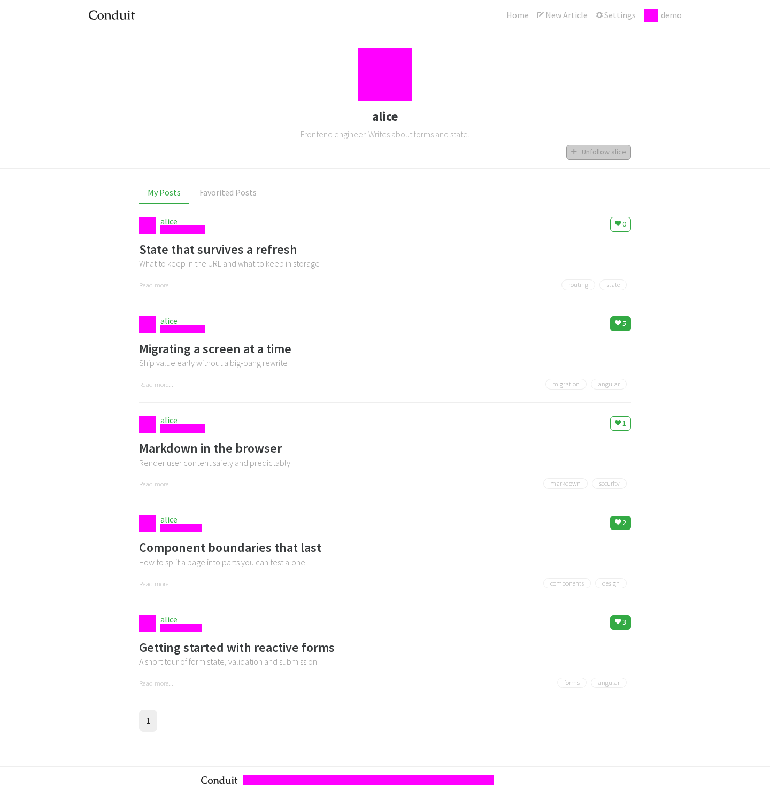   |    |    |
| after-unfollow        | 0.000% PASS |         |         | 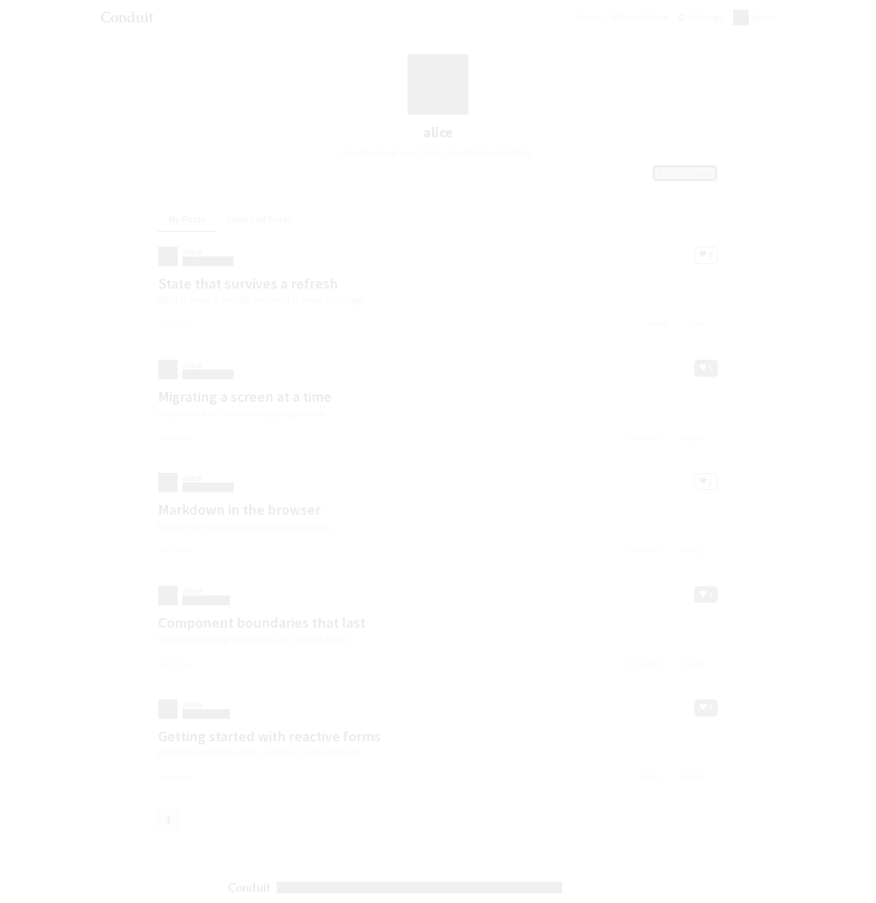        |
| after-follow          | 0.000% PASS |           | 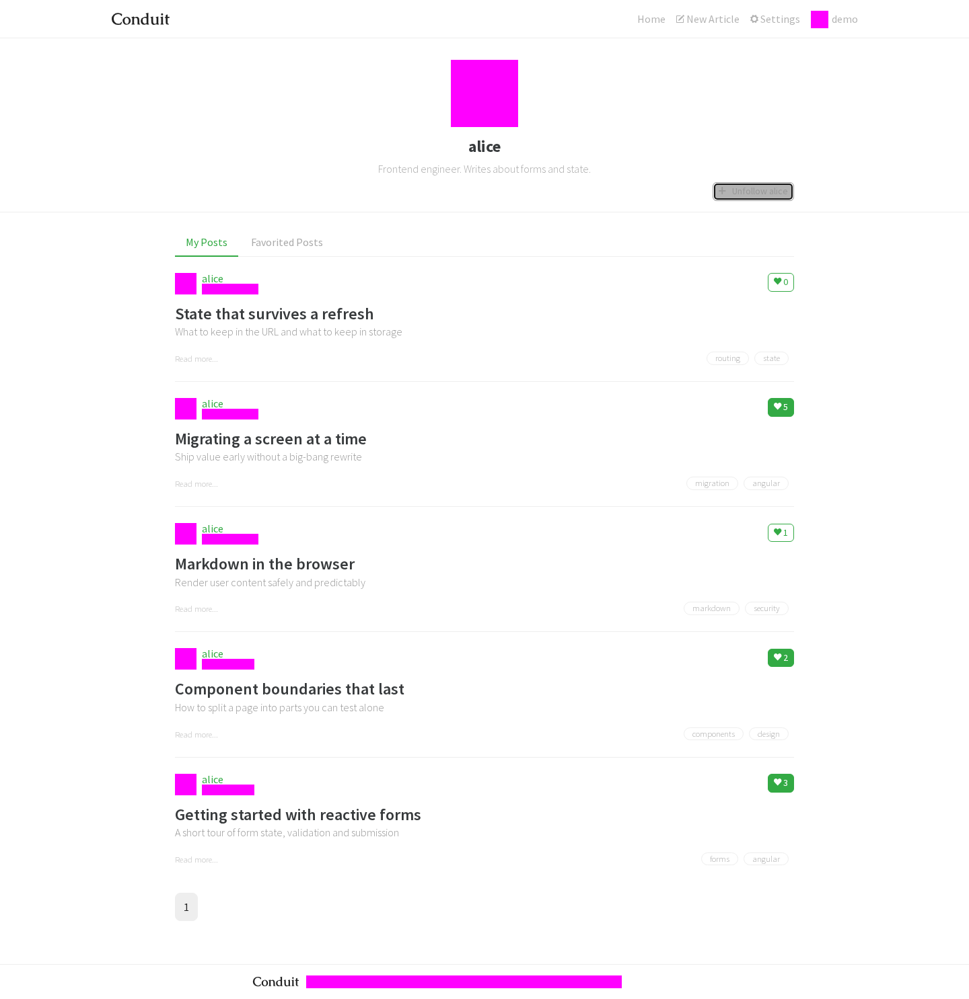          | 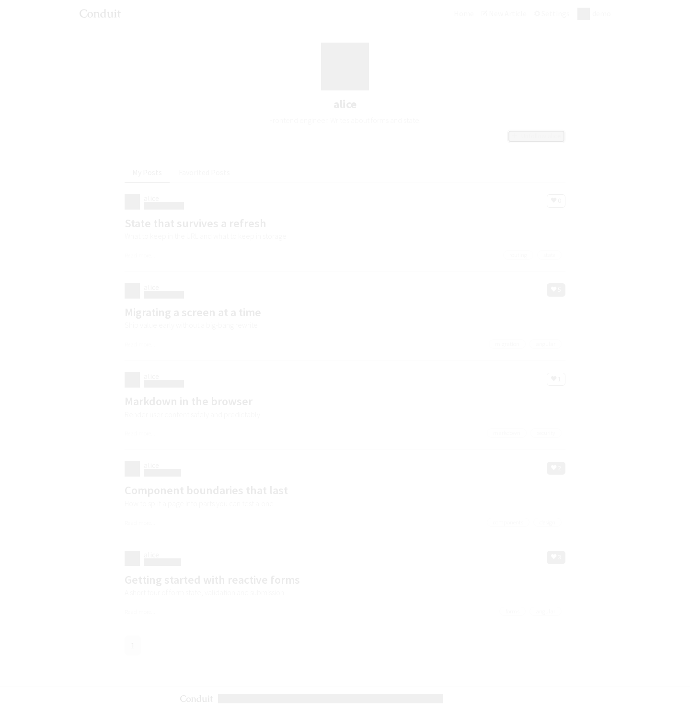          |
| after-second-unfollow | 0.000% PASS | 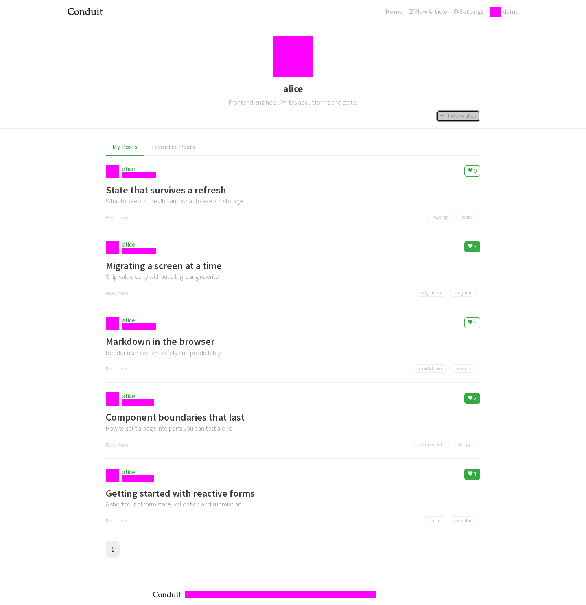 |  |  |

API calls (PASS):

| #   | Angular                                              | React                                                |
| --- | ---------------------------------------------------- | ---------------------------------------------------- |
| 1   | `GET /user → 200`                                    | `GET /user → 200`                                    |
| 2   | `GET /profiles/alice → 200`                          | `GET /profiles/alice → 200`                          |
| 3   | `GET /profiles/alice → 200`                          | `GET /profiles/alice → 200`                          |
| 4   | `GET /articles?author=alice&limit=10&offset=0 → 200` | `GET /articles?author=alice&limit=10&offset=0 → 200` |
| 5   | `DELETE /profiles/alice/follow → 200`                | `DELETE /profiles/alice/follow → 200`                |
| 6   | `POST /profiles/alice/follow {} → 200`               | `POST /profiles/alice/follow {} → 200`               |
| 7   | `DELETE /profiles/alice/follow → 200`                | `DELETE /profiles/alice/follow → 200`                |

Functional observations (PASS):

| Key                                  | Angular                                                                                                                                                             | React                                                                                                                                                               |
| ------------------------------------ | ------------------------------------------------------------------------------------------------------------------------------------------------------------------- | ------------------------------------------------------------------------------------------------------------------------------------------------------------------- |
| initial.url                          | `"/profile/alice"`                                                                                                                                                  | `"/profile/alice"`                                                                                                                                                  |
| initial.username                     | `"alice"`                                                                                                                                                           | `"alice"`                                                                                                                                                           |
| initial.bio                          | `"Frontend engineer. Writes about forms and state."`                                                                                                                | `"Frontend engineer. Writes about forms and state."`                                                                                                                |
| initial.image                        | `"http://localhost:3000/avatars/alice.svg"`                                                                                                                         | `"http://localhost:3000/avatars/alice.svg"`                                                                                                                         |
| initial.actionButtons                | `["   Unfollow alice"]`                                                                                                                                             | `["   Unfollow alice"]`                                                                                                                                             |
| initial.tabs                         | `[{"text":"My Posts","href":"/profile/alice","active":true},{"text":"Favorited Posts","href":"/profile/alice/favorites","active":false}]`                           | `[{"text":"My Posts","href":"/profile/alice","active":true},{"text":"Favorited Posts","href":"/profile/alice/favorites","active":false}]`                           |
| initial.articleTitles                | `["State that survives a refresh","Migrating a screen at a time","Markdown in the browser","Component boundaries that last","Getting started with reactive forms"]` | `["State that survives a refresh","Migrating a screen at a time","Markdown in the browser","Component boundaries that last","Getting started with reactive forms"]` |
| initial.emptyMessage                 | `[]`                                                                                                                                                                | `[]`                                                                                                                                                                |
| initial.pages                        | `["1"]`                                                                                                                                                             | `["1"]`                                                                                                                                                             |
| initial.backendFollowing             | `true`                                                                                                                                                              | `true`                                                                                                                                                              |
| afterUnfollow.button                 | `"   Follow alice"`                                                                                                                                                 | `"   Follow alice"`                                                                                                                                                 |
| afterUnfollow.buttonClass            | `"btn btn-sm action-btn btn-outline-secondary"`                                                                                                                     | `"btn btn-sm action-btn btn-outline-secondary"`                                                                                                                     |
| afterUnfollow.backendFollowing       | `false`                                                                                                                                                             | `false`                                                                                                                                                             |
| afterFollow.button                   | `"   Unfollow alice"`                                                                                                                                               | `"   Unfollow alice"`                                                                                                                                               |
| afterFollow.buttonClass              | `"btn btn-sm action-btn btn-secondary"`                                                                                                                             | `"btn btn-sm action-btn btn-secondary"`                                                                                                                             |
| afterFollow.backendFollowing         | `true`                                                                                                                                                              | `true`                                                                                                                                                              |
| afterSecondUnfollow.button           | `"   Follow alice"`                                                                                                                                                 | `"   Follow alice"`                                                                                                                                                 |
| afterSecondUnfollow.backendFollowing | `false`                                                                                                                                                             | `false`                                                                                                                                                             |
| afterSecondUnfollow.demoFeedAuthors  | `["bob"]`                                                                                                                                                           | `["bob"]`                                                                                                                                                           |

## header Your profile link while viewing another profile

React journey video: [video/header-your-profile-link-while-viewing-another-profile--react.webm](video/header-your-profile-link-while-viewing-another-profile--react.webm)

| State                     | Diff        | Angular                                                                                                     | React                                                                                                     | Diff image                                                                                             |
| ------------------------- | ----------- | ----------------------------------------------------------------------------------------------------------- | --------------------------------------------------------------------------------------------------------- | ------------------------------------------------------------------------------------------------------ |
| after-header-profile-link | 0.000% PASS |  | 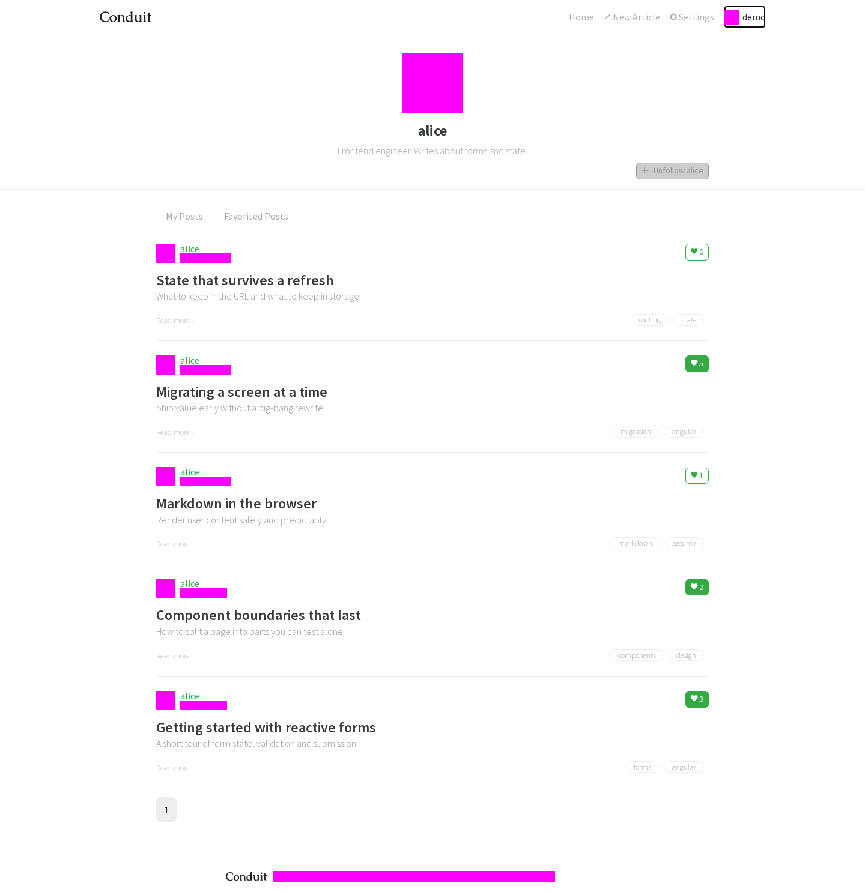 | 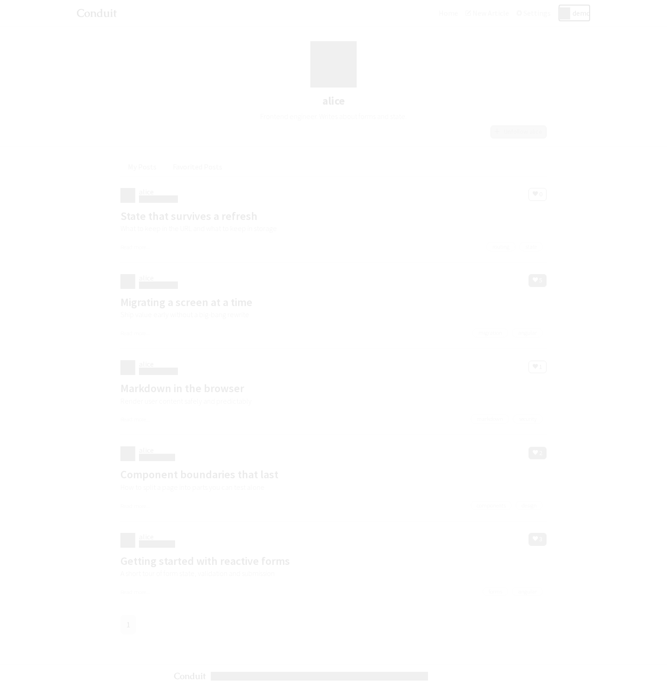 |

API calls (PASS):

| #   | Angular                                              | React                                                |
| --- | ---------------------------------------------------- | ---------------------------------------------------- |
| 1   | `GET /user → 200`                                    | `GET /user → 200`                                    |
| 2   | `GET /profiles/alice → 200`                          | `GET /profiles/alice → 200`                          |
| 3   | `GET /profiles/alice → 200`                          | `GET /profiles/alice → 200`                          |
| 4   | `GET /articles?author=alice&limit=10&offset=0 → 200` | `GET /articles?author=alice&limit=10&offset=0 → 200` |

Functional observations (PASS):

| Key                       | Angular                                                                                                                                                             | React                                                                                                                                                               |
| ------------------------- | ------------------------------------------------------------------------------------------------------------------------------------------------------------------- | ------------------------------------------------------------------------------------------------------------------------------------------------------------------- |
| afterSwitch.url           | `"/profile/demo"`                                                                                                                                                   | `"/profile/demo"`                                                                                                                                                   |
| afterSwitch.username      | `"alice"`                                                                                                                                                           | `"alice"`                                                                                                                                                           |
| afterSwitch.bio           | `"Frontend engineer. Writes about forms and state."`                                                                                                                | `"Frontend engineer. Writes about forms and state."`                                                                                                                |
| afterSwitch.image         | `"http://localhost:3000/avatars/alice.svg"`                                                                                                                         | `"http://localhost:3000/avatars/alice.svg"`                                                                                                                         |
| afterSwitch.actionButtons | `["   Unfollow alice"]`                                                                                                                                             | `["   Unfollow alice"]`                                                                                                                                             |
| afterSwitch.tabs          | `[{"text":"My Posts","href":"/profile/alice","active":false},{"text":"Favorited Posts","href":"/profile/alice/favorites","active":false}]`                          | `[{"text":"My Posts","href":"/profile/alice","active":false},{"text":"Favorited Posts","href":"/profile/alice/favorites","active":false}]`                          |
| afterSwitch.articleTitles | `["State that survives a refresh","Migrating a screen at a time","Markdown in the browser","Component boundaries that last","Getting started with reactive forms"]` | `["State that survives a refresh","Migrating a screen at a time","Markdown in the browser","Component boundaries that last","Getting started with reactive forms"]` |
| afterSwitch.emptyMessage  | `[]`                                                                                                                                                                | `[]`                                                                                                                                                                |
| afterSwitch.pages         | `["1"]`                                                                                                                                                             | `["1"]`                                                                                                                                                             |

## own profile shows Edit Profile Settings

React journey video: [video/own-profile-shows-edit-profile-settings--react.webm](video/own-profile-shows-edit-profile-settings--react.webm)

| State       | Diff        | Angular                                                                        | React                                                                        | Diff image                                                                |
| ----------- | ----------- | ------------------------------------------------------------------------------ | ---------------------------------------------------------------------------- | ------------------------------------------------------------------------- |
| own-profile | 0.000% PASS | 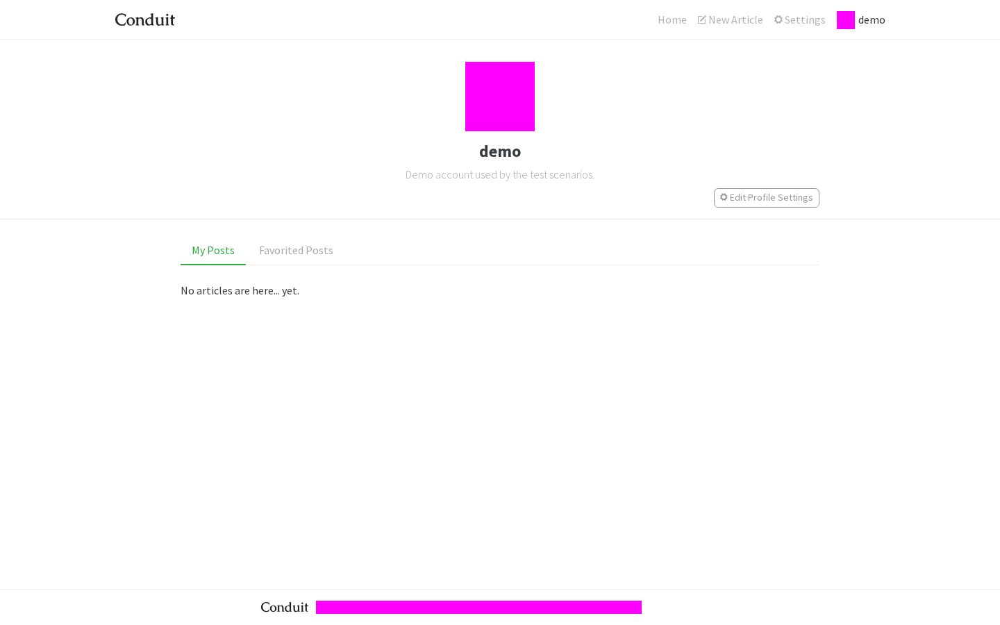 |  | 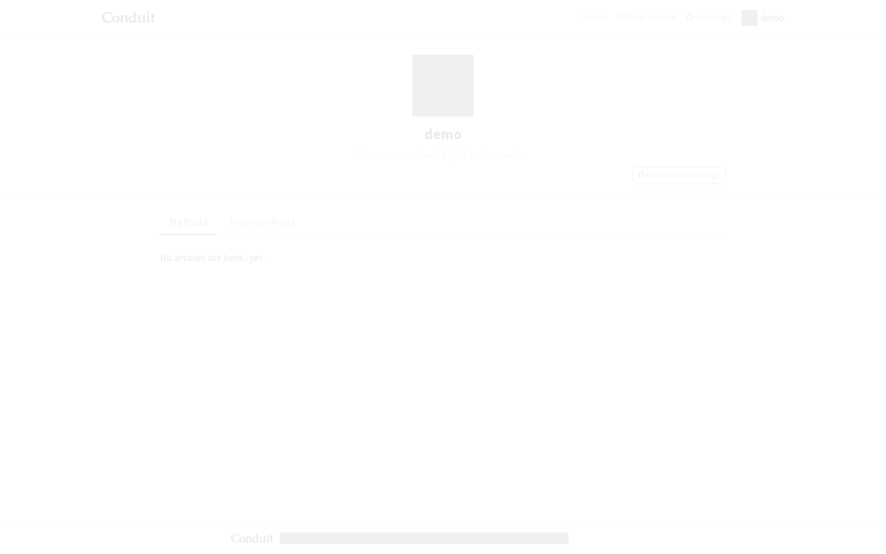 |

API calls (PASS):

| #   | Angular                                             | React                                               |
| --- | --------------------------------------------------- | --------------------------------------------------- |
| 1   | `GET /user → 200`                                   | `GET /user → 200`                                   |
| 2   | `GET /profiles/demo → 200`                          | `GET /profiles/demo → 200`                          |
| 3   | `GET /profiles/demo → 200`                          | `GET /profiles/demo → 200`                          |
| 4   | `GET /articles?author=demo&limit=10&offset=0 → 200` | `GET /articles?author=demo&limit=10&offset=0 → 200` |

Functional observations (PASS):

| Key               | Angular                                                                                                                                 | React                                                                                                                                   |
| ----------------- | --------------------------------------------------------------------------------------------------------------------------------------- | --------------------------------------------------------------------------------------------------------------------------------------- |
| own.url           | `"/profile/demo"`                                                                                                                       | `"/profile/demo"`                                                                                                                       |
| own.username      | `"demo"`                                                                                                                                | `"demo"`                                                                                                                                |
| own.bio           | `"Demo account used by the test scenarios."`                                                                                            | `"Demo account used by the test scenarios."`                                                                                            |
| own.image         | `"/assets/default-avatar.svg"`                                                                                                          | `"/assets/default-avatar.svg"`                                                                                                          |
| own.actionButtons | `[" Edit Profile Settings"]`                                                                                                            | `[" Edit Profile Settings"]`                                                                                                            |
| own.tabs          | `[{"text":"My Posts","href":"/profile/demo","active":true},{"text":"Favorited Posts","href":"/profile/demo/favorites","active":false}]` | `[{"text":"My Posts","href":"/profile/demo","active":true},{"text":"Favorited Posts","href":"/profile/demo/favorites","active":false}]` |
| own.articleTitles | `[]`                                                                                                                                    | `[]`                                                                                                                                    |
| own.emptyMessage  | `["No articles are here... yet."]`                                                                                                      | `["No articles are here... yet."]`                                                                                                      |
| own.pages         | `[]`                                                                                                                                    | `[]`                                                                                                                                    |
| editLink.href     | `"/settings"`                                                                                                                           | `"/settings"`                                                                                                                           |
| editLink.class    | `"btn btn-sm btn-outline-secondary action-btn"`                                                                                         | `"btn btn-sm btn-outline-secondary action-btn"`                                                                                         |
| followButtonCount | `0`                                                                                                                                     | `0`                                                                                                                                     |

## unknown username

React journey video: [video/unknown-username--react.webm](video/unknown-username--react.webm)

| State        | Diff        | Angular                                                  | React                                                  | Diff image                                          |
| ------------ | ----------- | -------------------------------------------------------- | ------------------------------------------------------ | --------------------------------------------------- |
| unknown-user | 0.000% PASS |  | 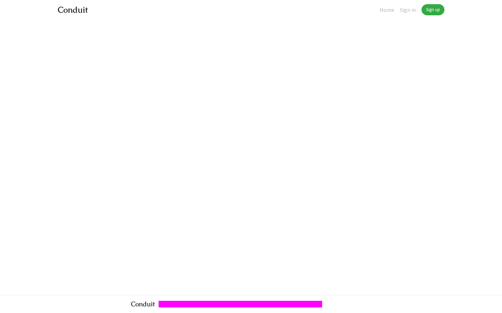 | 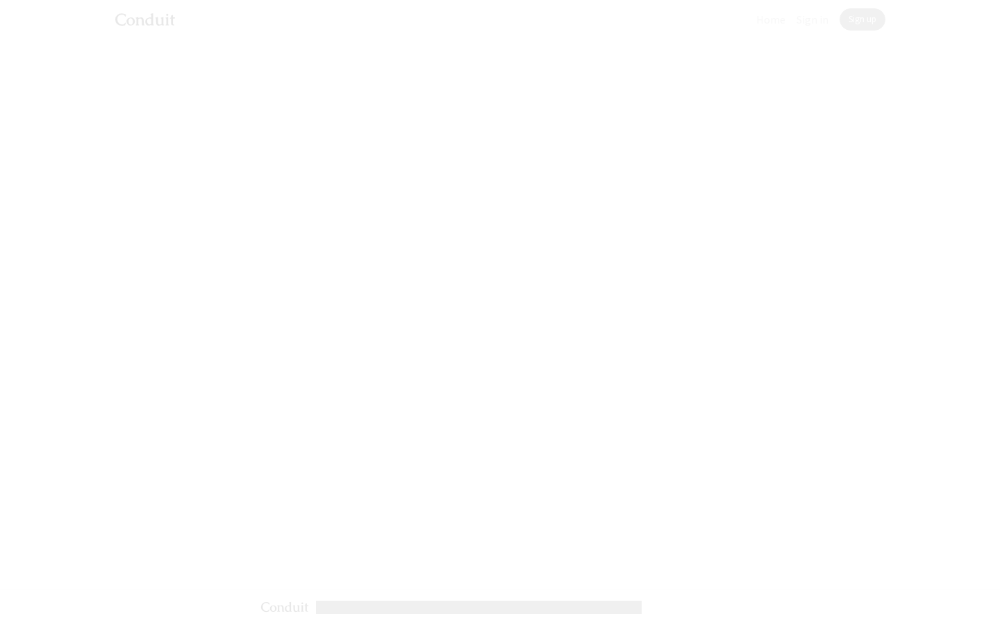 |

API calls (PASS):

| #   | Angular                          | React                            |
| --- | -------------------------------- | -------------------------------- |
| 1   | `GET /profiles/nosuchuser → 404` | `GET /profiles/nosuchuser → 404` |

Functional observations (PASS):

| Key            | Angular                                | React                                  |
| -------------- | -------------------------------------- | -------------------------------------- |
| url            | `"/profile/nosuchuser"`                | `"/profile/nosuchuser"`                |
| errorMessages  | `[]`                                   | `[]`                                   |
| errorListCount | `1`                                    | `1`                                    |
| userInfoCount  | `0`                                    | `0`                                    |
| tabsCount      | `0`                                    | `0`                                    |
| backend        | `{"errors":{"profile":["not found"]}}` | `{"errors":{"profile":["not found"]}}` |

## user with no posts shows empty message

React journey video: [video/user-with-no-posts-shows-empty-message--react.webm](video/user-with-no-posts-shows-empty-message--react.webm)

| State              | Diff        | Angular                                                                              | React                                                                              | Diff image                                                                      |
| ------------------ | ----------- | ------------------------------------------------------------------------------------ | ---------------------------------------------------------------------------------- | ------------------------------------------------------------------------------- |
| demo-profile-empty | 0.000% PASS | 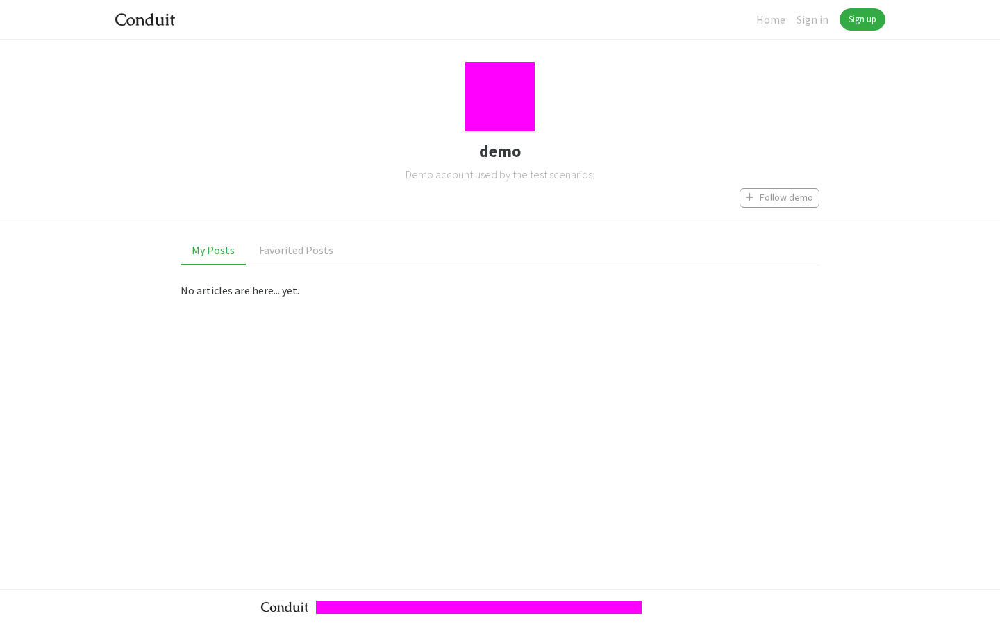 |  | 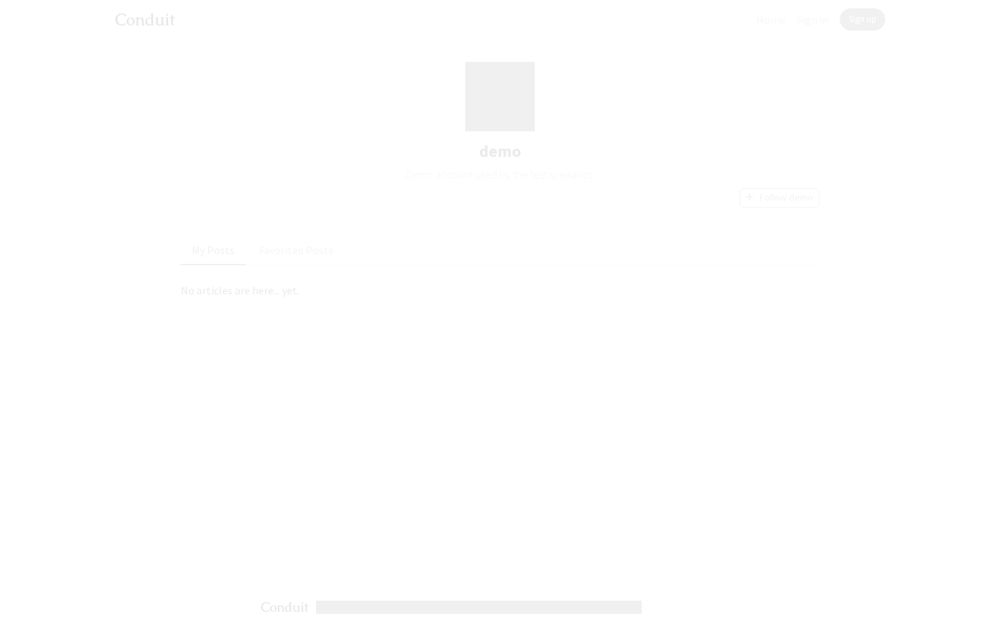 |

API calls (PASS):

| #   | Angular                                             | React                                               |
| --- | --------------------------------------------------- | --------------------------------------------------- |
| 1   | `GET /profiles/demo → 200`                          | `GET /profiles/demo → 200`                          |
| 2   | `GET /profiles/demo → 200`                          | `GET /profiles/demo → 200`                          |
| 3   | `GET /articles?author=demo&limit=10&offset=0 → 200` | `GET /articles?author=demo&limit=10&offset=0 → 200` |

Functional observations (PASS):

| Key                  | Angular                                                                                                                                 | React                                                                                                                                   |
| -------------------- | --------------------------------------------------------------------------------------------------------------------------------------- | --------------------------------------------------------------------------------------------------------------------------------------- |
| demo.url             | `"/profile/demo"`                                                                                                                       | `"/profile/demo"`                                                                                                                       |
| demo.username        | `"demo"`                                                                                                                                | `"demo"`                                                                                                                                |
| demo.bio             | `"Demo account used by the test scenarios."`                                                                                            | `"Demo account used by the test scenarios."`                                                                                            |
| demo.image           | `"/assets/default-avatar.svg"`                                                                                                          | `"/assets/default-avatar.svg"`                                                                                                          |
| demo.actionButtons   | `["   Follow demo"]`                                                                                                                    | `["   Follow demo"]`                                                                                                                    |
| demo.tabs            | `[{"text":"My Posts","href":"/profile/demo","active":true},{"text":"Favorited Posts","href":"/profile/demo/favorites","active":false}]` | `[{"text":"My Posts","href":"/profile/demo","active":true},{"text":"Favorited Posts","href":"/profile/demo/favorites","active":false}]` |
| demo.articleTitles   | `[]`                                                                                                                                    | `[]`                                                                                                                                    |
| demo.emptyMessage    | `["No articles are here... yet."]`                                                                                                      | `["No articles are here... yet."]`                                                                                                      |
| demo.pages           | `[]`                                                                                                                                    | `[]`                                                                                                                                    |
| backend.articleCount | `0`                                                                                                                                     | `0`                                                                                                                                     |

## view alice's profile signed out

React journey video: [video/view-alice-s-profile-signed-out--react.webm](video/view-alice-s-profile-signed-out--react.webm)

| State                    | Diff        | Angular                                                                             | React                                                                             | Diff image                                                                     |
| ------------------------ | ----------- | ----------------------------------------------------------------------------------- | --------------------------------------------------------------------------------- | ------------------------------------------------------------------------------ |
| alice-profile-signed-out | 0.000% PASS |  | 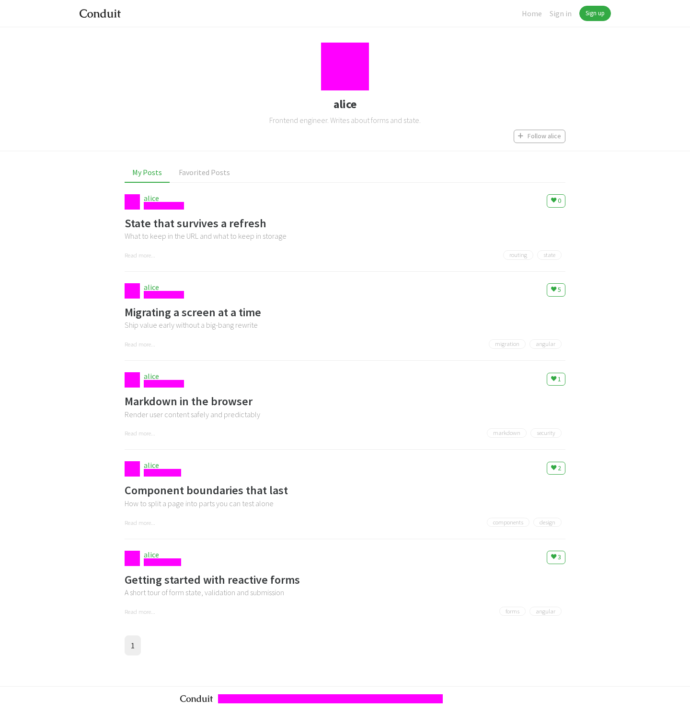 | 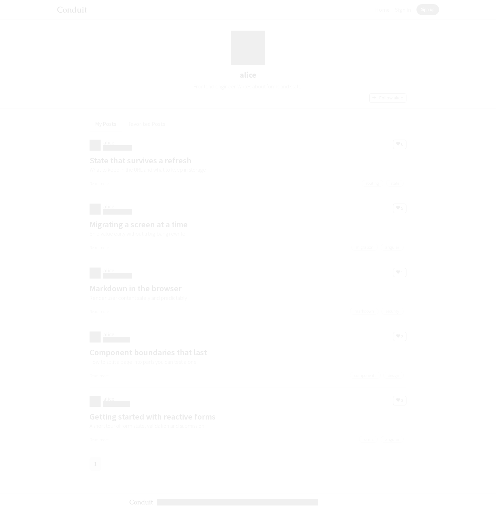 |

API calls (PASS):

| #   | Angular                                              | React                                                |
| --- | ---------------------------------------------------- | ---------------------------------------------------- |
| 1   | `GET /profiles/alice → 200`                          | `GET /profiles/alice → 200`                          |
| 2   | `GET /profiles/alice → 200`                          | `GET /profiles/alice → 200`                          |
| 3   | `GET /articles?author=alice&limit=10&offset=0 → 200` | `GET /articles?author=alice&limit=10&offset=0 → 200` |

Functional observations (PASS):

| Key                  | Angular                                                                                                                                                             | React                                                                                                                                                               |
| -------------------- | ------------------------------------------------------------------------------------------------------------------------------------------------------------------- | ------------------------------------------------------------------------------------------------------------------------------------------------------------------- |
| alice.url            | `"/profile/alice"`                                                                                                                                                  | `"/profile/alice"`                                                                                                                                                  |
| alice.username       | `"alice"`                                                                                                                                                           | `"alice"`                                                                                                                                                           |
| alice.bio            | `"Frontend engineer. Writes about forms and state."`                                                                                                                | `"Frontend engineer. Writes about forms and state."`                                                                                                                |
| alice.image          | `"http://localhost:3000/avatars/alice.svg"`                                                                                                                         | `"http://localhost:3000/avatars/alice.svg"`                                                                                                                         |
| alice.actionButtons  | `["   Follow alice"]`                                                                                                                                               | `["   Follow alice"]`                                                                                                                                               |
| alice.tabs           | `[{"text":"My Posts","href":"/profile/alice","active":true},{"text":"Favorited Posts","href":"/profile/alice/favorites","active":false}]`                           | `[{"text":"My Posts","href":"/profile/alice","active":true},{"text":"Favorited Posts","href":"/profile/alice/favorites","active":false}]`                           |
| alice.articleTitles  | `["State that survives a refresh","Migrating a screen at a time","Markdown in the browser","Component boundaries that last","Getting started with reactive forms"]` | `["State that survives a refresh","Migrating a screen at a time","Markdown in the browser","Component boundaries that last","Getting started with reactive forms"]` |
| alice.emptyMessage   | `[]`                                                                                                                                                                | `[]`                                                                                                                                                                |
| alice.pages          | `["1"]`                                                                                                                                                             | `["1"]`                                                                                                                                                             |
| backend.profile      | `{"profile":{"username":"alice","bio":"Frontend engineer. Writes about forms and state.","image":"http://localhost:3000/avatars/alice.svg","following":false}}`     | `{"profile":{"username":"alice","bio":"Frontend engineer. Writes about forms and state.","image":"http://localhost:3000/avatars/alice.svg","following":false}}`     |
| backend.articleCount | `5`                                                                                                                                                                 | `5`                                                                                                                                                                 |

## Deviations

_None recorded._
