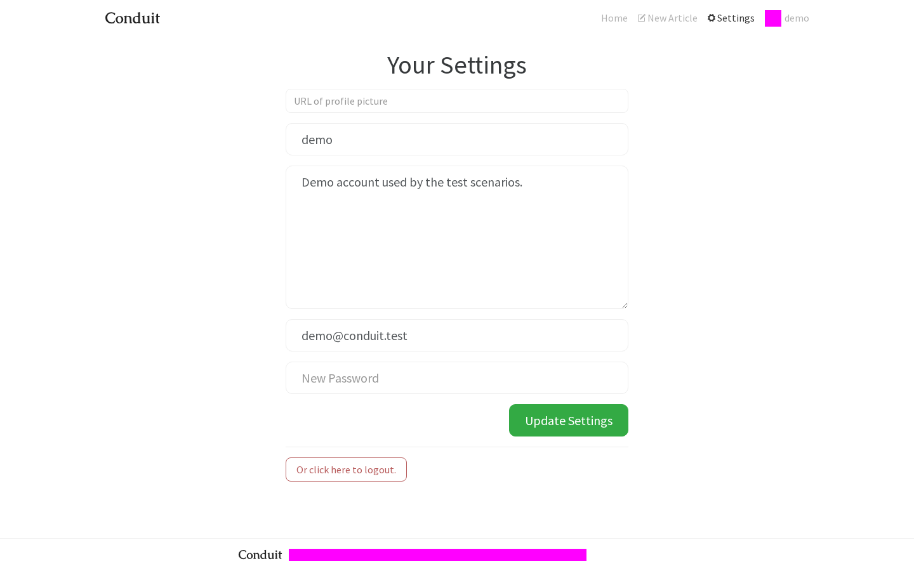
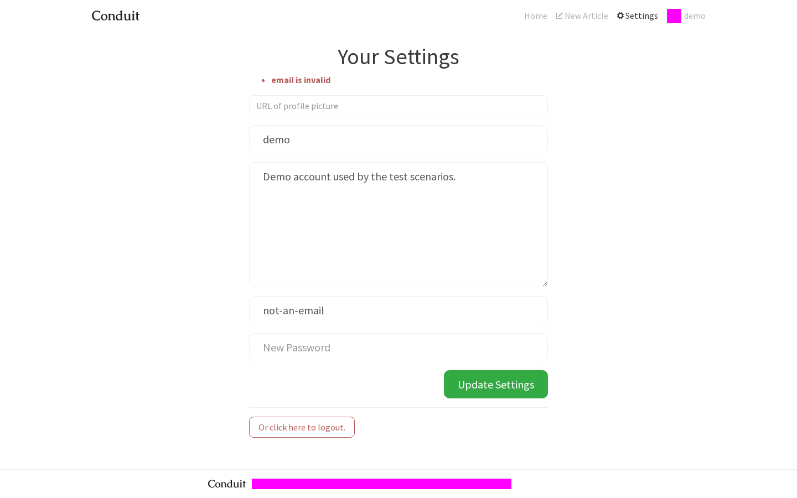
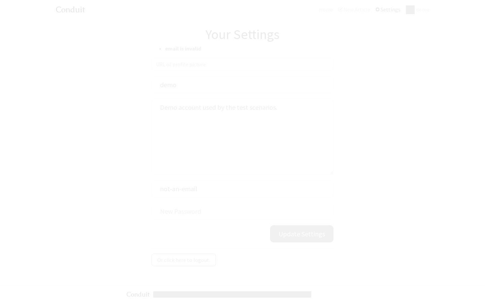
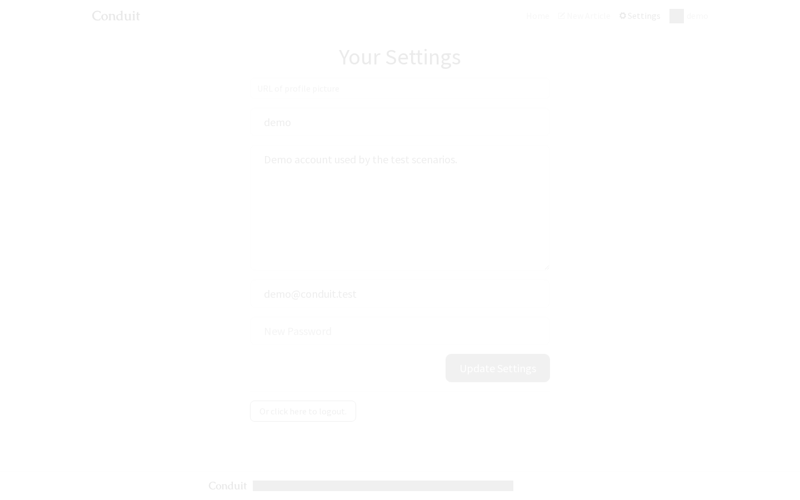
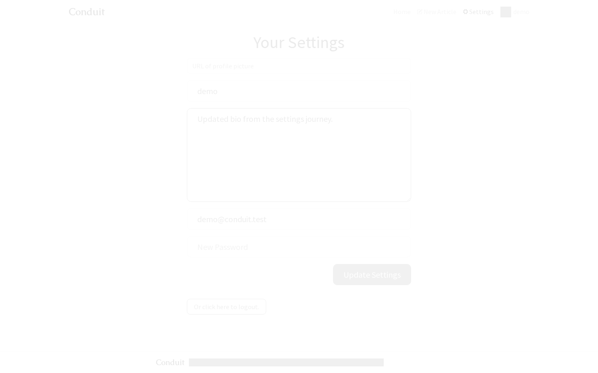

# Parity report: settings

Angular (http://localhost:4200) vs React (http://localhost:5173), same seeded mock API reset before each run, viewport 1440×900, dates/avatars masked in magenta. Visual pass threshold: ≤1% differing pixels (pixelmatch, threshold 0.1).

| Journey                                | No errors | Same states | Visual | API calls + payloads | Functional | Max diff | Result   |
| -------------------------------------- | --------- | ----------- | ------ | -------------------- | ---------- | -------- | -------- |
| form prefilled for demo                | PASS      | PASS        | PASS   | PASS                 | PASS       | 0.000%   | **PASS** |
| invalid email shows error              | PASS      | PASS        | PASS   | PASS                 | PASS       | 0.000%   | **PASS** |
| logout returns to home signed out      | PASS      | PASS        | PASS   | PASS                 | PASS       | 0.000%   | **PASS** |
| short new password shows error         | PASS      | PASS        | PASS   | PASS                 | PASS       | 0.000%   | **PASS** |
| signed-out settings redirects to login | PASS      | PASS        | PASS   | PASS                 | PASS       | 0.000%   | **PASS** |
| update bio then land on profile        | PASS      | PASS        | PASS   | PASS                 | PASS       | 0.000%   | **PASS** |

## form prefilled for demo

React journey video: [video/form-prefilled-for-demo--react.webm](video/form-prefilled-for-demo--react.webm)

| State                   | Diff        | Angular                                                                    | React                                                                    | Diff image                                                            |
| ----------------------- | ----------- | -------------------------------------------------------------------------- | ------------------------------------------------------------------------ | --------------------------------------------------------------------- |
| settings-form-prefilled | 0.000% PASS |  |  |  |

API calls (PASS):

| #   | Angular           | React             |
| --- | ----------------- | ----------------- |
| 1   | `GET /user → 200` | `GET /user → 200` |

Functional observations (PASS):

| Key          | Angular                                                                                                                     | React                                                                                                                       |
| ------------ | --------------------------------------------------------------------------------------------------------------------------- | --------------------------------------------------------------------------------------------------------------------------- |
| url          | `"/settings"`                                                                                                               | `"/settings"`                                                                                                               |
| heading      | `"Your Settings"`                                                                                                           | `"Your Settings"`                                                                                                           |
| formValues   | `{"image":"","username":"demo","bio":"Demo account used by the test scenarios.","email":"demo@conduit.test","password":""}` | `{"image":"","username":"demo","bio":"Demo account used by the test scenarios.","email":"demo@conduit.test","password":""}` |
| placeholders | `["URL of profile picture","Username","Short bio about you","Email","New Password"]`                                        | `["URL of profile picture","Username","Short bio about you","Email","New Password"]`                                        |
| buttons      | `["Update Settings","Or click here to logout."]`                                                                            | `["Update Settings","Or click here to logout."]`                                                                            |
| errors       | `[]`                                                                                                                        | `[]`                                                                                                                        |

## invalid email shows error

React journey video: [video/invalid-email-shows-error--react.webm](video/invalid-email-shows-error--react.webm)

| State               | Diff        | Angular                                                                  | React                                                                  | Diff image                                                          |
| ------------------- | ----------- | ------------------------------------------------------------------------ | ---------------------------------------------------------------------- | ------------------------------------------------------------------- |
| invalid-email-error | 0.000% PASS |  |  |  |

API calls (PASS):

| #   | Angular                                                                                                                           | React                                                                                                                             |
| --- | --------------------------------------------------------------------------------------------------------------------------------- | --------------------------------------------------------------------------------------------------------------------------------- |
| 1   | `GET /user → 200`                                                                                                                 | `GET /user → 200`                                                                                                                 |
| 2   | `PUT /user {"user":{"image":"","username":"demo","bio":"Demo account used by the test scenarios.","email":"not-an-email"}} → 422` | `PUT /user {"user":{"image":"","username":"demo","bio":"Demo account used by the test scenarios.","email":"not-an-email"}} → 422` |

Functional observations (PASS):

| Key              | Angular                                                                                                                | React                                                                                                                  |
| ---------------- | ---------------------------------------------------------------------------------------------------------------------- | ---------------------------------------------------------------------------------------------------------------------- |
| url              | `"/settings"`                                                                                                          | `"/settings"`                                                                                                          |
| errors           | `["email is invalid"]`                                                                                                 | `["email is invalid"]`                                                                                                 |
| formValues       | `{"image":"","username":"demo","bio":"Demo account used by the test scenarios.","email":"not-an-email","password":""}` | `{"image":"","username":"demo","bio":"Demo account used by the test scenarios.","email":"not-an-email","password":""}` |
| formEnabledAgain | `true`                                                                                                                 | `true`                                                                                                                 |
| backendEmail     | `"demo@conduit.test"`                                                                                                  | `"demo@conduit.test"`                                                                                                  |

## logout returns to home signed out

React journey video: [video/logout-returns-to-home-signed-out--react.webm](video/logout-returns-to-home-signed-out--react.webm)

| State                  | Diff        | Angular                                                                             | React                                                                             | Diff image                                                                     |
| ---------------------- | ----------- | ----------------------------------------------------------------------------------- | --------------------------------------------------------------------------------- | ------------------------------------------------------------------------------ |
| settings-before-logout | 0.000% PASS |  |  |  |

API calls (PASS):

| #   | Angular                                 | React                                   |
| --- | --------------------------------------- | --------------------------------------- |
| 1   | `GET /user → 200`                       | `GET /user → 200`                       |
| 2   | `GET /articles?limit=10&offset=0 → 200` | `GET /articles?limit=10&offset=0 → 200` |
| 3   | `GET /tags → 200`                       | `GET /tags → 200`                       |

Functional observations (PASS):

| Key                      | Angular                                      | React                                        |
| ------------------------ | -------------------------------------------- | -------------------------------------------- |
| navLinksBefore           | `["Home"," New Article"," Settings","demo"]` | `["Home"," New Article"," Settings","demo"]` |
| urlAfterLogout           | `"/"`                                        | `"/"`                                        |
| navLinksAfter            | `["Home","Sign in","Sign up"]`               | `["Home","Sign in","Sign up"]`               |
| storedToken              | `null`                                       | `null`                                       |
| tokenStillValidOnBackend | `true`                                       | `true`                                       |

## short new password shows error

React journey video: [video/short-new-password-shows-error--react.webm](video/short-new-password-shows-error--react.webm)

| State                | Diff        | Angular                                                                        | React                                                                        | Diff image                                                                |
| -------------------- | ----------- | ------------------------------------------------------------------------------ | ---------------------------------------------------------------------------- | ------------------------------------------------------------------------- |
| short-password-error | 0.000% PASS |  |  |  |

API calls (PASS):

| #   | Angular                                                                                                                                                   | React                                                                                                                                                     |
| --- | --------------------------------------------------------------------------------------------------------------------------------------------------------- | --------------------------------------------------------------------------------------------------------------------------------------------------------- |
| 1   | `GET /user → 200`                                                                                                                                         | `GET /user → 200`                                                                                                                                         |
| 2   | `PUT /user {"user":{"image":"","username":"demo","bio":"Demo account used by the test scenarios.","email":"demo@conduit.test","password":"short"}} → 422` | `PUT /user {"user":{"image":"","username":"demo","bio":"Demo account used by the test scenarios.","email":"demo@conduit.test","password":"short"}} → 422` |

Functional observations (PASS):

| Key         | Angular                                                                                                                                                                                                   | React                                                                                                                                                                                                     |
| ----------- | --------------------------------------------------------------------------------------------------------------------------------------------------------------------------------------------------------- | --------------------------------------------------------------------------------------------------------------------------------------------------------------------------------------------------------- |
| url         | `"/settings"`                                                                                                                                                                                             | `"/settings"`                                                                                                                                                                                             |
| errors      | `["password is too short (minimum is 8 characters)"]`                                                                                                                                                     | `["password is too short (minimum is 8 characters)"]`                                                                                                                                                     |
| backendUser | `{"user":{"email":"demo@conduit.test","token":"eyJ1c2VybmFtZSI6ImRlbW8ifQ.U3QHOI0d_K6BwzOhfc35h6BXkQ_4miYUEF9BpMXxH3s","username":"demo","bio":"Demo account used by the test scenarios.","image":null}}` | `{"user":{"email":"demo@conduit.test","token":"eyJ1c2VybmFtZSI6ImRlbW8ifQ.U3QHOI0d_K6BwzOhfc35h6BXkQ_4miYUEF9BpMXxH3s","username":"demo","bio":"Demo account used by the test scenarios.","image":null}}` |

## signed-out settings redirects to login

React journey video: [video/signed-out-settings-redirects-to-login--react.webm](video/signed-out-settings-redirects-to-login--react.webm)

| State | Diff | Angular | React | Diff image |
| ----- | ---- | ------- | ----- | ---------- |

API calls (PASS):

| #   | Angular | React |
| --- | ------- | ----- |

Functional observations (PASS):

| Key                  | Angular                        | React                          |
| -------------------- | ------------------------------ | ------------------------------ |
| url                  | `"/login"`                     | `"/login"`                     |
| settingsFormRendered | `0`                            | `0`                            |
| navLinks             | `["Home","Sign in","Sign up"]` | `["Home","Sign in","Sign up"]` |
| storedToken          | `null`                         | `null`                         |

## update bio then land on profile

React journey video: [video/update-bio-then-land-on-profile--react.webm](video/update-bio-then-land-on-profile--react.webm)

| State                      | Diff        | Angular                                                                               | React                                                                               | Diff image                                                                       |
| -------------------------- | ----------- | ------------------------------------------------------------------------------------- | ----------------------------------------------------------------------------------- | -------------------------------------------------------------------------------- |
| settings-form-with-new-bio | 0.000% PASS |  |  |  |

API calls (PASS):

| #   | Angular                                                                                                                              | React                                                                                                                                |
| --- | ------------------------------------------------------------------------------------------------------------------------------------ | ------------------------------------------------------------------------------------------------------------------------------------ |
| 1   | `GET /user → 200`                                                                                                                    | `GET /user → 200`                                                                                                                    |
| 2   | `PUT /user {"user":{"image":"","username":"demo","bio":"Updated bio from the settings journey.","email":"demo@conduit.test"}} → 200` | `PUT /user {"user":{"image":"","username":"demo","bio":"Updated bio from the settings journey.","email":"demo@conduit.test"}} → 200` |
| 3   | `GET /profiles/demo → 200`                                                                                                           | `GET /profiles/demo → 200`                                                                                                           |
| 4   | `GET /profiles/demo → 200`                                                                                                           | `GET /profiles/demo → 200`                                                                                                           |
| 5   | `GET /articles?author=demo&limit=10&offset=0 → 200`                                                                                  | `GET /articles?author=demo&limit=10&offset=0 → 200`                                                                                  |

Functional observations (PASS):

| Key                 | Angular                                                                                                                                                                                                 | React                                                                                                                                                                                                   |
| ------------------- | ------------------------------------------------------------------------------------------------------------------------------------------------------------------------------------------------------- | ------------------------------------------------------------------------------------------------------------------------------------------------------------------------------------------------------- |
| urlAfterSubmit      | `"/profile/demo"`                                                                                                                                                                                       | `"/profile/demo"`                                                                                                                                                                                       |
| backendUser         | `{"user":{"email":"demo@conduit.test","token":"eyJ1c2VybmFtZSI6ImRlbW8ifQ.U3QHOI0d_K6BwzOhfc35h6BXkQ_4miYUEF9BpMXxH3s","username":"demo","bio":"Updated bio from the settings journey.","image":null}}` | `{"user":{"email":"demo@conduit.test","token":"eyJ1c2VybmFtZSI6ImRlbW8ifQ.U3QHOI0d_K6BwzOhfc35h6BXkQ_4miYUEF9BpMXxH3s","username":"demo","bio":"Updated bio from the settings journey.","image":null}}` |
| backendProfile      | `{"profile":{"username":"demo","bio":"Updated bio from the settings journey.","image":null,"following":false}}`                                                                                         | `{"profile":{"username":"demo","bio":"Updated bio from the settings journey.","image":null,"following":false}}`                                                                                         |
| navLinksAfterSubmit | `["Home"," New Article"," Settings","demo"]`                                                                                                                                                            | `["Home"," New Article"," Settings","demo"]`                                                                                                                                                            |

## Deviations

## Status after integration (parent session, full suite run 2026-11-12 17:31Z)

Resolved. In the full parity run on the integration branch, with every package merged, all journeys for this screen pass every check (see `evidence/parity-results.md`). The notes below are what the child session recorded on its own branch, before the packages it depended on were merged. They are kept as the audit trail.

---

Two journeys fail only the **API calls + payloads** check, and only because of calls made by the screen the journey lands on, which belongs to another work package and is still a "not migrated" stub on the base branch. Every call made by the Settings screen itself matches exactly (`GET /user`, then `PUT /user` with the same payload and key order), and screenshots, observations and backend data match in all 6 journeys.

| Journey                           | Extra calls on Angular only                                            | Made by                        | Owner      |
| --------------------------------- | ---------------------------------------------------------------------- | ------------------------------ | ---------- |
| update bio then land on profile   | `GET /profiles/demo` ×2, `GET /articles?author=demo&limit=10&offset=0` | Profile page (`/profile/demo`) | profile WP |
| logout returns to home signed out | `GET /articles?limit=10&offset=0`, `GET /tags`                         | Home page (`/`)                | home WP    |

Check done for the first row: with the profile WP's `ProfilePage.tsx` and `ProfileArticles.tsx` (branch `wp/profile`, commit 64cf56c) temporarily copied into the working tree, "update bio then land on profile" passes all five checks, with the same five calls on both apps. The result file is `update-bio-with-profile-wp.json`. Those files were then restored and are not part of this PR. The home WP had no pushed branch yet, so the second row could not be checked the same way; it should pass once the home page is merged and the suite is re-run.

Not snapshotted on purpose: the screens reached after leaving Settings (profile, home, login) are owned by other work packages. Those states are checked through `observe()` (URL, navbar links, stored token, backend user/profile) rather than screenshots.

Foundation change: `react-app/src/app.css` gets the theme's sticky-footer rules (written for Angular's `<app-root>`) applied to React's `#root`. Without them, the footer on short pages like Settings sat 47px higher than in Angular (1.1–1.4% pixel diff). The text is copied byte for byte from the profile WP's branch, so the two branches merge cleanly.
